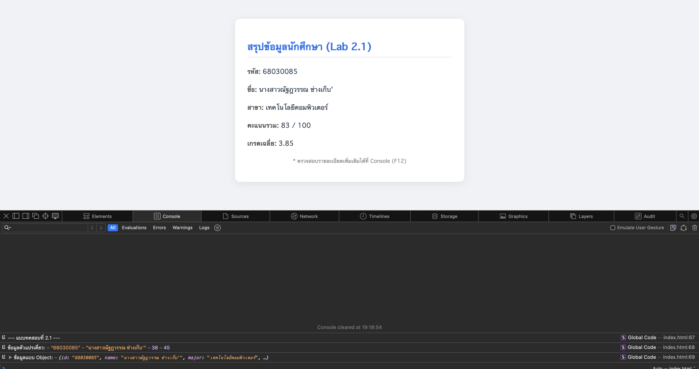
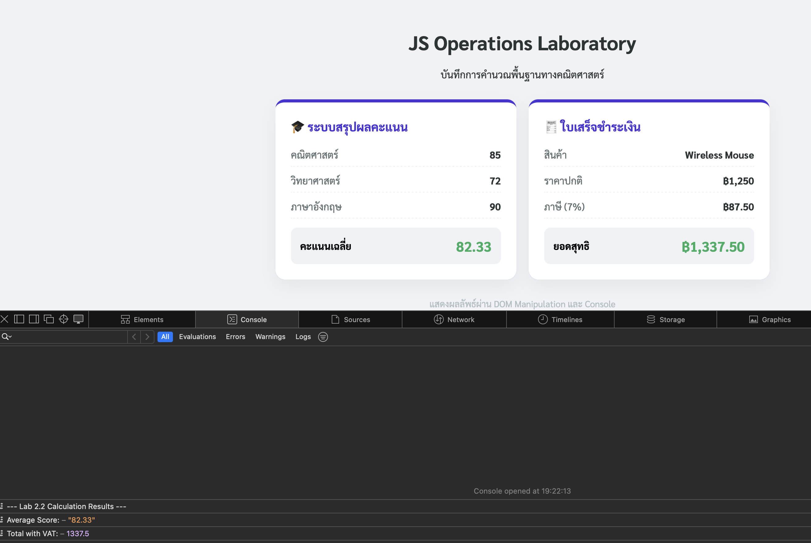
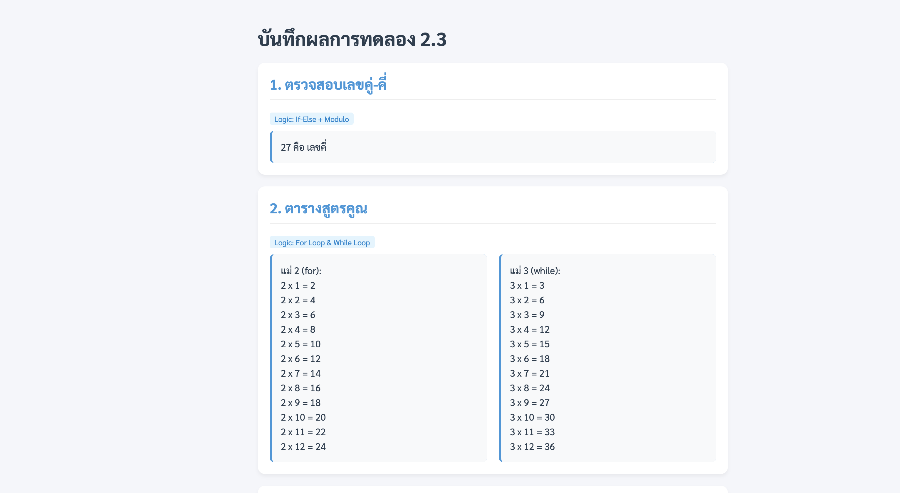
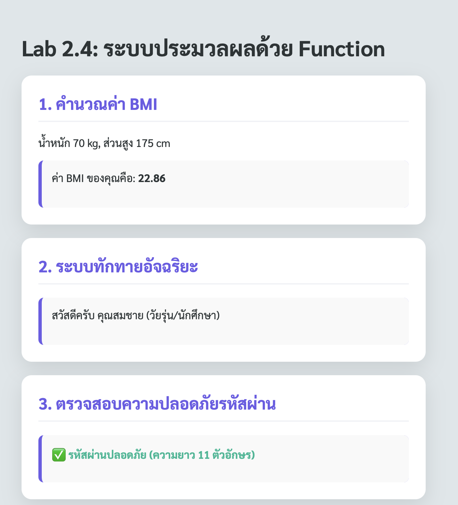
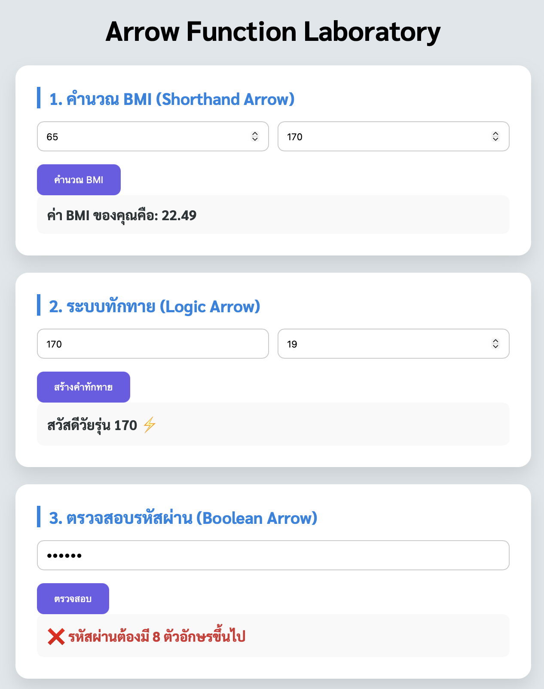
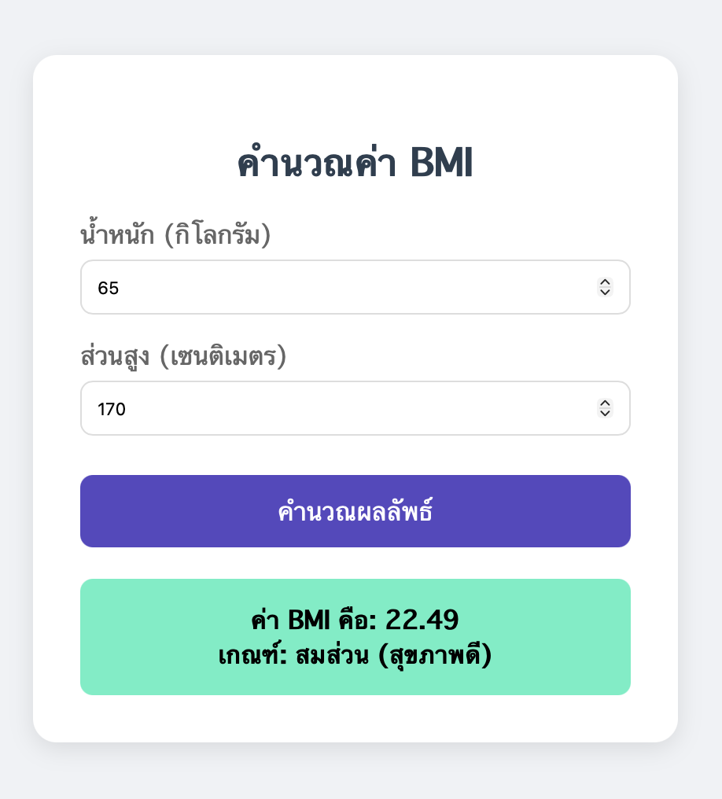
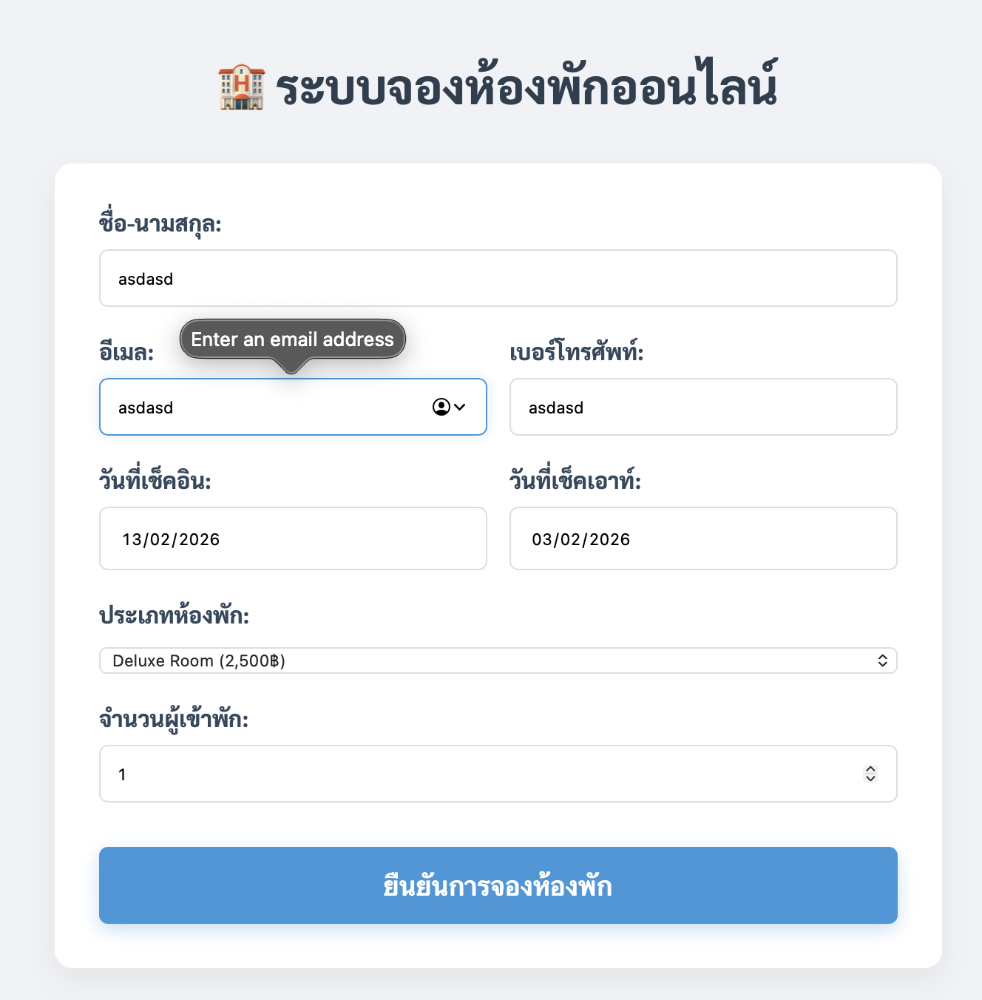

# การทดลอง พื้นฐาน JavaScript และการใช้งานร่วมกับ HTML/CSS
## การทดลองที่ 1 : ทำความรู้จักกับ JavaScript
###  การเพิ่ม JavaScript ลงในเว็บเพจ

JavaScript สามารถเพิ่มลงในเว็บเพจได้ 3 วิธี:

1. แบบ Inline: แทรก scipt ในแต่ละบรรทัดของ HTML Element
```html
<button onclick="alert('สวัสดี!')">คลิกที่นี่</button>
```

2. แบบ Internal Script: เขียน script ใน block   <script> </script>
```html
<script>
    alert('สวัสดี!');
</script>
```

3. แบบ External Script: เขียน script ในไฟล์แล้วเรียกใช้ใน HTML
   ไฟล์ script.js มีข้อมูลดังนี้
```javascript
    alert('สวัสดี!');
```
   ไฟล์ HTML มีการเรียกใช้ script ดังนี้
```html
<script src="script.js"></script>
```

### การทดลองที่ 1.1 : สร้างไฟล์ HTML และทดลองใช้ JavaScript ทั้ง 3 แบบ

สร้างไฟล์ `index.html`:
```html
<!DOCTYPE html>
<html lang="th">
<head>
    <meta charset="UTF-8">
    <title>ทดลอง JavaScript</title>
</head>
<body>
    <!-- Inline JavaScript -->
    <button onclick="alert('คลิกปุ่มที่ 1!')">ปุ่มที่ 1</button>

    <!-- ทดสอบ Internal JavaScript -->
    <button id="btn2">ปุ่มที่ 2</button>

    <!-- ทดสอบ External JavaScript -->
    <button id="btn3" onclick="hello3();">ปุ่มที่ 3</button>

    <!-- Internal JavaScript -->
    <script>
        document.getElementById('btn2').onclick = function() {
            alert('คลิกปุ่มที่ 2!');
        };
    </script>

    <!-- External JavaScript -->
  <!-- ต้องสร้างไฟล์ script.js มีโค้ดโปรแกรมในไฟล์ดังนี้
   function hello3(){
    alert('คลิกปุ่มที่ 3!');
    }
 -->
    <script src="script.js"></script>
</body>
</html>
```

### แบบฝึกปฏิบัติที่ 1: การใช้งาน JavaScript เบื้องต้น

1. สร้างหน้าเว็บที่มีปุ่ม 3 ปุ่ม:
   - ปุ่มที่ 1: ใช้ Inline JavaScript แสดงชื่อนักศึกษา
   - ปุ่มที่ 2: ใช้ Internal JavaScript แสดงวันที่ปัจจุบัน
   - ปุ่มที่ 3: ใช้ External JavaScript แสดงเวลาปัจจุบัน

2. เพิ่มกล่องข้อความและปุ่มสำหรับแสดงผล:
   - มีช่องกรอกข้อความ
   - มีปุ่มเมื่อคลิกแล้วจะแสดงข้อความที่กรอกในช่องข้อความ  (สามารถใช้ document.getElementById('id ของ textbox').value เพื่อดึงข้อมูลในช่อง)
### บันทึกผลการทดลอง 
```html
<!DOCTYPE html>
<html lang="th">
<head>
    <meta charset="UTF-8">
    <meta name="viewport" content="width=device-width, initial-scale=1.0">
    <title>JavaScript Interaction Lab</title>
    <link rel="stylesheet" href="style.css">
    <link href="https://fonts.googleapis.com/css2?family=Sarabun:wght@400;600&display=swap" rel="stylesheet">
</head>
<body>
    <div class="app-container">
        <header class="app-header">
            <h1>JS Interaction Lab</h1>
            <p>การจัดการเหตุการณ์และการควบคุม DOM</p>
        </header>

        <div class="card">
            <h3><span class="step-num">1</span> ข้อมูลระบบและเวลา</h3>
            <div class="button-group">
                <button class="btn btn-primary" id="btn-name">แสดงชื่อผู้ใช้งาน</button>
                <button class="btn btn-secondary" id="btn-date">วันที่ปัจจุบัน</button>
                <button class="btn btn-accent" id="btn-time">เวลาปัจจุบัน</button>
            </div>
            <div id="display-output" class="output-box">คลิกที่ปุ่มเพื่อแสดงข้อมูล...</div>
        </div>

        <div class="card">
            <h3><span class="step-num">2</span> ดึงข้อมูลจาก Input</h3>
            <div class="input-wrapper">
                <input type="text" id="myInput" placeholder="กรอกข้อความที่นี่...">
                <button id="btn-display" class="btn btn-submit">ส่งข้อมูล</button>
            </div>
            <div id="text-output" class="output-box info-box">รอรับข้อมูลจากคุณ...</div>
        </div>
    </div>

    <script src="script.js"></script>
</body>
</html>
```
**รูปผลการทดลอง**
![Final/lab1.png)

## การทดลองที่ 2: พื้นฐาน JavaScript
### 2.1 การประกาศตัวแปรและชนิดข้อมูล

JavaScript มีวิธีการประกาศตัวแปร 3 แบบ:
- `var`: ประกาศตัวแปรแบบเดิม (legacy) - ไม่แนะนำให้ใช้ในโค้ดสมัยใหม่
- `let`: ประกาศตัวแปรที่สามารถเปลี่ยนแปลงค่าได้ - เหมาะสำหรับค่าที่ต้องการเปลี่ยนแปลงในภายหลัง
- `const`: ประกาศตัวแปรที่ไม่สามารถเปลี่ยนแปลงค่าได้ - เหมาะสำหรับค่าคงที่

ชนิดข้อมูลพื้นฐานใน JavaScript:
1. Number: ตัวเลขทั้งจำนวนเต็มและทศนิยม
2. String: ข้อความ ใช้เครื่องหมาย '' หรือ ""
3. Boolean: ค่าความจริง true/false
4. Undefined: ตัวแปรที่ยังไม่ได้กำหนดค่า
5. Null: ตัวแปรที่ไม่มีค่า (ต่างจาก undefined)
6. Array
7. Object
   
### ตัวอย่าง การประกาศตัวแปรแต่ละแบบ
```javascript
// ประกาศตัวแปรแบบ let - สามารถเปลี่ยนแปลงค่าได้ในภายหลัง
let name = "สมชาย";     // String เก็บข้อความ
let age = 25;           // Number เก็บตัวเลข
let isStudent = true;   // Boolean เก็บค่าจริง/เท็จ

// ประกาศตัวแปรแบบ const - ไม่สามารถเปลี่ยนแปลงค่าได้หลังจากประกาศ
const PI = 3.14;            // ค่าคงที่ทางคณิตศาสตร์
const DAYS_IN_WEEK = 7;     // ค่าคงที่ที่ไม่ควรเปลี่ยนแปลง

// การเปลี่ยนแปลงค่าตัวแปร
name = "สมหญิง";   // ทำได้เพราะประกาศด้วย let
age = 26;          // สามารถเปลี่ยนค่าได้
// PI = 3.15;      // Error! ไม่สามารถเปลี่ยนค่า const ได้

// ตัวอย่างการใช้งาน undefined และ null
let uninitializedVar;           // มีค่าเป็น undefined โดยอัตโนมัติ
let emptyValue = null;          // กำหนดค่า null อย่างชัดเจน

// ตัวอย่างการประกาศ Array
let fruits = ["แอปเปิ้ล", "กล้วย", "ส้ม"];

// ตัวอย่างการประกาศ Object
let person = {
    name: "สมชาย",
    age: 25,
    isStudent: true
};
```

### 📝 แบบทดสอบที่ 2.1: การทดลองประกาศตัวแปร
1. สร้างตัวแปรเก็บข้อมูล รหัสนักศึกษา ชื่อนักศึกษา คะแนนสอบกลางภาค, คะแนนสอบปลายภาค โดยเลือกใช้ let หรือ const 
2. สร้าง Object สำหรับเก็บข้อมูลนักศึกษา  ประกอบด้วยข้อมูล รหัสนักศึกษา, ชื่อ, สาขาวิชา, เกรดเฉลี่ย

### บันทึกผลการทดลอง 2.1
```html
[<!DOCTYPE html>
<html lang="th">
<head>
    <meta charset="UTF-8">
    <meta name="viewport" content="width=device-width, initial-scale=1.0">
    <title>Lab 2.1 - JavaScript Variables & Objects</title>
    <style>
        body {
            font-family: 'Sarabun', sans-serif;
            background-color: #f0f2f5;
            display: flex;
            justify-content: center;
            padding: 40px;
        }
        .container {
            background: white;
            padding: 30px;
            border-radius: 12px;
            box-shadow: 0 4px 20px rgba(0,0,0,0.08);
            max-width: 500px;
            width: 100%;
        }
        h2 { color: #1a73e8; border-bottom: 2px solid #eee; padding-bottom: 10px; }
        .info-group { margin: 20px 0; line-height: 1.8; }
        .label { font-weight: bold; color: #555; }
        .value { color: #2c3e50; }
        .footer { font-size: 0.8rem; color: #888; margin-top: 20px; text-align: center; }
    </style>
</head>
<body>

    <div class="container">
        <h2>สรุปข้อมูลนักศึกษา (Lab 2.1)</h2>
        
        <div id="display" class="info-group">
            </div>

        <p class="footer">* ตรวจสอบรายละเอียดเพิ่มเติมได้ที่ Console (F12)</p>
    </div>

    <script>
        /* --- 1. การประกาศตัวแปรตามโจทย์ข้อ 1 --- */
        const student_id = "68030085";      // รหัสนักศึกษา (ใช้ const เพราะรหัสไม่เปลี่ยน)
        let student_name = "นางสาวณัฐฎวรรณ ช่างเก็บ'";  // ชื่อนักศึกษา (ใช้ let เผื่อเปลี่ยนคำนำหน้าหรือชื่อ)
        let midterm_score = 38;               // คะแนนกลางภาค
        let final_score = 45;                 // คะแนนปลายภาค

        /* --- 2. การสร้าง Object ตามโจทย์ข้อ 2 --- */
        const studentProfile = {
            id: student_id,
            name: student_name,
            major: "เทคโนโลยีคอมพิวเตอร์",
            gpa: 3.85
        };

        // แสดงผลบนหน้าเว็บ (DOM Manipulation)
        const displayDiv = document.getElementById('display');
        displayDiv.innerHTML = `
            <p><span class="label">รหัส:</span> <span class="value">${studentProfile.id}</span></p>
            <p><span class="label">ชื่อ:</span> <span class="value">${studentProfile.name}</span></p>
            <p><span class="label">สาขา:</span> <span class="value">${studentProfile.major}</span></p>
            <p><span class="label">คะแนนรวม:</span> <span class="value">${midterm_score + final_score} / 100</span></p>
            <p><span class="label">เกรดเฉลี่ย:</span> <span class="value">${studentProfile.gpa}</span></p>
        `;

        // แสดงผลใน Console ตามมาตรฐานการ Debug
        console.log("--- แบบทดสอบที่ 2.1 ---");
        console.log("ข้อมูลตัวแปรเดี่ยว:", student_id, student_name, midterm_score, final_score);
        console.log("ข้อมูลแบบ Object:", studentProfile);
    </script>
</body>
</html>]
```
**รูปผลการทดลอง**



### 2.2 การดำเนินการทางคณิตศาสตร์

JavaScript มีตัวดำเนินการทางคณิตศาสตร์พื้นฐานดังนี้:
- `+` การบวก
- `-` การลบ
- `*` การคูณ
- `/` การหาร
- `%` การหารเอาเศษ (modulo)
- `**` การยกกำลัง (exponentiation)
- `++` การเพิ่มค่าทีละ 1 (increment)
- `--` การลดค่าทีละ 1 (decrement)

### แบบฝึกหัด 2.2: ทดลองใช้ตัวดำเนินการทางคณิตศาสตร์
```javascript
// กำหนดค่าตัวแปรเริ่มต้น
let x = 10;
let y = 5;

// การดำเนินการพื้นฐาน
let sum = x + y;      // บวก: 10 + 5 = 15
let diff = x - y;     // ลบ: 10 - 5 = 5
let product = x * y;  // คูณ: 10 * 5 = 50
let quotient = x / y; // หาร: 10 / 5 = 2
let remainder = x % y; // หารเอาเศษ: 10 % 5 = 0 (หาร 5 ลงตัว)

// การเพิ่ม/ลดค่าทีละ 1
let counter = 1;
counter++;            // เพิ่มค่าทีละ 1: counter = 2
counter--;            // ลดค่าทีละ 1: counter = 1

// การยกกำลัง
let squared = x ** 2;  // 10 ยกกำลัง 2 = 100
let cubed = x ** 3;    // 10 ยกกำลัง 3 = 1000

// การใช้ตัวดำเนินการร่วมกับการกำหนดค่า
let number = 5;
number += 3;          // เท่ากับ number = number + 3
number -= 2;          // เท่ากับ number = number - 2
number *= 4;          // เท่ากับ number = number * 4
number /= 2;          // เท่ากับ number = number / 2

```

### 📝 แบบทดสอบที่ 2.2: การคำนวณพื้นฐาน
1. เขียนโปรแกรม กำหนดคะแนน  3 วิชา แล้วหาค่าคะแนนเฉลี่ย แล้วแสดงผลการคำนวณ
2. เขียนโปรแกรม กำหนดชื่อสินค้า ราคาสินค้า คำนวณราคาสินค้าที่รวม VAT 7% แล้วแสดงผลการคำนวณ

### บันทึกผลการทดลอง 2.2
```html
[<!DOCTYPE html>
<html lang="th">
<head>
    <meta charset="UTF-8">
    <meta name="viewport" content="width=device-width, initial-scale=1.0">
    <title>Lab 2.2 - Mathematical Operations</title>
    <link href="https://fonts.googleapis.com/css2?family=Sarabun:wght@400;700&display=swap" rel="stylesheet">
    <style>
        :root {
            --primary-color: #4834d4;
            --secondary-color: #686de0;
            --success-color: #27ae60;
            --bg-color: #f0f2f5;
        }

        body {
            font-family: 'Sarabun', sans-serif;
            background-color: var(--bg-color);
            display: flex;
            justify-content: center;
            padding: 40px 20px;
            margin: 0;
        }

        .container {
            width: 100%;
            max-width: 800px;
        }

        .header {
            text-align: center;
            margin-bottom: 30px;
            color: #2d3436;
        }

        .grid {
            display: grid;
            grid-template-columns: repeat(auto-fit, minmax(300px, 1fr));
            gap: 20px;
        }

        .card {
            background: white;
            border-radius: 15px;
            padding: 25px;
            box-shadow: 0 10px 25px rgba(0,0,0,0.05);
            border-top: 5px solid var(--primary-color);
        }

        .card-title {
            font-size: 1.2rem;
            font-weight: bold;
            margin-bottom: 20px;
            color: var(--primary-color);
            display: flex;
            align-items: center;
            gap: 10px;
        }

        .result-item {
            display: flex;
            justify-content: space-between;
            margin-bottom: 12px;
            padding-bottom: 8px;
            border-bottom: 1px dashed #eee;
        }

        .label { color: #636e72; }
        .value { font-weight: bold; color: #2d3436; }

        .total-highlight {
            background: #f1f2f6;
            padding: 15px;
            border-radius: 10px;
            margin-top: 15px;
            display: flex;
            justify-content: space-between;
            align-items: center;
        }

        .total-label { font-weight: bold; }
        .total-value { 
            font-size: 1.4rem; 
            color: var(--success-color); 
            font-weight: bold;
        }

        .footer {
            text-align: center;
            margin-top: 30px;
            color: #b2bec3;
            font-size: 0.9rem;
        }
    </style>
</head>
<body>

    <div class="container">
        <div class="header">
            <h1>JS Operations Laboratory</h1>
            <p>บันทึกการคำนวณพื้นฐานทางคณิตศาสตร์</p>
        </div>

        <div class="grid">
            <div class="card">
                <div class="card-title">🎓 ระบบสรุปผลคะแนน</div>
                <div id="grade-display"></div>
            </div>

            <div class="card">
                <div class="card-title">🧾 ใบเสร็จชำระเงิน</div>
                <div id="invoice-display"></div>
            </div>
        </div>

        <div class="footer">แสดงผลลัพธ์ผ่าน DOM Manipulation และ Console</div>
    </div>

    <script>
        // ==========================================
        // ข้อที่ 1: การคำนวณคะแนนเฉลี่ย 3 วิชา
        // ==========================================
        let math = 85;
        let science = 72;
        let english = 90;

        // สูตร: (ผลรวมทุกวิชา) / จำนวนวิชา
        let average = (math + science + english) / 3;

        const gradeDisplay = document.getElementById('grade-display');
        gradeDisplay.innerHTML = `
            <div class="result-item"><span class="label">คณิตศาสตร์</span><span class="value">${math}</span></div>
            <div class="result-item"><span class="label">วิทยาศาสตร์</span><span class="value">${science}</span></div>
            <div class="result-item"><span class="label">ภาษาอังกฤษ</span><span class="value">${english}</span></div>
            <div class="total-highlight">
                <span class="total-label">คะแนนเฉลี่ย</span>
                <span class="total-value">${average.toFixed(2)}</span>
            </div>
        `;

        // ==========================================
        // ข้อที่ 2: การคำนวณราคาสินค้ารวม VAT 7%
        // ==========================================
        const product = "Wireless Mouse";
        let price = 1250;
        const VAT_PERCENT = 0.07;

        let vat = price * VAT_PERCENT;
        let grandTotal = price + vat;

        const invoiceDisplay = document.getElementById('invoice-display');
        invoiceDisplay.innerHTML = `
            <div class="result-item"><span class="label">สินค้า</span><span class="value">${product}</span></div>
            <div class="result-item"><span class="label">ราคาปกติ</span><span class="value">฿${price.toLocaleString()}</span></div>
            <div class="result-item"><span class="label">ภาษี (7%)</span><span class="value">฿${vat.toFixed(2)}</span></div>
            <div class="total-highlight">
                <span class="total-label">ยอดสุทธิ</span>
                <span class="total-value">฿${grandTotal.toLocaleString(undefined, {minimumFractionDigits: 2})}</span>
            </div>
        `;

        // แสดงผลใน Console เพื่อยืนยันการทำงาน
        console.log("--- Lab 2.2 Calculation Results ---");
        console.log("Average Score:", average.toFixed(2));
        console.log("Total with VAT:", grandTotal);
    </script>
</body>
</html>]
```
**รูปผลการทดลอง**


### 2.3 การควบคุมการทำงาน

JavaScript มีโครงสร้างควบคุมการทำงานหลักๆ ดังนี้:

1. เงื่อนไข (Conditionals):
   - `if`: ตรวจสอบเงื่อนไขเดียว
   - `if...else`: ตรวจสอบเงื่อนไขและมีทางเลือก
   - `if...else if...else`: ตรวจสอบหลายเงื่อนไข
   - `switch`: เลือกทำงานตามค่าที่กำหนด

2. การวนซ้ำ (Loops):
   - `for`: วนซ้ำตามจำนวนรอบที่กำหนด
   - `while`: วนซ้ำตราบใดที่เงื่อนไขเป็นจริง
   - `do...while`: ทำงานอย่างน้อย 1 ครั้ง แล้ววนซ้ำตามเงื่อนไข
   - `for...of`: วนซ้ำสำหรับข้อมูลแบบ iterable
   - `for...in`: วนซ้ำสำหรับ properties ใน object


```javascript
// 1. การใช้ if-else
let score = 75;

// ตรวจสอบเงื่อนไขตามลำดับ
if (score >= 80) {         // ถ้าคะแนน >= 80
    console.log("เกรด A");
} else if (score >= 70) {  // ถ้าคะแนน >= 70 แต่ < 80
    console.log("เกรด B");
} else {                   // ถ้าไม่ตรงเงื่อนไขใดเลย
    console.log("เกรด C");
}

// 2. การใช้ switch
let day = 1;
switch (day) {
    case 1:
        console.log("วันจันทร์");
        break;              // break เพื่อออกจาก switch
    case 2:
        console.log("วันอังคาร");
        break;
    default:               // ค่าเริ่มต้นถ้าไม่ตรงกับ case ใดๆ
        console.log("วันอื่นๆ");
}

// 3. การใช้ for loop
// วนซ้ำ 5 รอบ: เริ่มที่ 1, ทำจนถึง 5, เพิ่มค่าทีละ 1
for (let i = 1; i <= 5; i++) {
    console.log("รอบที่", i);
}

// 4. การใช้ while loop
// วนซ้ำตราบใดที่เงื่อนไขเป็นจริง
let count = 1;
while (count <= 3) {      // ทำซ้ำตราบใดที่ count <= 3
    console.log("นับ:", count);
    count++;              // เพิ่มค่า count ทีละ 1
}

// 5. การใช้ do...while loop
// ทำงานอย่างน้อย 1 ครั้ง แล้วค่อยตรวจสอบเงื่อนไข
let num = 1;
do {
    console.log("ตัวเลข:", num);
    num++;
} while (num <= 3);

// 6. การใช้ for...of loop กับ array
let fruits = ['แอปเปิ้ล', 'กล้วย', 'ส้ม'];
for (let fruit of fruits) {
    console.log("ผลไม้:", fruit);
}

// 7. การใช้ for...in loop กับ object
let person = {
    name: 'สมชาย',
    age: 25,
    job: 'โปรแกรมเมอร์'
};
for (let key in person) {
    console.log(key + ":", person[key]);
}

// 8. การใช้เงื่อนไขซ้อน (Nested Conditions)
let age = 18;
let hasPermission = true;

if (age >= 18) {
    if (hasPermission) {
        console.log("สามารถเข้าใช้งานได้");
    } else {
        console.log("ต้องได้รับอนุญาตก่อน");
    }
} else {
    console.log("อายุไม่ถึงเกณฑ์");
}

// 9. การใช้ตัวดำเนินการลอจิคัล (Logical Operators)
let isStudent = true;
let isMember = false;

if (isStudent && isMember) {           // AND (&&)
    console.log("เป็นทั้งนักเรียนและสมาชิก");
} else if (isStudent || isMember) {    // OR (||)
    console.log("เป็นอย่างใดอย่างหนึ่ง");
} else {
    console.log("ไม่เป็นทั้งสองอย่าง");
}

// 10. การใช้ break และ continue
for (let i = 1; i <= 5; i++) {
    if (i === 3) {
        continue;    // ข้ามการทำงานที่เหลือในรอบนี้
    }
    if (i === 4) {
        break;       // ออกจาก loop ทันที
    }
    console.log("ตัวเลข:", i);
}
```


### 📝 แบบทดสอบที่ 2.3: การควบคุมการทำงาน
1. กำหนดตัวเลข และตรวจสอบว่าตัวเลขที่กำหนดเป็นเลขคู่หรือเลขคี่
2. สร้าง loop แบบ for แสดงตารางสูตรคูณ แม่ 2 และ loop แบบ while แสดงสูตรคูณ แม่ 3
3. เขียนโปรแกรมนับถอยหลังจาก 10 ถึง 1
4. เขียนโปรแกรมกำหนดอายุ และตรวจสอบช่วงวัยตามอายุที่กำหนด (กำหนดอายุแต่ละช่วงวัย วัยเด็ก วัยรุ่น วัยผู้ใหญ่)

### บันทึกผลการทดลอง 2.3
```html
[<!DOCTYPE html>
<html lang="th">
<head>
    <meta charset="UTF-8">
    <meta name="viewport" content="width=device-width, initial-scale=1.0">
    <title>Lab 2.3 - Control Structures</title>
    <link href="https://fonts.googleapis.com/css2?family=Sarabun:wght@400;700&display=swap" rel="stylesheet">
    <style>
        :root {
            --primary: #2c3e50;
            --accent: #3498db;
            --bg: #f5f6fa;
        }
        body { font-family: 'Sarabun', sans-serif; background: var(--bg); padding: 20px; color: var(--primary); }
        .wrapper { max-width: 800px; margin: 0 auto; }
        .card { background: white; border-radius: 12px; padding: 20px; margin-bottom: 20px; box-shadow: 0 4px 6px rgba(0,0,0,0.05); }
        h2 { color: var(--accent); border-bottom: 2px solid #eee; padding-bottom: 10px; margin-top: 0; }
        .result-box { background: #f8f9fa; padding: 15px; border-radius: 8px; border-left: 4px solid var(--accent); white-space: pre-line; line-height: 1.6; }
        .tag { display: inline-block; padding: 2px 8px; background: #e1f5fe; color: #0288d1; border-radius: 4px; font-size: 0.8rem; margin-bottom: 10px; }
    </style>
</head>
<body>

    <div class="wrapper">
        <h1>บันทึกผลการทดลอง 2.3</h1>

        <div class="card">
            <h2>1. ตรวจสอบเลขคู่-คี่</h2>
            <span class="tag">Logic: If-Else + Modulo</span>
            <div id="res1" class="result-box"></div>
        </div>

        <div class="card">
            <h2>2. ตารางสูตรคูณ</h2>
            <span class="tag">Logic: For Loop & While Loop</span>
            <div style="display: flex; gap: 20px;">
                <div id="res2a" class="result-box" style="flex: 1;"></div>
                <div id="res2b" class="result-box" style="flex: 1;"></div>
            </div>
        </div>

        <div class="card">
            <h2>3. นับถอยหลัง (10 - 1)</h2>
            <span class="tag">Logic: Reverse For Loop</span>
            <div id="res3" class="result-box"></div>
        </div>

        <div class="card">
            <h2>4. ตรวจสอบช่วงวัย</h2>
            <span class="tag">Logic: Else If Staircase</span>
            <div id="res4" class="result-box"></div>
        </div>
    </div>

    <script>
        // --- ข้อที่ 1: ตรวจสอบเลขคู่หรือเลขคี่ ---
        let numToCheck = 27;
        let res1 = (numToCheck % 2 === 0) ? `${numToCheck} คือ เลขคู่` : `${numToCheck} คือ เลขคี่`;
        document.getElementById('res1').textContent = res1;

        // --- ข้อที่ 2: สูตรคูณแม่ 2 (for) และ แม่ 3 (while) ---
        // แม่ 2
        let table2 = "แม่ 2 (for):\n";
        for (let i = 1; i <= 12; i++) {
            table2 += `2 x ${i} = ${2 * i}\n`;
        }
        document.getElementById('res2a').textContent = table2;

        // แม่ 3
        let table3 = "แม่ 3 (while):\n";
        let j = 1;
        while (j <= 12) {
            table3 += `3 x ${j} = ${3 * j}\n`;
            j++;
        }
        document.getElementById('res2b').textContent = table3;

        // --- ข้อที่ 3: นับถอยหลัง 10 ถึง 1 ---
        let countdown = "";
        for (let i = 10; i >= 1; i--) {
            countdown += i + (i > 1 ? ", " : " 🚀 Blast Off!");
        }
        document.getElementById('res3').textContent = countdown;

        // --- ข้อที่ 4: ตรวจสอบช่วงวัยตามอายุ ---
        let age = 16;
        let ageGroup = "";
        if (age <= 12) {
            ageGroup = `อายุ ${age} ปี: วัยเด็ก`;
        } else if (age <= 20) {
            ageGroup = `อายุ ${age} ปี: วัยรุ่น`;
        } else if (age <= 60) {
            ageGroup = `อายุ ${age} ปี: วัยผู้ใหญ่`;
        } else {
            ageGroup = `อายุ ${age} ปี: วัยสูงอายุ`;
        }
        document.getElementById('res4').textContent = ageGroup;
        
        // แสดงผลใน Console ด้วย
        console.log("Lab 2.3 Complete!");
    </script>
</body>
</html>]
```
**รูปผลการทดลอง**


### 2.4 Functions และ Arrow Functions

Functions คือกลุ่มคำสั่งที่สามารถนำมาใช้ซ้ำได้ ใน JavaScript มีวิธีการเขียน function 2 แบบหลักๆ:

1. Function แบบปกติ (Regular Functions):
   - ใช้คำสั่ง `function` ในการประกาศ
   - สามารถมีหรือไม่มีพารามิเตอร์ก็ได้
   - สามารถ return ค่ากลับหรือไม่ก็ได้
   - มี `this` context ของตัวเอง

2. Arrow Functions:
   - เป็นวิธีเขียนแบบสั้นที่มาใน ES6
   - ไม่มี `this` context ของตัวเอง
   - เหมาะสำหรับ function สั้นๆ
   - มักใช้ใน callback functions

#### ตัวอย่างการสร้างและเรียกใช้ Function 

```javascript
// 1. Function พื้นฐาน - ไม่มีพารามิเตอร์และไม่ return ค่า
function sayHello() {
    console.log("สวัสดี!");
}
sayHello();  // เรียกใช้ function: แสดง "สวัสดี!"

// 2. Function ที่รับพารามิเตอร์
function greet(name) {
    console.log("สวัสดี " + name);
}
greet("สมชาย");  // แสดง: "สวัสดี สมชาย"

// 3. Function ที่ return ค่า
function add(a, b) {
    return a + b;  // ส่งค่าผลบวกกลับ
}
let sum = add(5, 3);  // sum = 8

// 4. Function ที่มีค่าเริ่มต้นของพารามิเตอร์
function greetWithTitle(name, title = "คุณ") {
    console.log("สวัสดี " + title + " " + name);
}
greetWithTitle("สมชาย");          // แสดง: "สวัสดี คุณ สมชาย"
greetWithTitle("สมชาย", "ดร.");   // แสดง: "สวัสดี ดร. สมชาย"

// 5. Function ที่รับหลายพารามิเตอร์ (Rest Parameters)
function sum(...numbers) {
    let total = 0;
    for (let num of numbers) {
        total += num;
    }
    return total;
}
console.log(sum(1, 2, 3, 4));  // แสดง: 10

// 6. Function ที่ return หลายค่าโดยใช้ Object
function getPersonInfo() {
    return {
        name: "สมชาย",
        age: 25,
        job: "โปรแกรมเมอร์"
    };
}
let person = getPersonInfo();
console.log(person.name);  // แสดง: "สมชาย"

// 7. Function ที่เป็น Method ใน Object
let calculator = {
    add: function(a, b) {
        return a + b;
    },
    subtract: function(a, b) {
        return a - b;
    }
};
console.log(calculator.add(5, 3));      // แสดง: 8
console.log(calculator.subtract(5, 3));  // แสดง: 2

// 8. Nested Function (Function ซ้อน Function)
function outer(x) {
    function inner(y) {
        return x + y;  // inner function สามารถเข้าถึงตัวแปรของ outer function
    }
    return inner;
}
let addFive = outer(5);
console.log(addFive(3));  // แสดง: 8

// 9. Callback Function
function process(callback) {
    console.log("กำลังประมวลผล...");
    callback();  // เรียกใช้ function ที่ส่งเข้ามา
}
process(function() {
    console.log("เสร็จสิ้น!");
});

// 10. Immediately Invoked Function Expression (IIFE)
(function() {
    console.log("Function นี้ทำงานทันทีที่ถูกประกาศ");
})();
```


### 📝 แบบทดสอบที่ 2.4.1: Functions
1. สร้าง function คำนวณค่า BMI (ดัชนีมวลกาย) จากน้ำหนักและส่วนสูง
2. สร้าง function ที่รับชื่อและอายุ แล้วแสดงข้อความทักทายที่เหมาะสมกับอายุ
3. เขียน function ตรวจสอบรหัสผ่านว่ามีความยาวมากกว่า 8 ตัวอักษรหรือไม่

### บันทึกผลการทดลอง 2.4.1
```html
[<!DOCTYPE html>
<html lang="th">
<head>
    <meta charset="UTF-8">
    <meta name="viewport" content="width=device-width, initial-scale=1.0">
    <title>Lab 2.4 - Functions Mastery</title>
    <link href="https://fonts.googleapis.com/css2?family=Sarabun:wght@400;700&display=swap" rel="stylesheet">
    <style>
        :root {
            --primary: #6c5ce7;
            --success: #00b894;
            --danger: #d63031;
            --dark: #2d3436;
        }
        body { font-family: 'Sarabun', sans-serif; background: #dfe6e9; padding: 40px 20px; color: var(--dark); }
        .container { max-width: 600px; margin: 0 auto; }
        .card { background: white; padding: 25px; border-radius: 15px; box-shadow: 0 10px 30px rgba(0,0,0,0.1); margin-bottom: 20px; }
        h2 { color: var(--primary); margin-top: 0; border-bottom: 2px solid #f1f2f6; padding-bottom: 10px; }
        .result-area { background: #f9f9f9; padding: 15px; border-radius: 8px; margin-top: 15px; border-left: 5px solid var(--primary); min-height: 40px; }
        .status-pass { color: var(--success); font-weight: bold; }
        .status-fail { color: var(--danger); font-weight: bold; }
    </style>
</head>
<body>

    <div class="container">
        <h1>Lab 2.4: ระบบประมวลผลด้วย Function</h1>

        <div class="card">
            <h2>1. คำนวณค่า BMI</h2>
            <p>น้ำหนัก 70 kg, ส่วนสูง 175 cm</p>
            <div id="bmi-result" class="result-area"></div>
        </div>

        <div class="card">
            <h2>2. ระบบทักทายอัจฉริยะ</h2>
            <div id="greet-result" class="result-area"></div>
        </div>

        <div class="card">
            <h2>3. ตรวจสอบความปลอดภัยรหัสผ่าน</h2>
            <div id="pass-result" class="result-area"></div>
        </div>
    </div>

    <script>
        // ==========================================
        // 1. Function คำนวณค่า BMI
        // สูตร: BMI = น้ำหนัก (kg) / (ส่วนสูง (m) * ส่วนสูง (m))
        // ==========================================
        function calculateBMI(weight, heightCm) {
            let heightM = heightCm / 100;
            let bmi = weight / (heightM * heightM);
            return bmi.toFixed(2);
        }

        const bmiVal = calculateBMI(70, 175);
        document.getElementById('bmi-result').innerHTML = `ค่า BMI ของคุณคือ: <strong>${bmiVal}</strong>`;


        // ==========================================
        // 2. Function ทักทายตามอายุ
        // ==========================================
        function smartGreeting(name, age) {
            let message = "";
            if (age <= 12) {
                message = `สวัสดีจ๊ะ น้อง${name} (วัยเด็ก)`;
            } else if (age <= 22) {
                message = `สวัสดีครับ คุณ${name} (วัยรุ่น/นักศึกษา)`;
            } else {
                message = `สวัสดีครับ ท่าน${name} (วัยทำงาน)`;
            }
            return message;
        }

        const greeting = smartGreeting("สมชาย", 20);
        document.getElementById('greet-result').textContent = greeting;


        // ==========================================
        // 3. Function ตรวจสอบความยาวรหัสผ่าน
        // ==========================================
        const checkPassword = (password) => {
            if (password.length >= 8) {
                return `<span class="status-pass">✅ รหัสผ่านปลอดภัย (ความยาว ${password.length} ตัวอักษร)</span>`;
            } else {
                return `<span class="status-fail">❌ รหัสผ่านสั้นเกินไป (ต้องมีอย่างน้อย 8 ตัวอักษร)</span>`;
            }
        };

        // ทดสอบส่งค่ารหัสผ่านเข้าไปตรวจสอบ
        document.getElementById('pass-result').innerHTML = checkPassword("mySecret123");


        // --- แสดงผลใน Console เพื่อการตรวจสอบ ---
        console.log("BMI Result:", bmiVal);
        console.log("Greeting:", greeting);
    </script>
</body>
</html>]
```
**รูปผลการทดลอง**



#### 2.4.2 Arrow Function
Arrow Function เป็นวิธีการเขียน function แบบสั้นๆ ที่มาพร้อมกับ JavaScript เวอร์ชัน ES6

### ตัวอย่างการใช้ Arrow Function
```javascript
// Arrow Function แบบพื้นฐาน
const greet = (name) => {
    return "สวัสดี " + name;
};

// Arrow Function แบบย่อ (ถ้ามีคำสั่งเดียว)
const greetShort = name => "สวัสดี " + name;

// Arrow Function ที่มีหลายพารามิเตอร์
const multiply = (a, b) => a * b;

// Arrow Function ที่ไม่มีพารามิเตอร์
const getRandomNumber = () => Math.random();

// ตัวอย่างการใช้ Arrow Function กับ Array
const numbers = [1, 2, 3, 4, 5];

// การใช้ map กับ Arrow Function
const doubled = numbers.map(num => num * 2);
console.log("เลขคูณ 2:", doubled); // [2, 4, 6, 8, 10]

// การใช้ filter กับ Arrow Function
const evenNumbers = numbers.filter(num => num % 2 === 0);
console.log("เลขคู่:", evenNumbers); // [2, 4]
```
### แบบทดสอบ 2.4.2 เขียนฟังก์ชันต่อไปนี้ในรูปแบบ Arrow function
1. สร้าง function คำนวณค่า BMI (ดัชนีมวลกาย) จากน้ำหนักและส่วนสูง
2. สร้าง function ที่รับชื่อและอายุ แล้วแสดงข้อความทักทายที่เหมาะสมกับอายุ
3. เขียน function ตรวจสอบรหัสผ่านว่ามีความยาวมากกว่า 8 ตัวอักษรหรือไม่

### บันทึกผลการทดลอง 2.4.2
```html
[<!DOCTYPE html>
<html lang="th">
<head>
    <meta charset="UTF-8">
    <meta name="viewport" content="width=device-width, initial-scale=1.0">
    <title>Lab 2.4.2 - Arrow Function Solutions</title>
    <link href="https://fonts.googleapis.com/css2?family=Sarabun:wght@400;700&display=swap" rel="stylesheet">
    <style>
        :root {
            --primary: #0984e3;
            --secondary: #6c5ce7;
            --bg: #dfe6e9;
        }
        body { font-family: 'Sarabun', sans-serif; background: var(--bg); padding: 20px; }
        .app-container { max-width: 600px; margin: 0 auto; }
        .card { background: white; padding: 25px; border-radius: 15px; box-shadow: 0 10px 20px rgba(0,0,0,0.1); margin-bottom: 20px; }
        h2 { color: var(--primary); font-size: 1.2rem; margin-top: 0; margin-bottom: 15px; border-left: 4px solid var(--primary); padding-left: 10px; }
        .input-group { display: flex; gap: 10px; margin-bottom: 15px; }
        input { flex: 1; padding: 10px; border: 1px solid #ccc; border-radius: 8px; outline: none; }
        input:focus { border-color: var(--secondary); }
        button { padding: 10px 20px; background: var(--secondary); color: white; border: none; border-radius: 8px; cursor: pointer; transition: 0.3s; }
        button:hover { background: #5649c1; }
        .result { padding: 12px; background: #f9f9f9; border-radius: 8px; min-height: 20px; font-weight: bold; color: #2d3436; }
    </style>
</head>
<body>

    <div class="app-container">
        <h1 style="text-align: center;">Arrow Function Laboratory</h1>

        <div class="card">
            <h2>1. คำนวณ BMI (Shorthand Arrow)</h2>
            <div class="input-group">
                <input type="number" id="weight" placeholder="น้ำหนัก (kg)">
                <input type="number" id="height" placeholder="ส่วนสูง (cm)">
            </div>
            <button onclick="handleBMI()">คำนวณ BMI</button>
            <div id="res-bmi" class="result"></div>
        </div>

        <div class="card">
            <h2>2. ระบบทักทาย (Logic Arrow)</h2>
            <div class="input-group">
                <input type="text" id="guestName" placeholder="ระบุชื่อ">
                <input type="number" id="guestAge" placeholder="ระบุอายุ">
            </div>
            <button onclick="handleGreet()">สร้างคำทักทาย</button>
            <div id="res-greet" class="result"></div>
        </div>

        <div class="card">
            <h2>3. ตรวจสอบรหัสผ่าน (Boolean Arrow)</h2>
            <div class="input-group">
                <input type="password" id="passInput" placeholder="กรอกรหัสผ่าน">
            </div>
            <button onclick="handlePass()">ตรวจสอบ</button>
            <div id="res-pass" class="result"></div>
        </div>
    </div>

    <script>
        /* ==========================================
           เฉลยแบบทดสอบที่ 2.4.2 (Arrow Functions)
           ========================================== */

        // ข้อ 1: Arrow Function แบบบรรทัดเดียว (Implicit Return)
        const calcBMI = (w, h) => (w / (h / 100) ** 2).toFixed(2);

        // ข้อ 2: Arrow Function แบบมีเงื่อนไข (Block Body)
        const getGreeting = (name, age) => {
            if (age <= 12) return `สวัสดีจ๊ะ น้อง${name} 🍭`;
            if (age <= 20) return `สวัสดีวัยรุ่น ${name} ⚡`;
            return `สวัสดีครับคุณ ${name} 💼`;
        };

        // ข้อ 3: Arrow Function ตรวจสอบเงื่อนไข (Returns Boolean)
        const isSecure = (pass) => pass.length >= 8;


        /* ==========================================
           ส่วนของฟังก์ชันเชื่อมโยงหน้าเว็บ (UI Handlers)
           ========================================== */

        const handleBMI = () => {
            const w = document.getElementById('weight').value;
            const h = document.getElementById('height').value;
            if (w && h) {
                document.getElementById('res-bmi').textContent = `ค่า BMI ของคุณคือ: ${calcBMI(w, h)}`;
            } else {
                alert("กรุณากรอกข้อมูลให้ครบ");
            }
        };

        const handleGreet = () => {
            const name = document.getElementById('guestName').value;
            const age = document.getElementById('guestAge').value;
            if (name && age) {
                document.getElementById('res-greet').textContent = getGreeting(name, age);
            }
        };

        const handlePass = () => {
            const pass = document.getElementById('passInput').value;
            const resultBox = document.getElementById('res-pass');
            if (isSecure(pass)) {
                resultBox.textContent = "✅ รหัสผ่านปลอดภัย";
                resultBox.style.color = "#00b894";
            } else {
                resultBox.textContent = "❌ รหัสผ่านต้องมี 8 ตัวอักษรขึ้นไป";
                resultBox.style.color = "#d63031";
            }
        };
    </script>
</body>
</html>]
```
**รูปผลการทดลอง**



## การทดลองที่ 3 : การใช้ JavaScript กับ HTML และ CSS
### การทดลองที่ 3.1 การสร้างปุ่มและจัดการ Event ด้วย JavaScript
### ตัวอย่างที่ 1 
```html
<!DOCTYPE html>
<html>
<head>
    <title>Event Handling</title>
</head>
<body>
    <button onclick="showMessage()">คลิกที่นี่</button>
    
    <script>
    function showMessage() {
        alert("สวัสดีครับ/ค่ะ!");
    }
    </script>
</body>
</html>
```
### ตัวอย่างที่ 2
```html
<!DOCTYPE html>
<html>
<head>
    <title>Event Handling</title>
</head>
<body>
    Enter name<input type="text" id="name">
    <button onclick="showMessage(document.getElementById('name').value)">คลิกที่นี่</button>
    
    <script>
    function showMessage(name) {
        alert("สวัสดีครับ/ค่ะ คุณ :",name);
    }
    </script>
</body>
</html>
```
### ตัวอย่างที่ 3 
```html
<!DOCTYPE html>
<html>
<head>
    <title>Event Handling</title>
</head>
<body>
    Enter name<input type="text" id="name">
    <p id="output_value"></p>
    <button onclick="showMessage(document.getElementById('name').value)">คลิกที่นี่</button>
    
    <script>
    function showMessage(name) {
        document.getElementById('output_value').innerHTML='Hello' + name;
    }
    </script>
</body>
</html>
```

### แบบทดสอบ 3.1 
1. เขียนเว็บ รับค่าน้ำหนักและส่วนสูง ทำการ คำนวณค่า BMI (ดัชนีมวลกาย) แล้วแสดงผลว่า อ้วน, ผอม หรือ สมส่วน โดยเขียนฟังก์ชันแบบ Arrow function

### บันทึกผลการทดลอง 3.1
```html
[<!DOCTYPE html>
<html lang="th">
<head>
    <meta charset="UTF-8">
    <meta name="viewport" content="width=device-width, initial-scale=1.0">
    <title>แบบทดสอบ 3.1 - BMI Calculator</title>
    <style>
        body { font-family: 'Sarabun', sans-serif; background-color: #f0f2f5; display: flex; justify-content: center; padding-top: 50px; }
        .card { background: white; padding: 30px; border-radius: 15px; box-shadow: 0 4px 15px rgba(0,0,0,0.1); width: 350px; }
        h2 { text-align: center; color: #2c3e50; }
        .input-group { margin-bottom: 15px; }
        label { display: block; margin-bottom: 5px; color: #666; }
        input { width: 100%; padding: 10px; border: 1px solid #ddd; border-radius: 8px; box-sizing: border-box; }
        button { width: 100%; padding: 12px; background-color: #6c5ce7; color: white; border: none; border-radius: 8px; cursor: pointer; font-size: 16px; margin-top: 10px; }
        button:hover { background-color: #5649c1; }
        #result { margin-top: 20px; padding: 15px; border-radius: 8px; text-align: center; font-weight: bold; display: none; }
    </style>
</head>
<body>

    <div class="card">
        <h2>คำนวณค่า BMI</h2>
        
        <div class="input-group">
            <label>น้ำหนัก (กิโลกรัม)</label>
            <input type="number" id="weight" placeholder="เช่น 70">
        </div>

        <div class="input-group">
            <label>ส่วนสูง (เซนติเมตร)</label>
            <input type="number" id="height" placeholder="เช่น 175">
        </div>

        <button onclick="handleCalculation()">คำนวณผลลัพธ์</button>

        <div id="result"></div>
    </div>

    <script>
        // 1. สร้าง Arrow Function สำหรับคำนวณและประเมินผล
        const calculateBMI = (w, h) => {
            const heightInMeters = h / 100;
            const bmi = (w / (heightInMeters * heightInMeters)).toFixed(2);
            
            let status = "";
            let color = "";

            if (bmi < 18.5) {
                status = "ผอมเกินไป";
                color = "#fab1a0"; // สีส้มอ่อน
            } else if (bmi <= 24.9) {
                status = "สมส่วน (สุขภาพดี)";
                color = "#55efc4"; // สีเขียว
            } else {
                status = "อ้วน / น้ำหนักเกิน";
                color = "#ff7675"; // สีแดงอ่อน
            }

            return { bmi, status, color };
        };

        // 2. ฟังก์ชันจัดการเหตุการณ์เมื่อกดปุ่ม (Event Handler)
        const handleCalculation = () => {
            const w = document.getElementById('weight').value;
            const h = document.getElementById('height').value;
            const resultDiv = document.getElementById('result');

            if (w > 0 && h > 0) {
                // เรียกใช้ Arrow Function
                const res = calculateBMI(w, h);

                // แสดงผลบนหน้าเว็บ
                resultDiv.style.display = "block";
                resultDiv.style.backgroundColor = res.color;
                resultDiv.innerHTML = `ค่า BMI คือ: ${res.bmi}<br>เกณฑ์: ${res.status}`;
            } else {
                alert("กรุณากรอกข้อมูลให้ครบถ้วนและถูกต้องครับ");
            }
        };
    </script>
</body>
</html>]
```
**รูปผลการทดลอง**


## การทดลองที่ 3.2 : การสร้างฟอร์มสำหรับจองห้องพัก
การสร้างฟอร์มลงทะเบียนเพื่อรวบรวมข้อมูลที่จำเป็นสำหรับการจองห้องพัก

### ขั้นตอนที่ 3.2.1: สร้างโครงสร้าง HTML พื้นฐาน

สร้างไฟล์ `index.html` และใส่โค้ดต่อไปนี้:

```html
<!DOCTYPE html>
<html lang="th">
<head>
    <meta charset="UTF-8">
    <meta name="viewport" content="width=device-width, initial-scale=1.0">
    <title>ระบบจองห้องพักออนไลน์</title>
</head>
<body>
    <h1>แบบฟอร์มจองห้องพัก</h1>
    
    <form id="bookingForm">
        <div>
            <label for="fullname">ชื่อ-นามสกุล:</label>
            <input type="text" id="fullname" name="fullname" required>
        </div>

        <div>
            <label for="email">อีเมล:</label>
            <input type="email" id="email" name="email" required>
        </div>

        <div>
            <label for="phone">เบอร์โทรศัพท์:</label>
            <input type="tel" id="phone" name="phone" required>
        </div>

        <div>
            <label for="checkin">วันที่เช็คอิน:</label>
            <input type="date" id="checkin" name="checkin" required>
        </div>

        <div>
            <label for="checkout">วันที่เช็คเอาท์:</label>
            <input type="date" id="checkout" name="checkout" required>
        </div>

        <div>
            <label for="roomtype">ประเภทห้องพัก:</label>
            <select id="roomtype" name="roomtype" required>
                <option value="">กรุณาเลือกประเภทห้องพัก</option>
                <option value="standard">ห้องมาตรฐาน</option>
                <option value="deluxe">ห้องดีลักซ์</option>
                <option value="suite">ห้องสวีท</option>
            </select>
        </div>

        <div>
            <label for="guests">จำนวนผู้เข้าพัก:</label>
            <input type="number" id="guests" name="guests" min="1" max="4" required>
        </div>

        <button type="submit">จองห้องพัก</button>
    </form>
</body>
</html>
```

### ขั้นตอนที่ 3.2.2 : การปรับแต่งด้วย CSS

เพิ่มความสวยงามให้กับฟอร์มด้วย CSS โดยเพิ่ม `<style>` ในส่วน `<head>` ของไฟล์ HTML:

```html
<head>
    <meta charset="UTF-8">
    <meta name="viewport" content="width=device-width, initial-scale=1.0">
    <title>ระบบจองห้องพักออนไลน์</title>
    <style>
        body {
            font-family: 'Sarabun', sans-serif;
            max-width: 600px;
            margin: 0 auto;
            padding: 20px;
            background-color: #f5f5f5;
        }

        h1 {
            color: #2c3e50;
            text-align: center;
            margin-bottom: 30px;
        }

        form {
            background-color: white;
            padding: 20px;
            border-radius: 8px;
            box-shadow: 0 2px 4px rgba(0,0,0,0.1);
        }

        div {
            margin-bottom: 15px;
        }

        label {
            display: block;
            margin-bottom: 5px;
            color: #34495e;
            font-weight: bold;
        }

        input, select {
            width: 100%;
            padding: 8px;
            border: 1px solid #ddd;
            border-radius: 4px;
            box-sizing: border-box;
        }

        input:focus, select:focus {
            outline: none;
            border-color: #3498db;
            box-shadow: 0 0 5px rgba(52,152,219,0.3);
        }

        button {
            background-color: #2980b9;
            color: white;
            padding: 10px 20px;
            border: none;
            border-radius: 4px;
            cursor: pointer;
            width: 100%;
            font-size: 16px;
        }

        button:hover {
            background-color: #3498db;
        }

        @media (max-width: 480px) {
            body {
                padding: 10px;
            }
        }
    </style>
</head>
```

### คำอธิบาย CSS:

1. ใช้ `max-width` และ `margin: 0 auto` เพื่อจัดกึ่งกลางฟอร์ม
2. จัดการ layout ด้วย `display: block` และ `width: 100%`
3. เพิ่มเอฟเฟกต์ `hover` และ `focus`
4. ใช้ `box-shadow` เพื่อเพิ่มมิติการแสดงผล
5. รองรับการแสดงผลบนมือถือด้วย `@media`

### ผลการทดลอง
ทดสอบปรับแต่ง CSS ในแต่ละส่วน แล้วเขียน สรุปผลการทดลองว่าได้ทดลองเปลี่ยนส่วนใด แล้วผลเป็นอย่างไร พร้อมแนบรูปประกอบการทดลอง

### บันทึกผลการทดลอง 3.2.2
```html
[<!DOCTYPE html>
<html lang="th">
<head>
    <meta charset="UTF-8">
    <meta name="viewport" content="width=device-width, initial-scale=1.0">
    <title>ระบบจองห้องพักออนไลน์ - Lab 3.2</title>
    <link href="https://fonts.googleapis.com/css2?family=Sarabun:wght@400;700&display=swap" rel="stylesheet">
    <style>
        body {
            font-family: 'Sarabun', sans-serif;
            max-width: 600px;
            margin: 0 auto;
            padding: 40px 20px;
            background-color: #f0f2f5; /* ปรับพื้นหลังให้เข้มขึ้นเล็กน้อยเพื่อให้ฟอร์มเด่น */
        }

        h1 {
            color: #2c3e50;
            text-align: center;
            margin-bottom: 30px;
            font-weight: 700;
        }

        form {
            background-color: white;
            padding: 30px;
            border-radius: 12px;
            box-shadow: 0 8px 20px rgba(0,0,0,0.06); /* เพิ่มมิติความลึก */
        }

        .form-group {
            margin-bottom: 20px;
        }

        label {
            display: block;
            margin-bottom: 8px;
            color: #34495e;
            font-weight: bold;
            font-size: 0.95rem;
        }

        input, select {
            width: 100%;
            padding: 12px; /* เพิ่มพื้นที่คลิกให้ง่ายขึ้น */
            border: 1px solid #dcdde1;
            border-radius: 6px;
            box-sizing: border-box;
            transition: all 0.3s ease; /* เพิ่มความนุ่มนวล */
        }

        input:focus, select:focus {
            outline: none;
            border-color: #3498db;
            box-shadow: 0 0 8px rgba(52,152,219,0.2);
            background-color: #fff;
        }

        button {
            background-color: #2980b9;
            color: white;
            padding: 14px 20px;
            border: none;
            border-radius: 6px;
            cursor: pointer;
            width: 100%;
            font-size: 18px;
            font-weight: bold;
            margin-top: 10px;
            transition: background 0.2s;
        }

        button:hover {
            background-color: #3498db;
            box-shadow: 0 4px 12px rgba(52,152,219,0.3);
        }

        /* Responsive Design */
        @media (max-width: 480px) {
            body { padding: 20px 15px; }
            form { padding: 20px; }
        }
    </style>
</head>
<body>

    <h1>🏨 ระบบจองห้องพักออนไลน์</h1>
    
    <form id="bookingForm">
        <div class="form-group">
            <label for="fullname">ชื่อ-นามสกุล:</label>
            <input type="text" id="fullname" name="fullname" placeholder="นาย/นางสาว ..." required>
        </div>

        <div style="display: flex; gap: 15px;">
            <div class="form-group" style="flex: 1;">
                <label for="email">อีเมล:</label>
                <input type="email" id="email" name="email" placeholder="example@mail.com" required>
            </div>
            <div class="form-group" style="flex: 1;">
                <label for="phone">เบอร์โทรศัพท์:</label>
                <input type="tel" id="phone" name="phone" placeholder="08x-xxx-xxxx" required>
            </div>
        </div>

        <div style="display: flex; gap: 15px;">
            <div class="form-group" style="flex: 1;">
                <label for="checkin">วันที่เช็คอิน:</label>
                <input type="date" id="checkin" name="checkin" required>
            </div>
            <div class="form-group" style="flex: 1;">
                <label for="checkout">วันที่เช็คเอาท์:</label>
                <input type="date" id="checkout" name="checkout" required>
            </div>
        </div>

        <div class="form-group">
            <label for="roomtype">ประเภทห้องพัก:</label>
            <select id="roomtype" name="roomtype" required>
                <option value="">เลือกห้องพักที่คุณต้องการ</option>
                <option value="standard">Standard Room (1,200฿)</option>
                <option value="deluxe">Deluxe Room (2,500฿)</option>
                <option value="suite">Executive Suite (5,000฿)</option>
            </select>
        </div>

        <div class="form-group">
            <label for="guests">จำนวนผู้เข้าพัก:</label>
            <input type="number" id="guests" name="guests" min="1" max="4" value="1" required>
        </div>

        <button type="submit">ยืนยันการจองห้องพัก</button>
    </form>

</body>
</html>]
```
**รูปผลการทดลอง**



## ขั้นตอนที่ 3.2.3: การเพิ่มฟังก์ชันด้วย JavaScript

เพิ่มโค้ด JavaScript ก่อนปิด `</body>`:

```html
<script>
    document.getElementById('bookingForm').addEventListener('submit', function(e) {
        e.preventDefault();
        
        // ตรวจสอบวันที่
        const checkin = new Date(document.getElementById('checkin').value);
        const checkout = new Date(document.getElementById('checkout').value);
        const today = new Date();
        
        if (checkin < today) {
            alert('กรุณาเลือกวันเช็คอินที่ยังไม่ผ่านมา');
            return;
        }
        
        if (checkout <= checkin) {
            alert('วันเช็คเอาท์ต้องมาหลังวันเช็คอิน');
            return;
        }
        
        // ตรวจสอบรูปแบบเบอร์โทร
        const phone = document.getElementById('phone').value;
        const phoneRegex = /^[0-9]{10}$/;
        if (!phoneRegex.test(phone)) {
            alert('กรุณากรอกเบอร์โทรศัพท์ให้ถูกต้อง (10 หลัก)');
            return;
        }
        
        // คำนวณจำนวนวันที่พัก
        const days = Math.ceil((checkout - checkin) / (1000 * 60 * 60 * 24));
        
        // แสดงสรุปการจอง
        const roomtype = document.getElementById('roomtype');
        const roomtypeText = roomtype.options[roomtype.selectedIndex].text;
        
        const summary = `
            สรุปการจอง:
            - ชื่อผู้จอง: ${document.getElementById('fullname').value}
            - ประเภทห้อง: ${roomtypeText}
            - วันที่เข้าพัก: ${checkin.toLocaleDateString('th-TH')}
            - วันที่ออก: ${checkout.toLocaleDateString('th-TH')}
            - จำนวนวันที่พัก: ${days} วัน
            - จำนวนผู้เข้าพัก: ${document.getElementById('guests').value} ท่าน
        `;
        
        if (confirm(summary + '\n\nยืนยันการจองห้องพัก?')) {
            alert('จองห้องพักเรียบร้อยแล้ว');
            this.reset();
        }
    });

    // เพิ่มการตรวจสอบวันที่แบบ Real-time
    document.getElementById('checkin').addEventListener('change', function() {
        document.getElementById('checkout').min = this.value;
    });

    // จำกัดจำนวนผู้เข้าพักตามประเภทห้อง
    document.getElementById('roomtype').addEventListener('change', function() {
        const guestsInput = document.getElementById('guests');
        if (this.value === 'standard') {
            guestsInput.max = 2;
        } else if (this.value === 'deluxe') {
            guestsInput.max = 3;
        } else if (this.value === 'suite') {
            guestsInput.max = 4;
        }
        
        if (guestsInput.value > guestsInput.max) {
            guestsInput.value = guestsInput.max;
        }
    });
</script>
```

### คำอธิบาย JavaScript:

1. ตรวจสอบความถูกต้องของข้อมูล:
   - วันที่เช็คอินต้องไม่เป็นวันที่ผ่านมาแล้ว
   - วันที่เช็คเอาท์ต้องมาหลังวันเช็คอิน
   - เบอร์โทรศัพท์ต้องมี 10 หลัก

2. เพิ่มฟังก์ชันการโต้ตอบ:
   - แสดงสรุปการจองก่อนยืนยัน
   - รีเซ็ตฟอร์มหลังการจอง
   - ปรับจำนวนผู้เข้าพักตามประเภทห้อง

3. การตรวจสอบแบบ Real-time:
   - ตรวจสอบวันที่เช็คอิน-เช็คเอาท์
   - ปรับจำนวนผู้เข้าพักสูงสุดตามประเภทห้อง
</body>
</html>
```

### ผลการทดลอง
ทดสอบปรับแต่ง JavaScript ในแต่ละส่วน แล้วอธิบายโค้ดในแต่ละส่วน เขียนสรุปผลการทดลองว่าได้ทดลองเปลี่ยนส่วนใด แล้วผลเป็นอย่างไร พร้อมแนบรูปประกอบการทดลอง

### บันทึกผลการทดลอง 3.2.3
```html
[<!DOCTYPE html>
<html lang="th">
<head>
    <meta charset="UTF-8">
    <meta name="viewport" content="width=device-width, initial-scale=1.0">
    <title>ระบบจองห้องพักออนไลน์ - Lab 3.2.3</title>
    <link href="https://fonts.googleapis.com/css2?family=Sarabun:wght@400;700&display=swap" rel="stylesheet">
    <style>
        /* ส่วนที่ 3.2.2: CSS ปรับแต่งความสวยงาม */
        body {
            font-family: 'Sarabun', sans-serif;
            max-width: 600px;
            margin: 0 auto;
            padding: 40px 20px;
            background-color: #f5f6fa;
        }

        h1 {
            color: #2c3e50;
            text-align: center;
            margin-bottom: 30px;
        }

        form {
            background-color: white;
            padding: 30px;
            border-radius: 12px;
            box-shadow: 0 4px 15px rgba(0,0,0,0.1);
        }

        .form-group {
            margin-bottom: 15px;
        }

        label {
            display: block;
            margin-bottom: 5px;
            color: #34495e;
            font-weight: bold;
        }

        input, select {
            width: 100%;
            padding: 10px;
            border: 1px solid #ddd;
            border-radius: 6px;
            box-sizing: border-box;
            font-size: 14px;
        }

        input:focus, select:focus {
            outline: none;
            border-color: #3498db;
            box-shadow: 0 0 5px rgba(52,152,219,0.3);
        }

        button {
            background-color: #2980b9;
            color: white;
            padding: 12px;
            border: none;
            border-radius: 6px;
            cursor: pointer;
            width: 100%;
            font-size: 16px;
            font-weight: bold;
            margin-top: 10px;
            transition: 0.3s;
        }

        button:hover {
            background-color: #3498db;
        }

        .hint {
            font-size: 0.8rem;
            color: #7f8c8d;
            margin-top: 4px;
        }

        @media (max-width: 480px) {
            body { padding: 10px; }
        }
    </style>
</head>
<body>

    <h1>🏨 แบบฟอร์มจองห้องพัก</h1>
    
    <form id="bookingForm">
        <div class="form-group">
            <label for="fullname">ชื่อ-นามสกุล:</label>
            <input type="text" id="fullname" name="fullname" required>
        </div>

        <div class="form-group">
            <label for="email">อีเมล:</label>
            <input type="email" id="email" name="email" required>
        </div>

        <div class="form-group">
            <label for="phone">เบอร์โทรศัพท์:</label>
            <input type="tel" id="phone" name="phone" placeholder="ตัวเลข 10 หลัก" required>
        </div>

        <div style="display: flex; gap: 15px;">
            <div class="form-group" style="flex: 1;">
                <label for="checkin">วันที่เช็คอิน:</label>
                <input type="date" id="checkin" name="checkin" required>
            </div>
            <div class="form-group" style="flex: 1;">
                <label for="checkout">วันที่เช็คเอาท์:</label>
                <input type="date" id="checkout" name="checkout" required>
            </div>
        </div>

        <div class="form-group">
            <label for="roomtype">ประเภทห้องพัก:</label>
            <select id="roomtype" name="roomtype" required>
                <option value="">กรุณาเลือกประเภทห้องพัก</option>
                <option value="standard">ห้องมาตรฐาน (พักได้สูงสุด 2 ท่าน)</option>
                <option value="deluxe">ห้องดีลักซ์ (พักได้สูงสุด 3 ท่าน)</option>
                <option value="suite">ห้องสวีท (พักได้สูงสุด 4 ท่าน)</option>
            </select>
        </div>

        <div class="form-group">
            <label for="guests">จำนวนผู้เข้าพัก:</label>
            <input type="number" id="guests" name="guests" min="1" max="4" required>
            <div id="guestHint" class="hint">เลือกประเภทห้องเพื่อดูจำนวนผู้พักสูงสุด</div>
        </div>

        <button type="submit">ยืนยันการจองห้องพัก</button>
    </form>

    
    <script>
        // ฟังก์ชันหลักในการจัดการ Submit ฟอร์ม
        document.getElementById('bookingForm').addEventListener('submit', function(e) {
            e.preventDefault(); // ป้องกันหน้าเว็บรีโหลด
            
            // 1. ตรวจสอบความถูกต้องของวันที่
            const checkinValue = document.getElementById('checkin').value;
            const checkoutValue = document.getElementById('checkout').value;
            
            const checkin = new Date(checkinValue);
            const checkout = new Date(checkoutValue);
            const today = new Date();
            today.setHours(0,0,0,0); // รีเซ็ตเวลาเพื่อเปรียบเทียบแค่วันที่
            
            if (checkin < today) {
                alert('⚠️ กรุณาเลือกวันเช็คอินตั้งแต่วันนี้เป็นต้นไป');
                return;
            }
            
            if (checkout <= checkin) {
                alert('⚠️ วันเช็คเอาท์ต้องมาหลังวันเช็คอินอย่างน้อย 1 วัน');
                return;
            }
            
            // 2. ตรวจสอบรูปแบบเบอร์โทรศัพท์ (10 หลัก)
            const phone = document.getElementById('phone').value;
            const phoneRegex = /^[0-9]{10}$/;
            if (!phoneRegex.test(phone)) {
                alert('⚠️ กรุณากรอกเบอร์โทรศัพท์ให้ถูกต้อง (ตัวเลข 10 หลัก)');
                return;
            }
            
            // 3. คำนวณจำนวนวันที่พัก
            const timeDiff = checkout - checkin;
            const days = Math.ceil(timeDiff / (1000 * 60 * 60 * 24));
            
            // 4. ดึงข้อมูลสรุป
            const roomtypeSelect = document.getElementById('roomtype');
            const roomtypeText = roomtypeSelect.options[roomtypeSelect.selectedIndex].text;
            
            const summary = `
📝 สรุปรายละเอียดการจอง:
--------------------------------------
👤 ชื่อผู้จอง: ${document.getElementById('fullname').value}
🏨 ประเภทห้อง: ${roomtypeText}
📅 วันที่เข้าพัก: ${checkin.toLocaleDateString('th-TH')}
📅 วันที่ออก: ${checkout.toLocaleDateString('th-TH')}
🌙 จำนวนวันที่พัก: ${days} คืน
👥 จำนวนผู้เข้าพัก: ${document.getElementById('guests').value} ท่าน
--------------------------------------
            `;
            
            // 5. ยืนยันข้อมูล
            if (confirm(summary + '\nยืนยันการจองห้องพักหรือไม่?')) {
                alert('✅ จองห้องพักเรียบร้อยแล้ว! ขอบคุณที่ใช้บริการ');
                this.reset(); // ล้างข้อมูลในฟอร์ม
                document.getElementById('guestHint').textContent = "เลือกประเภทห้องเพื่อดูจำนวนผู้พักสูงสุด";
            }
        });

        // ฟังก์ชัน Real-time: ปรับวันเช็คเอาท์ขั้นต่ำตามวันเช็คอิน
        document.getElementById('checkin').addEventListener('change', function() {
            document.getElementById('checkout').min = this.value;
        });

        // ฟังก์ชัน Real-time: จำกัดจำนวนผู้พักตามประเภทห้อง
        document.getElementById('roomtype').addEventListener('change', function() {
            const guestsInput = document.getElementById('guests');
            const hint = document.getElementById('guestHint');
            
            let maxG = 4;
            if (this.value === 'standard') maxG = 2;
            else if (this.value === 'deluxe') maxG = 3;
            else if (this.value === 'suite') maxG = 4;
            
            guestsInput.max = maxG;
            hint.textContent = `ห้องประเภทนี้ พักได้สูงสุด ${maxG} ท่าน`;
            
            if (parseInt(guestsInput.value) > maxG) {
                guestsInput.value = maxG;
            }
        });
    </script>
</body>
</html>]
```
**รูปผลการทดลอง**


## คำแนะนำเพิ่มเติม
- ทดลองเขียนโค้ดทุกตัวอย่างด้วยตัวเอง
- ลองปรับเปลี่ยนค่าต่างๆ เพื่อดูผลลัพธ์ที่เปลี่ยนไป
- ใช้ Console ใน Developer Tools ของเบราว์เซอร์เพื่อดูผลลัพธ์และแก้ไขข้อผิดพลาด
- ทำความเข้าใจแต่ละบรรทัดของโค้ดก่อนที่จะไปศึกษาหัวข้อถัดไป (ใช้ GenAI เพื่อช่วยในการอธิบายได้)

## แหล่งเรียนรู้เพิ่มเติม
- MDN Web Docs: https://developer.mozilla.org/th/docs/Web/JavaScript
- W3Schools: https://www.w3schools.com/js/
- JavaScript.info: https://javascript.info/
