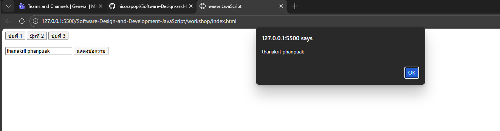

# การทดลอง พื้นฐาน JavaScript และการใช้งานร่วมกับ HTML/CSS
## การทดลองที่ 1 : ทำความรู้จักกับ JavaScript
###  การเพิ่ม JavaScript ลงในเว็บเพจ

JavaScript สามารถเพิ่มลงในเว็บเพจได้ 3 วิธี:

1. แบบ Inline: แทรก scipt ในแต่ละบรรทัดของ HTML Element
```html
<button onclick="alert('สวัสดี!')">คลิกที่นี่</button>
```

2. แบบ Internal Script: เขียน script ใน block   <script> </script>
```html
<script>
    alert('สวัสดี!');
</script>
```

3. แบบ External Script: เขียน script ในไฟล์แล้วเรียกใช้ใน HTML
   ไฟล์ script.js มีข้อมูลดังนี้
```javascript
    alert('สวัสดี!');
```
   ไฟล์ HTML มีการเรียกใช้ script ดังนี้
```html
<script src="script.js"></script>
```

### การทดลองที่ 1.1 : สร้างไฟล์ HTML และทดลองใช้ JavaScript ทั้ง 3 แบบ

สร้างไฟล์ `index.html`:
```html
<!DOCTYPE html>
<html lang="th">
<head>
    <meta charset="UTF-8">
    <title>ทดลอง JavaScript</title>
</head>
<body>
    <!-- Inline JavaScript -->
    <button onclick="alert('คลิกปุ่มที่ 1!')">ปุ่มที่ 1</button>

    <!-- ทดสอบ Internal JavaScript -->
    <button id="btn2">ปุ่มที่ 2</button>

    <!-- ทดสอบ External JavaScript -->
    <button id="btn3" onclick="hello3();">ปุ่มที่ 3</button>

    <!-- Internal JavaScript -->
    <script>
        document.getElementById('btn2').onclick = function() {
            alert('คลิกปุ่มที่ 2!');
        };
    </script>

    <!-- External JavaScript -->
  <!-- ต้องสร้างไฟล์ script.js มีโค้ดโปรแกรมในไฟล์ดังนี้
   function hello3(){
    alert('คลิกปุ่มที่ 3!');
    }
 -->
    <script src="script.js"></script>
</body>
</html>
```

### แบบฝึกปฏิบัติที่ 1: การใช้งาน JavaScript เบื้องต้น

1. สร้างหน้าเว็บที่มีปุ่ม 3 ปุ่ม:
   - ปุ่มที่ 1: ใช้ Inline JavaScript แสดงชื่อนักศึกษา
   - ปุ่มที่ 2: ใช้ Internal JavaScript แสดงวันที่ปัจจุบัน
   - ปุ่มที่ 3: ใช้ External JavaScript แสดงเวลาปัจจุบัน

2. เพิ่มกล่องข้อความและปุ่มสำหรับแสดงผล:
   - มีช่องกรอกข้อความ
   - มีปุ่มเมื่อคลิกแล้วจะแสดงข้อความที่กรอกในช่องข้อความ  (สามารถใช้ document.getElementById('id ของ textbox').value เพื่อดึงข้อมูลในช่อง)
### บันทึกผลการทดลอง 
```html
[บันทึกโค้ด ที่นี่]
```<!DOCTYPE html>
<html lang="th">
<head>
    <meta charset="UTF-8">
    <title>ทดลอง JavaScript</title>
    <style>
        body {
            font-family: Arial, sans-serif;
            padding: 20px;
        }
        button {
            padding: 10px 20px;
            margin: 5px;
            cursor: pointer;
            font-size: 14px;
        }
        .section {
            margin: 20px 0;
            border: 1px solid #ccc;
            padding: 15px;
            border-radius: 5px;
        }
        input[type="text"] {
            padding: 8px;
            width: 300px;
            font-size: 14px;
            margin-right: 10px;
        }
        #output {
            margin-top: 10px;
            padding: 10px;
            background-color: #f0f0f0;
            border-radius: 3px;
            min-height: 30px;
        }
    </style>
</head>
<body>
    <h1>ทดลอง JavaScript</h1>

    <!-- Section ปุ่ม -->
    <div class="section">
        <h2>ปุ่มทั้ง 3 ประเภท</h2>
        
        <!-- Inline JavaScript -->
        <button onclick="alert('ชื่อนักศึกษา: ธีธัช คัคคนัมพร')">ปุ่มที่ 1 (Inline)</button>

        <!-- Internal JavaScript -->
        <button id="btn2">ปุ่มที่ 2 (Internal)</button>

        <!-- External JavaScript -->
        <button id="btn3">ปุ่มที่ 3 (External)</button>
    </div>

    <!-- Section กล่องข้อความและแสดงผล -->
    <div class="section">
        <h2>กล่องข้อความและแสดงผล</h2>
        <input type="text" id="textInput" placeholder="กรอกข้อความที่นี่...">
        <button onclick="displayText()">แสดงข้อความ</button>
        <div id="output"></div>
    </div>

    <!-- Internal JavaScript -->
    <script>
        document.getElementById('btn2').onclick = function() {
            alert('วันที่ปัจจุบัน: 24/2/2569');
        };
        
        function displayText() {
            const textValue = document.getElementById('textInput').value;
            const outputDiv = document.getElementById('output');
            
            if (textValue.trim() === '') {
                outputDiv.textContent = 'กรุณากรอกข้อความ';
            } else {
                outputDiv.textContent = 'คุณกรอก: ' + textValue;
            }
        }
    </script>

    <!-- External JavaScript -->
    <script src="script.js"></script>
</body>
</html>
**รูปผลการทดลอง**



## การทดลองที่ 2: พื้นฐาน JavaScript
### 2.1 การประกาศตัวแปรและชนิดข้อมูล

JavaScript มีวิธีการประกาศตัวแปร 3 แบบ:
- `var`: ประกาศตัวแปรแบบเดิม (legacy) - ไม่แนะนำให้ใช้ในโค้ดสมัยใหม่
- `let`: ประกาศตัวแปรที่สามารถเปลี่ยนแปลงค่าได้ - เหมาะสำหรับค่าที่ต้องการเปลี่ยนแปลงในภายหลัง
- `const`: ประกาศตัวแปรที่ไม่สามารถเปลี่ยนแปลงค่าได้ - เหมาะสำหรับค่าคงที่

ชนิดข้อมูลพื้นฐานใน JavaScript:
1. Number: ตัวเลขทั้งจำนวนเต็มและทศนิยม
2. String: ข้อความ ใช้เครื่องหมาย '' หรือ ""
3. Boolean: ค่าความจริง true/false
4. Undefined: ตัวแปรที่ยังไม่ได้กำหนดค่า
5. Null: ตัวแปรที่ไม่มีค่า (ต่างจาก undefined)
6. Array
7. Object
   
### ตัวอย่าง การประกาศตัวแปรแต่ละแบบ
```javascript
// ประกาศตัวแปรแบบ let - สามารถเปลี่ยนแปลงค่าได้ในภายหลัง
let name = "สมชาย";     // String เก็บข้อความ
let age = 25;           // Number เก็บตัวเลข
let isStudent = true;   // Boolean เก็บค่าจริง/เท็จ

// ประกาศตัวแปรแบบ const - ไม่สามารถเปลี่ยนแปลงค่าได้หลังจากประกาศ
const PI = 3.14;            // ค่าคงที่ทางคณิตศาสตร์
const DAYS_IN_WEEK = 7;     // ค่าคงที่ที่ไม่ควรเปลี่ยนแปลง

// การเปลี่ยนแปลงค่าตัวแปร
name = "สมหญิง";   // ทำได้เพราะประกาศด้วย let
age = 26;          // สามารถเปลี่ยนค่าได้
// PI = 3.15;      // Error! ไม่สามารถเปลี่ยนค่า const ได้

// ตัวอย่างการใช้งาน undefined และ null
let uninitializedVar;           // มีค่าเป็น undefined โดยอัตโนมัติ
let emptyValue = null;          // กำหนดค่า null อย่างชัดเจน

// ตัวอย่างการประกาศ Array
let fruits = ["แอปเปิ้ล", "กล้วย", "ส้ม"];

// ตัวอย่างการประกาศ Object
let person = {
    name: "สมชาย",
    age: 25,
    isStudent: true
};
```

### 📝 แบบทดสอบที่ 2.1: การทดลองประกาศตัวแปร
1. สร้างตัวแปรเก็บข้อมูล รหัสนักศึกษา ชื่อนักศึกษา คะแนนสอบกลางภาค, คะแนนสอบปลายภาค โดยเลือกใช้ let หรือ const 
2. สร้าง Object สำหรับเก็บข้อมูลนักศึกษา  ประกอบด้วยข้อมูล รหัสนักศึกษา, ชื่อ, สาขาวิชา, เกรดเฉลี่ย

### บันทึกผลการทดลอง 2.1
```html
[บันทึกโค้ด ที่นี่]
```<!DOCTYPE html>
<html lang="th">
<head>
    <meta charset="UTF-8">
    <meta name="viewport" content="width=device-width, initial-scale=1.0">
    <title>ข้อมูลนักศึกษา</title>
    <style>
        body {
            font-family: 'Segoe UI', Tahoma, Geneva, Verdana, sans-serif;
            background: linear-gradient(135deg, #667eea 0%, #764ba2 100%);
            min-height: 100vh;
            display: flex;
            justify-content: center;
            align-items: center;
            margin: 0;
            padding: 20px;
        }
        
        .container {
            background: white;
            border-radius: 15px;
            box-shadow: 0 10px 40px rgba(0, 0, 0, 0.2);
            max-width: 600px;
            width: 100%;
            padding: 40px;
        }
        
        h1 {
            color: #333;
            text-align: center;
            margin-top: 0;
            border-bottom: 3px solid #667eea;
            padding-bottom: 20px;
        }
        
        .section {
            margin-bottom: 30px;
        }
        
        .section-title {
            color: #667eea;
            font-size: 18px;
            font-weight: 600;
            margin-bottom: 15px;
            padding-left: 10px;
            border-left: 4px solid #667eea;
        }
        
        .variable {
            background: #f8f9fa;
            padding: 12px 15px;
            margin-bottom: 10px;
            border-radius: 8px;
            border-left: 4px solid #764ba2;
            display: flex;
            justify-content: space-between;
            align-items: center;
        }
        
        .variable-name {
            font-weight: 600;
            color: #333;
            font-family: 'Courier New', monospace;
            color: #764ba2;
        }
        
        .variable-value {
            color: #555;
            font-size: 15px;
        }
        
        .variable-type {
            background: #667eea;
            color: white;
            padding: 3px 8px;
            border-radius: 4px;
            font-size: 12px;
            margin-left: 10px;
            font-weight: 500;
        }
        
        .student-object {
            background: #f0f4ff;
            padding: 20px;
            border-radius: 10px;
            border: 2px solid #667eea;
        }
        
        .object-property {
            margin-bottom: 15px;
            padding: 12px;
            background: white;
            border-radius: 6px;
            display: flex;
            justify-content: space-between;
            align-items: center;
        }
        
        .object-property-name {
            font-weight: 600;
            color: #764ba2;
            font-family: 'Courier New', monospace;
        }
        
        .object-property-value {
            color: #333;
            font-size: 15px;
        }
        
        .code-section {
            background: #2d2d2d;
            color: #f8f8f2;
            padding: 20px;
            border-radius: 10px;
            margin-top: 30px;
            overflow-x: auto;
            font-family: 'Courier New', monospace;
            font-size: 13px;
            line-height: 1.6;
        }
        
        .code-section .keyword {
            color: #ff79c6;
        }
        
        .code-section .string {
            color: #f1fa8c;
        }
        
        .code-section .number {
            color: #bd93f9;
        }
    </style>
</head>
<body>
    <div class="container">
        <h1>📋 ข้อมูลนักศึกษา</h1>
        
        <!-- ตัวแปรแต่ละตัว -->
        <div class="section">
            <div class="section-title">ตัวแปรเก็บข้อมูล</div>
            
            <div class="variable">
                <div>
                    <span class="variable-name">studentID</span>
                    <span class="variable-type">const</span>
                </div>
                <div class="variable-value">68030125</div>
            </div>
            
            <div class="variable">
                <div>
                    <span class="variable-name">studentName</span>
                    <span class="variable-type">const</span>
                </div>
                <div class="variable-value">ธีธัช คัคคนัมพร</div>
            </div>
            
            <div class="variable">
                <div>
                    <span class="variable-name">midtermScore</span>
                    <span class="variable-type">let</span>
                </div>
                <div class="variable-value">15 คะแนน</div>
            </div>
            
            <div class="variable">
                <div>
                    <span class="variable-name">finalScore</span>
                    <span class="variable-type">let</span>
                </div>
                <div class="variable-value">18 คะแนน</div>
            </div>
            
            <div class="variable">
                <div>
                    <span class="variable-name">major</span>
                    <span class="variable-type">const</span>
                </div>
                <div class="variable-value">คอมพิวเตอร์</div>
            </div>
            
            <div class="variable">
                <div>
                    <span class="variable-name">gpa</span>
                    <span class="variable-type">const</span>
                </div>
                <div class="variable-value">3.79</div>
            </div>
        </div>
        
        <!-- Object -->
        <div class="section">
            <div class="section-title">Object สำหรับเก็บข้อมูลนักศึกษา</div>
            
            <div class="student-object">
                <div class="object-property">
                    <span class="object-property-name">studentID:</span>
                    <span class="object-property-value">"68030125"</span>
                </div>
                
                <div class="object-property">
                    <span class="object-property-name">name:</span>
                    <span class="object-property-value">"ธีธัช คัคคนัมพร"</span>
                </div>
                
                <div class="object-property">
                    <span class="object-property-name">major:</span>
                    <span class="object-property-value">"คอมพิวเตอร์"</span>
                </div>
                
                <div class="object-property">
                    <span class="object-property-name">gpa:</span>
                    <span class="object-property-value">3.79</span>
                </div>
            </div>
        </div>
        
        <!-- Code -->
        <div class="code-section">
            <pre><span class="keyword">const</span> student = {<br>    studentID: <span class="string">"68030125"</span>,<br>    name: <span class="string">"ธีธัช คัคคนัมพร"</span>,<br>    major: <span class="string">"คอมพิวเตอร์"</span>,<br>    gpa: <span class="number">3.79</span><br>};</pre>
        </div>
    </div>
</body>
</html>

**รูปผลการทดลอง**


### 2.2 การดำเนินการทางคณิตศาสตร์

JavaScript มีตัวดำเนินการทางคณิตศาสตร์พื้นฐานดังนี้:
- `+` การบวก
- `-` การลบ
- `*` การคูณ
- `/` การหาร
- `%` การหารเอาเศษ (modulo)
- `**` การยกกำลัง (exponentiation)
- `++` การเพิ่มค่าทีละ 1 (increment)
- `--` การลดค่าทีละ 1 (decrement)

### แบบฝึกหัด 2.2: ทดลองใช้ตัวดำเนินการทางคณิตศาสตร์
```javascript
// กำหนดค่าตัวแปรเริ่มต้น
let x = 10;
let y = 5;

// การดำเนินการพื้นฐาน
let sum = x + y;      // บวก: 10 + 5 = 15
let diff = x - y;     // ลบ: 10 - 5 = 5
let product = x * y;  // คูณ: 10 * 5 = 50
let quotient = x / y; // หาร: 10 / 5 = 2
let remainder = x % y; // หารเอาเศษ: 10 % 5 = 0 (หาร 5 ลงตัว)

// การเพิ่ม/ลดค่าทีละ 1
let counter = 1;
counter++;            // เพิ่มค่าทีละ 1: counter = 2
counter--;            // ลดค่าทีละ 1: counter = 1

// การยกกำลัง
let squared = x ** 2;  // 10 ยกกำลัง 2 = 100
let cubed = x ** 3;    // 10 ยกกำลัง 3 = 1000

// การใช้ตัวดำเนินการร่วมกับการกำหนดค่า
let number = 5;
number += 3;          // เท่ากับ number = number + 3
number -= 2;          // เท่ากับ number = number - 2
number *= 4;          // เท่ากับ number = number * 4
number /= 2;          // เท่ากับ number = number / 2

```

### 📝 แบบทดสอบที่ 2.2: การคำนวณพื้นฐาน
1. เขียนโปรแกรม กำหนดคะแนน  3 วิชา แล้วหาค่าคะแนนเฉลี่ย แล้วแสดงผลการคำนวณ
2. เขียนโปรแกรม กำหนดชื่อสินค้า ราคาสินค้า คำนวณราคาสินค้าที่รวม VAT 7% แล้วแสดงผลการคำนวณ

### บันทึกผลการทดลอง 2.2
```html
[บันทึกโค้ด ที่นี่]
```<!DOCTYPE html>
<html lang="th">
<head>
    <meta charset="UTF-8">
    <meta name="viewport" content="width=device-width, initial-scale=1.0">
    <title>โปรแกรมคำนวณคะแนนและราคา</title>
    <style>
        body {
            font-family: 'Segoe UI', Tahoma, Geneva, Verdana, sans-serif;
            background: linear-gradient(135deg, #667eea 0%, #764ba2 100%);
            min-height: 100vh;
            padding: 20px;
            margin: 0;
        }
        
        .container {
            max-width: 1200px;
            margin: 0 auto;
        }
        
        h1 {
            color: white;
            text-align: center;
            margin-bottom: 30px;
            font-size: 28px;
        }
        
        .programs {
            display: grid;
            grid-template-columns: 1fr 1fr;
            gap: 20px;
            margin-bottom: 30px;
        }
        
        @media (max-width: 768px) {
            .programs {
                grid-template-columns: 1fr;
            }
        }
        
        .program-card {
            background: white;
            border-radius: 15px;
            overflow: hidden;
            box-shadow: 0 10px 40px rgba(0, 0, 0, 0.2);
        }
        
        .program-header {
            background: linear-gradient(135deg, #667eea 0%, #764ba2 100%);
            color: white;
            padding: 20px;
            font-size: 18px;
            font-weight: 600;
        }
        
        .program-content {
            padding: 20px;
        }
        
        .code-block {
            background: #2d2d2d;
            color: #f8f8f2;
            padding: 15px;
            border-radius: 8px;
            overflow-x: auto;
            font-family: 'Courier New', monospace;
            font-size: 12px;
            line-height: 1.5;
            margin-bottom: 20px;
        }
        
        .code-block .keyword {
            color: #ff79c6;
        }
        
        .code-block .string {
            color: #f1fa8c;
        }
        
        .code-block .number {
            color: #bd93f9;
        }
        
        .code-block .comment {
            color: #6272a4;
        }
        
        .result-box {
            background: #f0f4ff;
            border-left: 4px solid #667eea;
            padding: 15px;
            border-radius: 8px;
            margin-top: 15px;
        }
        
        .result-item {
            display: flex;
            justify-content: space-between;
            align-items: center;
            padding: 8px 0;
            border-bottom: 1px solid #ddd;
        }
        
        .result-item:last-child {
            border-bottom: none;
        }
        
        .result-label {
            font-weight: 600;
            color: #333;
        }
        
        .result-value {
            color: #667eea;
            font-weight: 600;
            font-family: 'Courier New', monospace;
        }
        
        .output-title {
            color: #667eea;
            font-weight: 600;
            font-size: 14px;
            margin-top: 15px;
            margin-bottom: 10px;
        }
        
        .footer {
            background: white;
            padding: 20px;
            border-radius: 15px;
            box-shadow: 0 10px 40px rgba(0, 0, 0, 0.2);
            margin-top: 20px;
        }
    </style>
</head>
<body>
    <div class="container">
        <h1>📊 โปรแกรมคำนวณคะแนนและราคา</h1>
        
        <div class="programs">
            <!-- โปรแกรมที่ 1: คำนวณคะแนนเฉลี่ย -->
            <div class="program-card">
                <div class="program-header">📚 โปรแกรมคำนวณคะแนนเฉลี่ย 3 วิชา</div>
                <div class="program-content">
                    <div class="code-block"><pre><span class="comment">// กำหนดคะแนน 3 วิชา</span>
<span class="keyword">let</span> score1 = 85;  <span class="comment">// วิชาที่ 1</span>
<span class="keyword">let</span> score2 = 90;  <span class="comment">// วิชาที่ 2</span>
<span class="keyword">let</span> score3 = 78;  <span class="comment">// วิชาที่ 3</span>

<span class="comment">// หาค่าคะแนนรวม</span>
<span class="keyword">let</span> totalScore = score1 + score2 + score3;
<span class="comment">// คำนวณ: 85 + 90 + 78 = 253</span>

<span class="comment">// หาค่าคะแนนเฉลี่ย</span>
<span class="keyword">let</span> average = totalScore / 3;
<span class="comment">// คำนวณ: 253 / 3 = 84.33</span></pre></div>
                    
                    <div class="output-title">📤 ผลการคำนวณ:</div>
                    <div class="result-box">
                        <div class="result-item">
                            <span class="result-label">คะแนนวิชาที่ 1:</span>
                            <span class="result-value">85</span>
                        </div>
                        <div class="result-item">
                            <span class="result-label">คะแนนวิชาที่ 2:</span>
                            <span class="result-value">90</span>
                        </div>
                        <div class="result-item">
                            <span class="result-label">คะแนนวิชาที่ 3:</span>
                            <span class="result-value">78</span>
                        </div>
                        <div class="result-item" style="border-bottom: 2px solid #667eea; margin-top: 10px; padding-top: 10px;">
                            <span class="result-label">คะแนนรวม:</span>
                            <span class="result-value">253</span>
                        </div>
                        <div class="result-item" style="color: #42a5f5; font-weight: 700;">
                            <span class="result-label">คะแนนเฉลี่ย:</span>
                            <span class="result-value" style="color: #42a5f5; font-size: 16px;">84.33</span>
                        </div>
                    </div>
                </div>
            </div>
            
            <!-- โปรแกรมที่ 2: คำนวณราคารวม VAT -->
            <div class="program-card">
                <div class="program-header">💰 โปรแกรมคำนวณราคาสินค้ารวม VAT 7%</div>
                <div class="program-content">
                    <div class="code-block"><pre><span class="comment">// กำหนดข้อมูลสินค้า</span>
<span class="keyword">let</span> productName = <span class="string">"แล็ปท็อป"</span>;
<span class="keyword">let</span> price = <span class="number">25000</span>;  <span class="comment">// ราคาสินค้า (บาท)</span>

<span class="comment">// คำนวณ VAT 7%</span>
<span class="keyword">let</span> vat = price * <span class="number">0.07</span>;
<span class="comment">// คำนวณ: 25000 * 0.07 = 1750</span>

<span class="comment">// คำนวณราคารวม VAT</span>
<span class="keyword">let</span> totalPrice = price + vat;
<span class="comment">// คำนวณ: 25000 + 1750 = 26750</span></pre></div>
                    
                    <div class="output-title">📤 ผลการคำนวณ:</div>
                    <div class="result-box">
                        <div class="result-item">
                            <span class="result-label">ชื่อสินค้า:</span>
                            <span class="result-value">แล็ปท็อป</span>
                        </div>
                        <div class="result-item">
                            <span class="result-label">ราคาสินค้า:</span>
                            <span class="result-value">25,000 บาท</span>
                        </div>
                        <div class="result-item">
                            <span class="result-label">VAT 7%:</span>
                            <span class="result-value">1,750 บาท</span>
                        </div>
                        <div class="result-item" style="border-bottom: 2px solid #667eea; margin-top: 10px; padding-top: 10px;">
                            <span class="result-label">ราคารวม:</span>
                            <span class="result-value">26,750 บาท</span>
                        </div>
                    </div>
                </div>
            </div>
        </div>
        

    </div>
    
    <script>
        // โปรแกรมจริงสามารถรันได้ที่นี่
        console.log("=== โปรแกรมที่ 1: คำนวณคะแนนเฉลี่ย ===");
        let score1 = 85;
        let score2 = 90;
        let score3 = 78;
        let totalScore = score1 + score2 + score3;
        let average = totalScore / 3;
        
        console.log(`คะแนนวิชาที่ 1: ${score1}`);
        console.log(`คะแนนวิชาที่ 2: ${score2}`);
        console.log(`คะแนนวิชาที่ 3: ${score3}`);
        console.log(`คะแนนรวม: ${totalScore}`);
        console.log(`คะแนนเฉลี่ย: ${average.toFixed(2)}`);
        
        console.log("\n=== โปรแกรมที่ 2: คำนวณราคารวม VAT ===");
        let productName = "แล็ปท็อป";
        let price = 25000;
        let vat = price * 0.07;
        let totalPrice = price + vat;
        
        console.log(`ชื่อสินค้า: ${productName}`);
        console.log(`ราคาสินค้า: ${price.toLocaleString()} บาท`);
        console.log(`VAT 7%: ${vat.toLocaleString()} บาท`);
        console.log(`ราคารวม: ${totalPrice.toLocaleString()} บาท`);
    </script>
</body>
**รูปผลการทดลอง**


### 2.3 การควบคุมการทำงาน

JavaScript มีโครงสร้างควบคุมการทำงานหลักๆ ดังนี้:

1. เงื่อนไข (Conditionals):
   - `if`: ตรวจสอบเงื่อนไขเดียว
   - `if...else`: ตรวจสอบเงื่อนไขและมีทางเลือก
   - `if...else if...else`: ตรวจสอบหลายเงื่อนไข
   - `switch`: เลือกทำงานตามค่าที่กำหนด

2. การวนซ้ำ (Loops):
   - `for`: วนซ้ำตามจำนวนรอบที่กำหนด
   - `while`: วนซ้ำตราบใดที่เงื่อนไขเป็นจริง
   - `do...while`: ทำงานอย่างน้อย 1 ครั้ง แล้ววนซ้ำตามเงื่อนไข
   - `for...of`: วนซ้ำสำหรับข้อมูลแบบ iterable
   - `for...in`: วนซ้ำสำหรับ properties ใน object


```javascript
// 1. การใช้ if-else
let score = 75;

// ตรวจสอบเงื่อนไขตามลำดับ
if (score >= 80) {         // ถ้าคะแนน >= 80
    console.log("เกรด A");
} else if (score >= 70) {  // ถ้าคะแนน >= 70 แต่ < 80
    console.log("เกรด B");
} else {                   // ถ้าไม่ตรงเงื่อนไขใดเลย
    console.log("เกรด C");
}

// 2. การใช้ switch
let day = 1;
switch (day) {
    case 1:
        console.log("วันจันทร์");
        break;              // break เพื่อออกจาก switch
    case 2:
        console.log("วันอังคาร");
        break;
    default:               // ค่าเริ่มต้นถ้าไม่ตรงกับ case ใดๆ
        console.log("วันอื่นๆ");
}

// 3. การใช้ for loop
// วนซ้ำ 5 รอบ: เริ่มที่ 1, ทำจนถึง 5, เพิ่มค่าทีละ 1
for (let i = 1; i <= 5; i++) {
    console.log("รอบที่", i);
}

// 4. การใช้ while loop
// วนซ้ำตราบใดที่เงื่อนไขเป็นจริง
let count = 1;
while (count <= 3) {      // ทำซ้ำตราบใดที่ count <= 3
    console.log("นับ:", count);
    count++;              // เพิ่มค่า count ทีละ 1
}

// 5. การใช้ do...while loop
// ทำงานอย่างน้อย 1 ครั้ง แล้วค่อยตรวจสอบเงื่อนไข
let num = 1;
do {
    console.log("ตัวเลข:", num);
    num++;
} while (num <= 3);

// 6. การใช้ for...of loop กับ array
let fruits = ['แอปเปิ้ล', 'กล้วย', 'ส้ม'];
for (let fruit of fruits) {
    console.log("ผลไม้:", fruit);
}

// 7. การใช้ for...in loop กับ object
let person = {
    name: 'สมชาย',
    age: 25,
    job: 'โปรแกรมเมอร์'
};
for (let key in person) {
    console.log(key + ":", person[key]);
}

// 8. การใช้เงื่อนไขซ้อน (Nested Conditions)
let age = 18;
let hasPermission = true;

if (age >= 18) {
    if (hasPermission) {
        console.log("สามารถเข้าใช้งานได้");
    } else {
        console.log("ต้องได้รับอนุญาตก่อน");
    }
} else {
    console.log("อายุไม่ถึงเกณฑ์");
}

// 9. การใช้ตัวดำเนินการลอจิคัล (Logical Operators)
let isStudent = true;
let isMember = false;

if (isStudent && isMember) {           // AND (&&)
    console.log("เป็นทั้งนักเรียนและสมาชิก");
} else if (isStudent || isMember) {    // OR (||)
    console.log("เป็นอย่างใดอย่างหนึ่ง");
} else {
    console.log("ไม่เป็นทั้งสองอย่าง");
}

// 10. การใช้ break และ continue
for (let i = 1; i <= 5; i++) {
    if (i === 3) {
        continue;    // ข้ามการทำงานที่เหลือในรอบนี้
    }
    if (i === 4) {
        break;       // ออกจาก loop ทันที
    }
    console.log("ตัวเลข:", i);
}
```


### 📝 แบบทดสอบที่ 2.3: การควบคุมการทำงาน
1. กำหนดตัวเลข และตรวจสอบว่าตัวเลขที่กำหนดเป็นเลขคู่หรือเลขคี่
2. สร้าง loop แบบ for แสดงตารางสูตรคูณ แม่ 2 และ loop แบบ while แสดงสูตรคูณ แม่ 3
3. เขียนโปรแกรมนับถอยหลังจาก 10 ถึง 1
4. เขียนโปรแกรมกำหนดอายุ และตรวจสอบช่วงวัยตามอายุที่กำหนด (กำหนดอายุแต่ละช่วงวัย วัยเด็ก วัยรุ่น วัยผู้ใหญ่)

### บันทึกผลการทดลอง 2.3
```html
[บันทึกโค้ด ที่นี่]
```<!DOCTYPE html>
<html lang="th">
<head>
    <meta charset="UTF-8">
    <meta name="viewport" content="width=device-width, initial-scale=1.0">
    <title>โปรแกรม Condition และ Loop</title>
    <style>
        body {
            font-family: 'Segoe UI', Tahoma, Geneva, Verdana, sans-serif;
            background: linear-gradient(135deg, #667eea 0%, #764ba2 100%);
            min-height: 100vh;
            padding: 20px;
            margin: 0;
        }
        
        .container {
            max-width: 1400px;
            margin: 0 auto;
        }
        
        h1 {
            color: white;
            text-align: center;
            margin-bottom: 30px;
            font-size: 28px;
        }
        
        .programs {
            display: grid;
            grid-template-columns: 1fr 1fr;
            gap: 20px;
            margin-bottom: 30px;
        }
        
        @media (max-width: 1024px) {
            .programs {
                grid-template-columns: 1fr;
            }
        }
        
        .program-card {
            background: white;
            border-radius: 15px;
            overflow: hidden;
            box-shadow: 0 10px 40px rgba(0, 0, 0, 0.2);
        }
        
        .program-header {
            background: linear-gradient(135deg, #667eea 0%, #764ba2 100%);
            color: white;
            padding: 20px;
            font-size: 16px;
            font-weight: 600;
        }
        
        .program-content {
            padding: 20px;
        }
        
        .code-block {
            background: #2d2d2d;
            color: #f8f8f2;
            padding: 15px;
            border-radius: 8px;
            overflow-x: auto;
            font-family: 'Courier New', monospace;
            font-size: 11px;
            line-height: 1.5;
            margin-bottom: 15px;
        }
        
        .code-block .keyword {
            color: #ff79c6;
        }
        
        .code-block .string {
            color: #f1fa8c;
        }
        
        .code-block .number {
            color: #bd93f9;
        }
        
        .code-block .comment {
            color: #6272a4;
        }
        
        .result-box {
            background: #f0f4ff;
            border-left: 4px solid #667eea;
            padding: 15px;
            border-radius: 8px;
            margin-top: 15px;
        }
        
        .result-title {
            color: #667eea;
            font-weight: 600;
            font-size: 13px;
            margin-bottom: 10px;
        }
        
        .result-content {
            color: #333;
            line-height: 1.8;
            font-family: 'Courier New', monospace;
            font-size: 12px;
        }
        
        .output-label {
            color: #667eea;
            font-weight: 600;
            font-size: 13px;
            margin-top: 15px;
            margin-bottom: 8px;
        }
        
        .table-output {
            display: grid;
            grid-template-columns: repeat(2, 1fr);
            gap: 10px;
            margin-top: 10px;
        }
        
        .table-item {
            background: white;
            padding: 8px 12px;
            border-radius: 6px;
            border: 1px solid #ddd;
            font-size: 12px;
            font-family: 'Courier New', monospace;
        }
        
        .countdown-output {
            background: white;
            padding: 10px;
            border-radius: 6px;
            font-family: 'Courier New', monospace;
            font-size: 12px;
            word-break: break-all;
        }
        
        .age-check {
            background: white;
            padding: 12px;
            border-radius: 6px;
            border-left: 4px solid #42a5f5;
            margin-top: 10px;
            font-size: 12px;
        }
        
        .age-range {
            display: flex;
            justify-content: space-between;
            padding: 8px 0;
            border-bottom: 1px solid #eee;
        }
        
        .age-range:last-child {
            border-bottom: none;
        }
        
        .age-range-name {
            font-weight: 600;
            color: #333;
        }
        
        .age-range-years {
            color: #667eea;
            font-weight: 600;
        }
    </style>
</head>
<body>
    <div class="container">
        <h1>🔄 โปรแกรม Condition และ Loop</h1>
        
        <div class="programs">
            <!-- โปรแกรมที่ 1: ตรวจสอบเลขคู่/เลขคี่ -->
            <div class="program-card">
                <div class="program-header">🔢 ตรวจสอบเลขคู่หรือเลขคี่</div>
                <div class="program-content">
                    <div class="code-block"><pre><span class="comment">// กำหนดตัวเลข</span>
<span class="keyword">let</span> number = <span class="number">15</span>;

<span class="comment">// ตรวจสอบว่าเป็นเลขคู่หรือเลขคี่</span>
<span class="keyword">if</span> (number % <span class="number">2</span> === <span class="number">0</span>) {
    console.log(<span class="string">"เลขคู่"</span>);
} <span class="keyword">else</span> {
    console.log(<span class="string">"เลขคี่"</span>);
}</pre></div>
                    
                    <div class="result-box">
                        <div class="result-title">📤 ผลลัพธ์:</div>
                        <div class="result-content">
                            ตัวเลข: 15<br>
                            15 % 2 = 1 (ไม่เท่ากับ 0)<br>
                            ✓ <span style="color: #42a5f5; font-weight: 600;">เลขคี่</span>
                        </div>
                    </div>
                </div>
            </div>
            
            <!-- โปรแกรมที่ 2: For Loop สูตรคูณแม่ 2 -->
            <div class="program-card">
                <div class="program-header">📚 For Loop - สูตรคูณแม่ 2</div>
                <div class="program-content">
                    <div class="code-block"><pre><span class="comment">// For loop แสดงสูตรคูณแม่ 2</span>
<span class="keyword">for</span> (<span class="keyword">let</span> i = <span class="number">1</span>; i <= <span class="number">10</span>; i++) {
    console.log(
        <span class="string">`2 × ${i} = ${2 * i}`</span>
    );
}</pre></div>
                    
                    <div class="result-box">
                        <div class="result-title">📤 ผลลัพธ์:</div>
                        <div class="result-content">
                            2 × 1 = 2<br>
                            2 × 2 = 4<br>
                            2 × 3 = 6<br>
                            2 × 4 = 8<br>
                            2 × 5 = 10<br>
                            2 × 6 = 12<br>
                            2 × 7 = 14<br>
                            2 × 8 = 16<br>
                            2 × 9 = 18<br>
                            2 × 10 = 20
                        </div>
                    </div>
                </div>
            </div>
            
            <!-- โปรแกรมที่ 3: While Loop สูตรคูณแม่ 3 -->
            <div class="program-card">
                <div class="program-header">📚 While Loop - สูตรคูณแม่ 3</div>
                <div class="program-content">
                    <div class="code-block"><pre><span class="comment">// While loop แสดงสูตรคูณแม่ 3</span>
<span class="keyword">let</span> i = <span class="number">1</span>;
<span class="keyword">while</span> (i <= <span class="number">10</span>) {
    console.log(
        <span class="string">`3 × ${i} = ${3 * i}`</span>
    );
    i++;
}</pre></div>
                    
                    <div class="result-box">
                        <div class="result-title">📤 ผลลัพธ์:</div>
                        <div class="result-content">
                            3 × 1 = 3<br>
                            3 × 2 = 6<br>
                            3 × 3 = 9<br>
                            3 × 4 = 12<br>
                            3 × 5 = 15<br>
                            3 × 6 = 18<br>
                            3 × 7 = 21<br>
                            3 × 8 = 24<br>
                            3 × 9 = 27<br>
                            3 × 10 = 30
                        </div>
                    </div>
                </div>
            </div>
            
            <!-- โปรแกรมที่ 4: นับถอยหลัง -->
            <div class="program-card">
                <div class="program-header">⏱️ นับถอยหลังจาก 10 ถึง 1</div>
                <div class="program-content">
                    <div class="code-block"><pre><span class="comment">// นับถอยหลังจาก 10 ถึง 1</span>
<span class="keyword">for</span> (<span class="keyword">let</span> i = <span class="number">10</span>; i >= <span class="number">1</span>; i--) {
    console.log(i);
}
console.log(<span class="string">"จบ! 🎉"</span>);</pre></div>
                    
                    <div class="result-box">
                        <div class="result-title">📤 ผลลัพธ์:</div>
                        <div class="countdown-output">
                            10 → 9 → 8 → 7 → 6 → 5 → 4 → 3 → 2 → 1<br><br>
                            <span style="color: #42a5f5; font-weight: 600;">จบ! 🎉</span>
                        </div>
                    </div>
                </div>
            </div>
            
            <!-- โปรแกรมที่ 5: ตรวจสอบช่วงวัย -->
            <div class="program-card">
                <div class="program-header">👤 ตรวจสอบช่วงวัยตามอายุ</div>
                <div class="program-content">
                    <div class="code-block"><pre><span class="comment">// กำหนดอายุ</span>
<span class="keyword">let</span> age = <span class="number">17</span>;

<span class="comment">// ตรวจสอบช่วงวัย</span>
<span class="keyword">if</span> (age >= <span class="number">1</span> && age <= <span class="number">15</span>) {
    console.log(<span class="string">"วัยเด็ก"</span>);
} <span class="keyword">else if</span> (age >= <span class="number">16</span> && age <= <span class="number">20</span>) {
    console.log(<span class="string">"วัยรุ่น"</span>);
} <span class="keyword">else if</span> (age >= <span class="number">21</span> && age <= <span class="number">60</span>) {
    console.log(<span class="string">"วัยผู้ใหญ่"</span>);
} <span class="keyword">else</span> {
    console.log(<span class="string">"วัยสูงอายุ"</span>);
}</pre></div>
                    
                    <div class="result-box">
                        <div class="result-title">📤 ผลลัพธ์:</div>
                        <div class="age-check">
                            <div style="margin-bottom: 12px;">
                                <strong>อายุที่กำหนด: </strong>17 ปี
                            </div>
                            <div style="color: #42a5f5; font-weight: 600; padding: 8px; background: #f0f4ff; border-radius: 4px; text-align: center;">
                                ✓ วัยรุ่น
                            </div>
                            
                            <div style="margin-top: 15px; border-top: 1px solid #ddd; padding-top: 12px; font-size: 11px;">
                                <div class="age-range">
                                    <span class="age-range-name">🧒 วัยเด็ก</span>
                                    <span class="age-range-years">1 - 15 ปี</span>
                                </div>
                                <div class="age-range">
                                    <span class="age-range-name">👦 วัยรุ่น</span>
                                    <span class="age-range-years">16 - 20 ปี</span>
                                </div>
                                <div class="age-range">
                                    <span class="age-range-name">👨 วัยผู้ใหญ่</span>
                                    <span class="age-range-years">21 - 60 ปี</span>
                                </div>
                                <div class="age-range">
                                    <span class="age-range-name">👴 วัยสูงอายุ</span>
                                    <span class="age-range-years">61+ ปี</span>
                                </div>
                            </div>
                        </div>
                    </div>
                </div>
            </div>
        </div>
    </div>
    
    <script>
        // โปรแกรมที่ 1: ตรวจสอบเลขคู่/เลขคี่
        console.log("=== โปรแกรมที่ 1: ตรวจสอบเลขคู่/เลขคี่ ===");
        let number = 15;
        if (number % 2 === 0) {
            console.log(`${number} เป็นเลขคู่`);
        } else {
            console.log(`${number} เป็นเลขคี่`);
        }
        
        // โปรแกรมที่ 2: For Loop สูตรคูณแม่ 2
        console.log("\n=== โปรแกรมที่ 2: For Loop - สูตรคูณแม่ 2 ===");
        for (let i = 1; i <= 10; i++) {
            console.log(`2 × ${i} = ${2 * i}`);
        }
        
        // โปรแกรมที่ 3: While Loop สูตรคูณแม่ 3
        console.log("\n=== โปรแกรมที่ 3: While Loop - สูตรคูณแม่ 3 ===");
        let j = 1;
        while (j <= 10) {
            console.log(`3 × ${j} = ${3 * j}`);
            j++;
        }
        
        // โปรแกรมที่ 4: นับถอยหลัง
        console.log("\n=== โปรแกรมที่ 4: นับถอยหลังจาก 10 ถึง 1 ===");
        for (let k = 10; k >= 1; k--) {
            console.log(k);
        }
        console.log("จบ! 🎉");
        
        // โปรแกรมที่ 5: ตรวจสอบช่วงวัย
        console.log("\n=== โปรแกรมที่ 5: ตรวจสอบช่วงวัย ===");
        let age = 17;
        if (age >= 1 && age <= 15) {
            console.log(`อายุ ${age} ปี: วัยเด็ก`);
        } else if (age >= 16 && age <= 20) {
            console.log(`อายุ ${age} ปี: วัยรุ่น`);
        } else if (age >= 21 && age <= 60) {
            console.log(`อายุ ${age} ปี: วัยผู้ใหญ่`);
        } else {
            console.log(`อายุ ${age} ปี: วัยสูงอายุ`);
        }
    </script>
</body>
</html>

**รูปผลการทดลอง**


### 2.4 Functions และ Arrow Functions

Functions คือกลุ่มคำสั่งที่สามารถนำมาใช้ซ้ำได้ ใน JavaScript มีวิธีการเขียน function 2 แบบหลักๆ:

1. Function แบบปกติ (Regular Functions):
   - ใช้คำสั่ง `function` ในการประกาศ
   - สามารถมีหรือไม่มีพารามิเตอร์ก็ได้
   - สามารถ return ค่ากลับหรือไม่ก็ได้
   - มี `this` context ของตัวเอง

2. Arrow Functions:
   - เป็นวิธีเขียนแบบสั้นที่มาใน ES6
   - ไม่มี `this` context ของตัวเอง
   - เหมาะสำหรับ function สั้นๆ
   - มักใช้ใน callback functions

#### ตัวอย่างการสร้างและเรียกใช้ Function 

```javascript
// 1. Function พื้นฐาน - ไม่มีพารามิเตอร์และไม่ return ค่า
function sayHello() {
    console.log("สวัสดี!");
}
sayHello();  // เรียกใช้ function: แสดง "สวัสดี!"

// 2. Function ที่รับพารามิเตอร์
function greet(name) {
    console.log("สวัสดี " + name);
}
greet("สมชาย");  // แสดง: "สวัสดี สมชาย"

// 3. Function ที่ return ค่า
function add(a, b) {
    return a + b;  // ส่งค่าผลบวกกลับ
}
let sum = add(5, 3);  // sum = 8

// 4. Function ที่มีค่าเริ่มต้นของพารามิเตอร์
function greetWithTitle(name, title = "คุณ") {
    console.log("สวัสดี " + title + " " + name);
}
greetWithTitle("สมชาย");          // แสดง: "สวัสดี คุณ สมชาย"
greetWithTitle("สมชาย", "ดร.");   // แสดง: "สวัสดี ดร. สมชาย"

// 5. Function ที่รับหลายพารามิเตอร์ (Rest Parameters)
function sum(...numbers) {
    let total = 0;
    for (let num of numbers) {
        total += num;
    }
    return total;
}
console.log(sum(1, 2, 3, 4));  // แสดง: 10

// 6. Function ที่ return หลายค่าโดยใช้ Object
function getPersonInfo() {
    return {
        name: "สมชาย",
        age: 25,
        job: "โปรแกรมเมอร์"
    };
}
let person = getPersonInfo();
console.log(person.name);  // แสดง: "สมชาย"

// 7. Function ที่เป็น Method ใน Object
let calculator = {
    add: function(a, b) {
        return a + b;
    },
    subtract: function(a, b) {
        return a - b;
    }
};
console.log(calculator.add(5, 3));      // แสดง: 8
console.log(calculator.subtract(5, 3));  // แสดง: 2

// 8. Nested Function (Function ซ้อน Function)
function outer(x) {
    function inner(y) {
        return x + y;  // inner function สามารถเข้าถึงตัวแปรของ outer function
    }
    return inner;
}
let addFive = outer(5);
console.log(addFive(3));  // แสดง: 8

// 9. Callback Function
function process(callback) {
    console.log("กำลังประมวลผล...");
    callback();  // เรียกใช้ function ที่ส่งเข้ามา
}
process(function() {
    console.log("เสร็จสิ้น!");
});

// 10. Immediately Invoked Function Expression (IIFE)
(function() {
    console.log("Function นี้ทำงานทันทีที่ถูกประกาศ");
})();
```


### 📝 แบบทดสอบที่ 2.4.1: Functions
1. สร้าง function คำนวณค่า BMI (ดัชนีมวลกาย) จากน้ำหนักและส่วนสูง
2. สร้าง function ที่รับชื่อและอายุ แล้วแสดงข้อความทักทายที่เหมาะสมกับอายุ
3. เขียน function ตรวจสอบรหัสผ่านว่ามีความยาวมากกว่า 8 ตัวอักษรหรือไม่

### บันทึกผลการทดลอง 2.4.1
```html
[บันทึกโค้ด ที่นี่]
```<!DOCTYPE html>
<html lang="th">
<head>
    <meta charset="UTF-8">
    <meta name="viewport" content="width=device-width, initial-scale=1.0">
    <title>โปรแกรม Function</title>
    <style>
        body {
            font-family: 'Segoe UI', Tahoma, Geneva, Verdana, sans-serif;
            background: linear-gradient(135deg, #667eea 0%, #764ba2 100%);
            min-height: 100vh;
            padding: 20px;
            margin: 0;
        }
        
        .container {
            max-width: 1200px;
            margin: 0 auto;
        }
        
        h1 {
            color: white;
            text-align: center;
            margin-bottom: 30px;
            font-size: 28px;
        }
        
        .programs {
            display: grid;
            grid-template-columns: 1fr 1fr;
            gap: 20px;
            margin-bottom: 30px;
        }
        
        @media (max-width: 768px) {
            .programs {
                grid-template-columns: 1fr;
            }
        }
        
        .program-card {
            background: white;
            border-radius: 15px;
            overflow: hidden;
            box-shadow: 0 10px 40px rgba(0, 0, 0, 0.2);
        }
        
        .program-header {
            background: linear-gradient(135deg, #667eea 0%, #764ba2 100%);
            color: white;
            padding: 20px;
            font-size: 16px;
            font-weight: 600;
        }
        
        .program-content {
            padding: 20px;
        }
        
        .code-block {
            background: #2d2d2d;
            color: #f8f8f2;
            padding: 15px;
            border-radius: 8px;
            overflow-x: auto;
            font-family: 'Courier New', monospace;
            font-size: 11px;
            line-height: 1.5;
            margin-bottom: 15px;
        }
        
        .code-block .keyword {
            color: #ff79c6;
        }
        
        .code-block .string {
            color: #f1fa8c;
        }
        
        .code-block .number {
            color: #bd93f9;
        }
        
        .code-block .comment {
            color: #6272a4;
        }
        
        .result-box {
            background: #f0f4ff;
            border-left: 4px solid #667eea;
            padding: 15px;
            border-radius: 8px;
            margin-top: 15px;
        }
        
        .result-title {
            color: #667eea;
            font-weight: 600;
            font-size: 13px;
            margin-bottom: 10px;
        }
        
        .result-item {
            display: flex;
            justify-content: space-between;
            align-items: center;
            padding: 8px 0;
            border-bottom: 1px solid #ddd;
            font-size: 12px;
        }
        
        .result-item:last-child {
            border-bottom: none;
        }
        
        .result-label {
            font-weight: 600;
            color: #333;
        }
        
        .result-value {
            color: #667eea;
            font-weight: 600;
            font-family: 'Courier New', monospace;
        }
        
        .bmi-result {
            padding: 12px;
            border-radius: 6px;
            background: white;
            margin-top: 10px;
            text-align: center;
            font-weight: 600;
            font-size: 13px;
        }
        
        .bmi-normal {
            border-left: 4px solid #66bb6a;
            color: #66bb6a;
        }
        
        .greeting-box {
            padding: 12px;
            border-radius: 6px;
            background: white;
            margin-top: 10px;
            text-align: center;
            font-weight: 600;
            font-size: 13px;
            border-left: 4px solid #42a5f5;
            color: #333;
        }
        
        .password-box {
            padding: 12px;
            border-radius: 6px;
            background: white;
            margin-top: 10px;
            text-align: center;
            font-weight: 600;
            font-size: 13px;
        }
        
        .password-strong {
            border-left: 4px solid #66bb6a;
            color: #66bb6a;
        }
        
        .password-weak {
            border-left: 4px solid #ef5350;
            color: #ef5350;
        }
        
        .output-section {
            margin-top: 20px;
        }
        
        .output-section h3 {
            color: white;
            font-size: 18px;
            margin-bottom: 15px;
            text-align: center;
        }
        
        .large-card {
            background: white;
            border-radius: 15px;
            padding: 25px;
            box-shadow: 0 10px 40px rgba(0, 0, 0, 0.2);
            grid-column: 1 / -1;
        }
        
        .large-card .program-header {
            margin: -25px -25px 20px -25px;
            padding: 20px 25px;
            border-radius: 15px 15px 0 0;
        }
    </style>
</head>
<body>
    <div class="container">
        <h1>🔧 โปรแกรม Function</h1>
        
        <div class="programs">
            <!-- โปรแกรมที่ 1: คำนวณ BMI -->
            <div class="program-card">
                <div class="program-header">⚖️ คำนวณค่า BMI</div>
                <div class="program-content">
                    <div class="code-block"><pre><span class="comment">// Function คำนวณ BMI</span>
<span class="keyword">function</span> calculateBMI(
    weight, height
) {
    <span class="keyword">let</span> bmi = weight / 
              (height * height);
    <span class="keyword">return</span> bmi.toFixed(<span class="number">2</span>);
}

<span class="comment">// เรียกใช้ function</span>
<span class="keyword">let</span> myBMI = 
    calculateBMI(<span class="number">65</span>, <span class="number">1.75</span>);</pre></div>
                    
                    <div class="result-box">
                        <div class="result-title">📤 ผลลัพธ์:</div>
                        <div class="result-item">
                            <span class="result-label">น้ำหนัก:</span>
                            <span class="result-value">65 kg</span>
                        </div>
                        <div class="result-item">
                            <span class="result-label">ส่วนสูง:</span>
                            <span class="result-value">1.75 m</span>
                        </div>
                        <div class="result-item">
                            <span class="result-label">สูตร:</span>
                            <span class="result-value">65 ÷ (1.75²)</span>
                        </div>
                        <div class="bmi-result bmi-normal">
                            ✓ BMI = 21.22 (น้ำหนักปกติ)
                        </div>
                    </div>
                </div>
            </div>
            
            <!-- โปรแกรมที่ 2: ทักทายตามอายุ -->
            <div class="program-card">
                <div class="program-header">👋 ทักทายตามอายุ</div>
                <div class="program-content">
                    <div class="code-block"><pre><span class="comment">// Function ทักทายตามอายุ</span>
<span class="keyword">function</span> greet(
    name, age
) {
    <span class="keyword">if</span> (age < <span class="number">18</span>) {
        <span class="keyword">return</span> 
            <span class="string">`สวัสดีน้อย ${name}`</span>;
    } <span class="keyword">else</span> {
        <span class="keyword">return</span> 
            <span class="string">`สวัสดีคุณ ${name}`</span>;
    }
}

<span class="comment">// เรียกใช้ function</span>
<span class="keyword">let</span> message = 
    greet(<span class="string">"สมชาย"</span>, <span class="number">16</span>);</pre></div>
                    
                    <div class="result-box">
                        <div class="result-title">📤 ผลลัพธ์:</div>
                        <div class="result-item">
                            <span class="result-label">ชื่อ:</span>
                            <span class="result-value">สมชาย</span>
                        </div>
                        <div class="result-item">
                            <span class="result-label">อายุ:</span>
                            <span class="result-value">16 ปี</span>
                        </div>
                        <div class="greeting-box">
                            ✓ สวัสดีน้อย สมชาย
                        </div>
                    </div>
                </div>
            </div>
            
            <!-- โปรแกรมที่ 3: ตรวจสอบรหัสผ่าน -->
            <div class="program-card">
                <div class="program-header">🔐 ตรวจสอบรหัสผ่าน</div>
                <div class="program-content">
                    <div class="code-block"><pre><span class="comment">// Function ตรวจสอบรหัส</span>
<span class="keyword">function</span> checkPassword(
    password
) {
    <span class="keyword">if</span> (password.length > <span class="number">8</span>) {
        <span class="keyword">return</span> <span class="string">"รหัสแข็งแรง"</span>;
    } <span class="keyword">else</span> {
        <span class="keyword">return</span> 
            <span class="string">"รหัสอ่อนแอ"</span>;
    }
}

<span class="comment">// เรียกใช้ function</span>
<span class="keyword">let</span> pwd = 
    checkPassword(<span class="string">"abc123"</span>);</pre></div>
                    
                    <div class="result-box">
                        <div class="result-title">📤 ผลลัพธ์:</div>
                        <div class="result-item">
                            <span class="result-label">รหัสผ่าน:</span>
                            <span class="result-value">abc123</span>
                        </div>
                        <div class="result-item">
                            <span class="result-label">ความยาว:</span>
                            <span class="result-value">6 ตัวอักษร</span>
                        </div>
                        <div class="password-box password-weak">
                            ✗ รหัสอ่อนแอ (ต้อง > 8 ตัว)
                        </div>
                    </div>
                </div>
            </div>
        </div>
        
        <!-- ตัวอย่างเพิ่มเติม -->
        <div class="output-section">
            <h3>📊 ตัวอย่างเพิ่มเติม</h3>
            <div class="programs">
                <!-- BMI ตัวอย่างเพิ่มเติม -->
                <div class="program-card">
                    <div class="program-header">⚖️ ตัวอย่าง BMI เพิ่มเติม</div>
                    <div class="program-content">
                        <div class="result-box">
                            <div class="result-title">📤 การคำนวณ BMI ได้ผลลัพธ์แตกต่างกัน:</div>
                            <div class="result-item">
                                <span class="result-label">น้ำหนัก 55 kg, ส่วนสูง 1.65 m:</span>
                                <span class="result-value">BMI = 20.20</span>
                            </div>
                            <div class="result-item">
                                <span class="result-label">น้ำหนัก 80 kg, ส่วนสูง 1.75 m:</span>
                                <span class="result-value">BMI = 26.12</span>
                            </div>
                            <div class="result-item">
                                <span class="result-label">น้ำหนัก 45 kg, ส่วนสูง 1.60 m:</span>
                                <span class="result-value">BMI = 17.58</span>
                            </div>
                        </div>
                    </div>
                </div>
                
                <!-- อายุตัวอย่างเพิ่มเติม -->
                <div class="program-card">
                    <div class="program-header">👋 ตัวอย่างการทักทาย</div>
                    <div class="program-content">
                        <div class="result-box">
                            <div class="result-title">📤 การทักทายตามอายุ:</div>
                            <div class="result-item">
                                <span class="result-label">greet("สม", 12):</span>
                                <span class="result-value">สวัสดีน้อย สม</span>
                            </div>
                            <div class="result-item">
                                <span class="result-label">greet("มิน", 25):</span>
                                <span class="result-value">สวัสดีคุณ มิน</span>
                            </div>
                            <div class="result-item">
                                <span class="result-label">greet("อ้อย", 50):</span>
                                <span class="result-value">สวัสดีคุณ อ้อย</span>
                            </div>
                        </div>
                    </div>
                </div>
                
                <!-- รหัสผ่านตัวอย่างเพิ่มเติม -->
                <div class="program-card">
                    <div class="program-header">🔐 ตัวอย่างรหัสผ่าน</div>
                    <div class="program-content">
                        <div class="result-box">
                            <div class="result-title">📤 ความแข็งแรงของรหัสผ่าน:</div>
                            <div class="result-item">
                                <span class="result-label">checkPassword("123"):</span>
                                <span class="result-value" style="color: #ef5350;">อ่อนแอ (3 ตัว)</span>
                            </div>
                            <div class="result-item">
                                <span class="result-label">checkPassword("myPass123"):</span>
                                <span class="result-value" style="color: #66bb6a;">แข็งแรง (9 ตัว)</span>
                            </div>
                            <div class="result-item">
                                <span class="result-label">checkPassword("Secure@2024Pass"):</span>
                                <span class="result-value" style="color: #66bb6a;">แข็งแรง (15 ตัว)</span>
                            </div>
                        </div>
                    </div>
                </div>
            </div>
        </div>
    </div>
    
    <script>
        // Function ที่ 1: คำนวณ BMI
        function calculateBMI(weight, height) {
            let bmi = weight / (height * height);
            return bmi.toFixed(2);
        }
        
        // Function ที่ 2: ทักทายตามอายุ
        function greet(name, age) {
            if (age < 18) {
                return `สวัสดีน้อย ${name}`;
            } else {
                return `สวัสดีคุณ ${name}`;
            }
        }
        
        // Function ที่ 3: ตรวจสอบรหัสผ่าน
        function checkPassword(password) {
            if (password.length > 8) {
                return "รหัสแข็งแรง";
            } else {
                return "รหัสอ่อนแอ";
            }
        }
        
        // ทดสอบ Function
        console.log("=== Test Function ===");
        console.log("BMI: " + calculateBMI(65, 1.75));
        console.log("Greet: " + greet("สมชาย", 16));
        console.log("Password: " + checkPassword("abc123"));
    </script>
</body>
</html>

**รูปผลการทดลอง**


#### 2.4.2 Arrow Function
Arrow Function เป็นวิธีการเขียน function แบบสั้นๆ ที่มาพร้อมกับ JavaScript เวอร์ชัน ES6

### ตัวอย่างการใช้ Arrow Function
```javascript
// Arrow Function แบบพื้นฐาน
const greet = (name) => {
    return "สวัสดี " + name;
};

// Arrow Function แบบย่อ (ถ้ามีคำสั่งเดียว)
const greetShort = name => "สวัสดี " + name;

// Arrow Function ที่มีหลายพารามิเตอร์
const multiply = (a, b) => a * b;

// Arrow Function ที่ไม่มีพารามิเตอร์
const getRandomNumber = () => Math.random();

// ตัวอย่างการใช้ Arrow Function กับ Array
const numbers = [1, 2, 3, 4, 5];

// การใช้ map กับ Arrow Function
const doubled = numbers.map(num => num * 2);
console.log("เลขคูณ 2:", doubled); // [2, 4, 6, 8, 10]

// การใช้ filter กับ Arrow Function
const evenNumbers = numbers.filter(num => num % 2 === 0);
console.log("เลขคู่:", evenNumbers); // [2, 4]
```
### แบบทดสอบ 2.4.2 เขียนฟังก์ชันต่อไปนี้ในรูปแบบ Arrow function
1. สร้าง function คำนวณค่า BMI (ดัชนีมวลกาย) จากน้ำหนักและส่วนสูง
2. สร้าง function ที่รับชื่อและอายุ แล้วแสดงข้อความทักทายที่เหมาะสมกับอายุ
3. เขียน function ตรวจสอบรหัสผ่านว่ามีความยาวมากกว่า 8 ตัวอักษรหรือไม่

### บันทึกผลการทดลอง 2.4.2
```html
[บันทึกโค้ด ที่นี่]
```!DOCTYPE html>
<html lang="th">
<head>
    <meta charset="UTF-8">
    <meta name="viewport" content="width=device-width, initial-scale=1.0">
    <title>โปรแกรม Arrow Function</title>
    <style>
        body {
            font-family: 'Segoe UI', Tahoma, Geneva, Verdana, sans-serif;
            background: linear-gradient(135deg, #667eea 0%, #764ba2 100%);
            min-height: 100vh;
            padding: 20px;
            margin: 0;
        }
        
        .container {
            max-width: 1200px;
            margin: 0 auto;
        }
        
        h1 {
            color: white;
            text-align: center;
            margin-bottom: 30px;
            font-size: 28px;
        }
        
        .programs {
            display: grid;
            grid-template-columns: 1fr 1fr;
            gap: 20px;
            margin-bottom: 30px;
        }
        
        @media (max-width: 768px) {
            .programs {
                grid-template-columns: 1fr;
            }
        }
        
        .program-card {
            background: white;
            border-radius: 15px;
            overflow: hidden;
            box-shadow: 0 10px 40px rgba(0, 0, 0, 0.2);
        }
        
        .program-header {
            background: linear-gradient(135deg, #667eea 0%, #764ba2 100%);
            color: white;
            padding: 20px;
            font-size: 16px;
            font-weight: 600;
        }
        
        .program-content {
            padding: 20px;
        }
        
        .code-block {
            background: #2d2d2d;
            color: #f8f8f2;
            padding: 15px;
            border-radius: 8px;
            overflow-x: auto;
            font-family: 'Courier New', monospace;
            font-size: 11px;
            line-height: 1.5;
            margin-bottom: 15px;
        }
        
        .code-block .keyword {
            color: #ff79c6;
        }
        
        .code-block .string {
            color: #f1fa8c;
        }
        
        .code-block .number {
            color: #bd93f9;
        }
        
        .code-block .comment {
            color: #6272a4;
        }
        
        .code-block .operator {
            color: #ff79c6;
        }
        
        .result-box {
            background: #f0f4ff;
            border-left: 4px solid #667eea;
            padding: 15px;
            border-radius: 8px;
            margin-top: 15px;
        }
        
        .result-title {
            color: #667eea;
            font-weight: 600;
            font-size: 13px;
            margin-bottom: 10px;
        }
        
        .result-item {
            display: flex;
            justify-content: space-between;
            align-items: center;
            padding: 8px 0;
            border-bottom: 1px solid #ddd;
            font-size: 12px;
        }
        
        .result-item:last-child {
            border-bottom: none;
        }
        
        .result-label {
            font-weight: 600;
            color: #333;
        }
        
        .result-value {
            color: #667eea;
            font-weight: 600;
            font-family: 'Courier New', monospace;
        }
        
        .bmi-result {
            padding: 12px;
            border-radius: 6px;
            background: white;
            margin-top: 10px;
            text-align: center;
            font-weight: 600;
            font-size: 13px;
        }
        
        .bmi-normal {
            border-left: 4px solid #66bb6a;
            color: #66bb6a;
        }
        
        .greeting-box {
            padding: 12px;
            border-radius: 6px;
            background: white;
            margin-top: 10px;
            text-align: center;
            font-weight: 600;
            font-size: 13px;
            border-left: 4px solid #42a5f5;
            color: #333;
        }
        
        .password-box {
            padding: 12px;
            border-radius: 6px;
            background: white;
            margin-top: 10px;
            text-align: center;
            font-weight: 600;
            font-size: 13px;
        }
        
        .password-strong {
            border-left: 4px solid #66bb6a;
            color: #66bb6a;
        }
        
        .password-weak {
            border-left: 4px solid #ef5350;
            color: #ef5350;
        }
        
        .output-section {
            margin-top: 20px;
        }
        
        .output-section h3 {
            color: white;
            font-size: 18px;
            margin-bottom: 15px;
            text-align: center;
        }
        
        .comparison-table {
            background: white;
            border-radius: 15px;
            padding: 25px;
            box-shadow: 0 10px 40px rgba(0, 0, 0, 0.2);
            grid-column: 1 / -1;
            margin-bottom: 20px;
        }
        
        .comparison-table h3 {
            color: #667eea;
            margin-top: 0;
        }
        
        .syntax-comparison {
            display: grid;
            grid-template-columns: 1fr 1fr;
            gap: 20px;
            margin-top: 15px;
        }
        
        .syntax-box {
            background: #f5f5f5;
            border-left: 4px solid #667eea;
            padding: 15px;
            border-radius: 8px;
        }
        
        .syntax-box h4 {
            margin-top: 0;
            color: #667eea;
            font-size: 13px;
            text-transform: uppercase;
        }
        
        .syntax-code {
            background: #2d2d2d;
            color: #f8f8f2;
            padding: 12px;
            border-radius: 6px;
            font-family: 'Courier New', monospace;
            font-size: 10px;
            line-height: 1.4;
            overflow-x: auto;
        }
        
        .syntax-code .keyword {
            color: #ff79c6;
        }
        
        .syntax-code .operator {
            color: #ff79c6;
        }
        
        .syntax-code .string {
            color: #f1fa8c;
        }
        
        .syntax-code .number {
            color: #bd93f9;
        }
        
        .syntax-code .comment {
            color: #6272a4;
        }
    </style>
</head>
<body>
    <div class="container">
        <h1>➡️ โปรแกรม Arrow Function</h1>
        
        <!-- ตารางเปรียบเทียบ -->
        <div class="comparison-table">
            <h3>📊 เปรียบเทียบ Regular Function vs Arrow Function</h3>
            
            <div class="syntax-comparison">
                <div class="syntax-box">
                    <h4>Regular Function</h4>
                    <div class="syntax-code"><pre><span class="keyword">function</span> calculateBMI(
    weight, height
) {
    <span class="keyword">let</span> bmi = weight / 
              (height * height);
    <span class="keyword">return</span> 
        bmi.toFixed(<span class="number">2</span>);
}</pre></div>
                </div>
                
                <div class="syntax-box">
                    <h4>Arrow Function</h4>
                    <div class="syntax-code"><pre><span class="keyword">const</span> calculateBMI = 
    (weight, height) <span class="operator">=></span> {
    <span class="keyword">let</span> bmi = weight / 
              (height * height);
    <span class="keyword">return</span> 
        bmi.toFixed(<span class="number">2</span>);
}</pre></div>
                </div>
            </div>
        </div>
        
        <div class="programs">
            <!-- โปรแกรมที่ 1: คำนวณ BMI -->
            <div class="program-card">
                <div class="program-header">⚖️ Arrow Function - คำนวณ BMI</div>
                <div class="program-content">
                    <div class="code-block"><pre><span class="comment">// Arrow function คำนวณ BMI</span>
<span class="keyword">const</span> calculateBMI = 
    (weight, height) <span class="operator">=></span> {
    <span class="keyword">let</span> bmi = weight / 
              (height * height);
    <span class="keyword">return</span> bmi.toFixed(<span class="number">2</span>);
};

<span class="comment">// เรียกใช้ function</span>
<span class="keyword">let</span> myBMI = 
    calculateBMI(<span class="number">65</span>, <span class="number">1.75</span>);</pre></div>
                    
                    <div class="result-box">
                        <div class="result-title">📤 ผลลัพธ์:</div>
                        <div class="result-item">
                            <span class="result-label">น้ำหนัก:</span>
                            <span class="result-value">65 kg</span>
                        </div>
                        <div class="result-item">
                            <span class="result-label">ส่วนสูง:</span>
                            <span class="result-value">1.75 m</span>
                        </div>
                        <div class="result-item">
                            <span class="result-label">สูตร:</span>
                            <span class="result-value">65 ÷ (1.75²)</span>
                        </div>
                        <div class="bmi-result bmi-normal">
                            ✓ BMI = 21.22 (น้ำหนักปกติ)
                        </div>
                    </div>
                </div>
            </div>
            
            <!-- โปรแกรมที่ 2: ทักทายตามอายุ -->
            <div class="program-card">
                <div class="program-header">👋 Arrow Function - ทักทายตามอายุ</div>
                <div class="program-content">
                    <div class="code-block"><pre><span class="comment">// Arrow function ทักทาย</span>
<span class="keyword">const</span> greet = 
    (name, age) <span class="operator">=></span> {
    <span class="keyword">if</span> (age < <span class="number">18</span>) {
        <span class="keyword">return</span> 
            <span class="string">`สวัสดีน้อย ${name}`</span>;
    } <span class="keyword">else</span> {
        <span class="keyword">return</span> 
            <span class="string">`สวัสดีคุณ ${name}`</span>;
    }
};

<span class="comment">// เรียกใช้ function</span>
<span class="keyword">let</span> message = 
    greet(<span class="string">"สมชาย"</span>, <span class="number">16</span>);</pre></div>
                    
                    <div class="result-box">
                        <div class="result-title">📤 ผลลัพธ์:</div>
                        <div class="result-item">
                            <span class="result-label">ชื่อ:</span>
                            <span class="result-value">สมชาย</span>
                        </div>
                        <div class="result-item">
                            <span class="result-label">อายุ:</span>
                            <span class="result-value">16 ปี</span>
                        </div>
                        <div class="greeting-box">
                            ✓ สวัสดีน้อย สมชาย
                        </div>
                    </div>
                </div>
            </div>
            
            <!-- โปรแกรมที่ 3: ตรวจสอบรหัสผ่าน -->
            <div class="program-card">
                <div class="program-header">🔐 Arrow Function - ตรวจสอบรหัสผ่าน</div>
                <div class="program-content">
                    <div class="code-block"><pre><span class="comment">// Arrow function ตรวจสอบ</span>
<span class="keyword">const</span> checkPassword = 
    (password) <span class="operator">=></span> {
    <span class="keyword">if</span> (password.length > <span class="number">8</span>) {
        <span class="keyword">return</span> <span class="string">"ปลอดภัย"</span>;
    } <span class="keyword">else</span> {
        <span class="keyword">return</span> 
            <span class="string">"อ่อนแอ"</span>;
    }
};

<span class="comment">// เรียกใช้ function</span>
<span class="keyword">let</span> pwd = 
    checkPassword(<span class="string">"abc123"</span>);</pre></div>
                    
                    <div class="result-box">
                        <div class="result-title">📤 ผลลัพธ์:</div>
                        <div class="result-item">
                            <span class="result-label">รหัสผ่าน:</span>
                            <span class="result-value">abc123</span>
                        </div>
                        <div class="result-item">
                            <span class="result-label">ความยาว:</span>
                            <span class="result-value">6 ตัวอักษร</span>
                        </div>
                        <div class="password-box password-weak">
                            ✗ อ่อนแอ (ต้อง > 8 ตัว)
                        </div>
                    </div>
                </div>
            </div>
        </div>
        
        <!-- ตัวอย่าง Arrow Function Shorthand -->
        <div class="output-section">
            <h3>📊 Arrow Function Shorthand</h3>
            <div class="programs">
                <div class="program-card">
                    <div class="program-header">⚡ Short Syntax (One-liner)</div>
                    <div class="program-content">
                        <div class="code-block" style="margin-bottom: 10px;"><pre><span class="comment">// Arrow function แบบ shorthand</span>
<span class="keyword">const</span> calculateBMI = 
    (w, h) <span class="operator">=></span> (w / (h * h))
        .toFixed(<span class="number">2</span>);

<span class="keyword">const</span> greet = (name, age) <span class="operator">=></span>
    age < <span class="number">18</span> ? 
    <span class="string">`สวัสดีน้อย ${name}`</span> : 
    <span class="string">`สวัสดีคุณ ${name}`</span>;

<span class="keyword">const</span> checkPassword = 
    (pwd) <span class="operator">=></span> pwd.length > <span class="number">8</span>;</pre></div>
                        
                        <div class="result-box">
                            <div class="result-title">💡 คำอธิบาย Shorthand:</div>
                            <div class="result-item">
                                <span class="result-label">หนึ่งพารามิเตอร์:</span>
                                <span class="result-value">pwd => ...</span>
                            </div>
                            <div class="result-item">
                                <span class="result-label">ไม่มี parameter:</span>
                                <span class="result-value">() => ...</span>
                            </div>
                            <div class="result-item">
                                <span class="result-label">หลายค่าที่ return:</span>
                                <span class="result-value">บล็อก {} ต้องใช้</span>
                            </div>
                            <div class="result-item">
                                <span class="result-label">ค่าเดียว return:</span>
                                <span class="result-value">ไม่ต้อง {} & return</span>
                            </div>
                        </div>
                    </div>
                </div>
                
                <div class="program-card">
                    <div class="program-header">📝 ตัวอย่างการใช้</div>
                    <div class="program-content">
                        <div class="code-block"><pre><span class="comment">// บวกเลข (ไม่มี { })</span>
<span class="keyword">const</span> add = (a, b) <span class="operator">=></span> 
    a + b;

<span class="comment">// ยกกำลัง</span>
<span class="keyword">const</span> square = x <span class="operator">=></span> x * x;

<span class="comment">// ทัศนะสองทาง</span>
<span class="keyword">const</span> isEven = n <span class="operator">=></span> 
    n % <span class="number">2</span> === <span class="number">0</span>;

<span class="comment">// ใช้กับ Array</span>
<span class="keyword">const</span> numbers = [<span class="number">1</span>, <span class="number">2</span>, <span class="number">3</span>];
<span class="keyword">const</span> doubled = 
    numbers.map(n <span class="operator">=></span> n * <span class="number">2</span>);</pre></div>
                    </div>
                </div>
            </div>
        </div>
        
        <!-- ตัวอย่างเพิ่มเติม -->
        <div class="output-section">
            <h3>📊 ตัวอย่างผลลัพธ์</h3>
            <div class="programs">
                <!-- BMI ตัวอย่างเพิ่มเติม -->
                <div class="program-card">
                    <div class="program-header">⚖️ ผลลัพธ์ BMI</div>
                    <div class="program-content">
                        <div class="result-box">
                            <div class="result-title">📤 ตัวอย่างการคำนวณ:</div>
                            <div class="result-item">
                                <span class="result-label">calculateBMI(55, 1.65):</span>
                                <span class="result-value">20.20</span>
                            </div>
                            <div class="result-item">
                                <span class="result-label">calculateBMI(80, 1.75):</span>
                                <span class="result-value">26.12</span>
                            </div>
                            <div class="result-item">
                                <span class="result-label">calculateBMI(45, 1.60):</span>
                                <span class="result-value">17.58</span>
                            </div>
                        </div>
                    </div>
                </div>
                
                <!-- การทักทาย -->
                <div class="program-card">
                    <div class="program-header">👋 ผลลัพธ์การทักทาย</div>
                    <div class="program-content">
                        <div class="result-box">
                            <div class="result-title">📤 ตัวอย่างการทักทาย:</div>
                            <div class="result-item">
                                <span class="result-label">greet("สม", 12):</span>
                                <span class="result-value">สวัสดีน้อย สม</span>
                            </div>
                            <div class="result-item">
                                <span class="result-label">greet("มิน", 25):</span>
                                <span class="result-value">สวัสดีคุณ มิน</span>
                            </div>
                            <div class="result-item">
                                <span class="result-label">greet("อ้อย", 50):</span>
                                <span class="result-value">สวัสดีคุณ อ้อย</span>
                            </div>
                        </div>
                    </div>
                </div>
                
                <!-- รหัสผ่าน -->
                <div class="program-card">
                    <div class="program-header">🔐 ผลลัพธ์รหัสผ่าน</div>
                    <div class="program-content">
                        <div class="result-box">
                            <div class="result-title">📤 ตัวอย่างตรวจสอบ:</div>
                            <div class="result-item">
                                <span class="result-label">checkPassword("123"):</span>
                                <span class="result-value" style="color: #ef5350;">false</span>
                            </div>
                            <div class="result-item">
                                <span class="result-label">checkPassword("myPass123"):</span>
                                <span class="result-value" style="color: #66bb6a;">true</span>
                            </div>
                            <div class="result-item">
                                <span class="result-label">checkPassword("Secure@2024Pass"):</span>
                                <span class="result-value" style="color: #66bb6a;">true</span>
                            </div>
                        </div>
                    </div>
                </div>
            </div>
        </div>
    </div>
    
    <script>
        // ===== Arrow Function ที่ 1: คำนวณ BMI =====
        const calculateBMI = (weight, height) => {
            let bmi = weight / (height * height);
            return bmi.toFixed(2);
        };
        
        // ===== Arrow Function ที่ 2: ทักทายตามอายุ =====
        const greet = (name, age) => {
            if (age < 18) {
                return `สวัสดีน้อย ${name}`;
            } else {
                return `สวัสดีคุณ ${name}`;
            }
        };
        
        // ===== Arrow Function ที่ 3: ตรวจสอบรหัสผ่าน =====
        const checkPassword = (password) => {
            if (password.length > 8) {
                return "ปลอดภัย";
            } else {
                return "อ่อนแอ";
            }
        };
        
        // ===== Arrow Function Shorthand =====
        const calculateBMIShort = (w, h) => (w / (h * h)).toFixed(2);
        const greetShort = (name, age) => age < 18 ? `สวัสดีน้อย ${name}` : `สวัสดีคุณ ${name}`;
        const checkPasswordShort = (pwd) => pwd.length > 8;
        
        // ทดสอบ Arrow Function
        console.log("=== Test Arrow Function ===");
        console.log("BMI: " + calculateBMI(65, 1.75));
        console.log("Greet: " + greet("สมชาย", 16));
        console.log("Password: " + checkPassword("abc123"));
        
        console.log("\n=== Test Shorthand ===");
        console.log("BMI Short: " + calculateBMIShort(65, 1.75));
        console.log("Greet Short: " + greetShort("สมชาย", 16));
        console.log("Password Check: " + checkPasswordShort("myPassword123"));
    </script>
</body>
</html>

**รูปผลการทดลอง**


## การทดลองที่ 3 : การใช้ JavaScript กับ HTML และ CSS
### การทดลองที่ 3.1 การสร้างปุ่มและจัดการ Event ด้วย JavaScript
### ตัวอย่างที่ 1 
```html
<!DOCTYPE html>
<html>
<head>
    <title>Event Handling</title>
</head>
<body>
    <button onclick="showMessage()">คลิกที่นี่</button>
    
    <script>
    function showMessage() {
        alert("สวัสดีครับ/ค่ะ!");
    }
    </script>
</body>
</html>
```
### ตัวอย่างที่ 2
```html
<!DOCTYPE html>
<html>
<head>
    <title>Event Handling</title>
</head>
<body>
    Enter name<input type="text" id="name">
    <button onclick="showMessage(document.getElementById('name').value)">คลิกที่นี่</button>
    
    <script>
    function showMessage(name) {
        alert("สวัสดีครับ/ค่ะ คุณ :",name);
    }
    </script>
</body>
</html>
```
### ตัวอย่างที่ 3 
```html
<!DOCTYPE html>
<html>
<head>
    <title>Event Handling</title>
</head>
<body>
    Enter name<input type="text" id="name">
    <p id="output_value"></p>
    <button onclick="showMessage(document.getElementById('name').value)">คลิกที่นี่</button>
    
    <script>
    function showMessage(name) {
        document.getElementById('output_value').innerHTML='Hello' + name;
    }
    </script>
</body>
</html>
```

### แบบทดสอบ 3.1 
1. เขียนเว็บ รับค่าน้ำหนักและส่วนสูง ทำการ คำนวณค่า BMI (ดัชนีมวลกาย) แล้วแสดงผลว่า อ้วน, ผอม หรือ สมส่วน โดยเขียนฟังก์ชันแบบ Arrow function

### บันทึกผลการทดลอง 3.1
```html
[บันทึกโค้ด ที่นี่]
```!DOCTYPE html>
<html lang="th">
<head>
    <meta charset="UTF-8">
    <meta name="viewport" content="width=device-width, initial-scale=1.0">
    <title>คำนวณค่า BMI (ดัชนีมวลกาย)</title>
    <style>
        * {
            margin: 0;
            padding: 0;
            box-sizing: border-box;
        }
        
        body {
            font-family: 'Segoe UI', Tahoma, Geneva, Verdana, sans-serif;
            background: linear-gradient(135deg, #667eea 0%, #764ba2 100%);
            min-height: 100vh;
            display: flex;
            justify-content: center;
            align-items: center;
            padding: 20px;
        }
        
        .container {
            background: white;
            border-radius: 20px;
            box-shadow: 0 20px 60px rgba(0, 0, 0, 0.3);
            max-width: 600px;
            width: 100%;
            overflow: hidden;
        }
        
        .header {
            background: linear-gradient(135deg, #667eea 0%, #764ba2 100%);
            color: white;
            padding: 40px 30px;
            text-align: center;
        }
        
        .header h1 {
            font-size: 28px;
            margin-bottom: 10px;
        }
        
        .header p {
            font-size: 13px;
            opacity: 0.9;
        }
        
        .content {
            padding: 40px 30px;
        }
        
        .form-group {
            margin-bottom: 25px;
        }
        
        .form-group label {
            display: block;
            font-weight: 600;
            color: #333;
            margin-bottom: 8px;
            font-size: 14px;
        }
        
        .form-group input {
            width: 100%;
            padding: 12px 15px;
            border: 2px solid #e0e0e0;
            border-radius: 8px;
            font-size: 14px;
            transition: all 0.3s ease;
            font-family: 'Segoe UI', Tahoma, Geneva, Verdana, sans-serif;
        }
        
        .form-group input:focus {
            outline: none;
            border-color: #667eea;
            box-shadow: 0 0 0 3px rgba(102, 126, 234, 0.1);
        }
        
        .input-hint {
            font-size: 12px;
            color: #999;
            margin-top: 5px;
        }
        
        .button-group {
            display: grid;
            grid-template-columns: 1fr 1fr;
            gap: 15px;
            margin-top: 30px;
        }
        
        button {
            padding: 14px 20px;
            border: none;
            border-radius: 8px;
            font-size: 14px;
            font-weight: 600;
            cursor: pointer;
            transition: all 0.3s ease;
            text-transform: uppercase;
            letter-spacing: 0.5px;
        }
        
        .btn-calculate {
            background: linear-gradient(135deg, #667eea 0%, #764ba2 100%);
            color: white;
        }
        
        .btn-calculate:hover {
            transform: translateY(-2px);
            box-shadow: 0 10px 20px rgba(102, 126, 234, 0.3);
        }
        
        .btn-calculate:active {
            transform: translateY(0);
        }
        
        .btn-reset {
            background: #f5f5f5;
            color: #333;
            border: 2px solid #e0e0e0;
        }
        
        .btn-reset:hover {
            background: #efefef;
            border-color: #ccc;
        }
        
        .result-section {
            margin-top: 30px;
            padding-top: 30px;
            border-top: 2px solid #f0f0f0;
            display: none;
        }
        
        .result-section.show {
            display: block;
            animation: slideIn 0.3s ease;
        }
        
        @keyframes slideIn {
            from {
                opacity: 0;
                transform: translateY(10px);
            }
            to {
                opacity: 1;
                transform: translateY(0);
            }
        }
        
        .result-box {
            background: #f8f9fa;
            border-radius: 12px;
            padding: 20px;
            text-align: center;
        }
        
        .bmi-score {
            font-size: 48px;
            font-weight: 700;
            margin-bottom: 15px;
            background: linear-gradient(135deg, #667eea 0%, #764ba2 100%);
            -webkit-background-clip: text;
            -webkit-text-fill-color: transparent;
            background-clip: text;
        }
        
        .bmi-status {
            font-size: 20px;
            font-weight: 600;
            margin-bottom: 15px;
            padding: 12px 20px;
            border-radius: 8px;
            display: inline-block;
        }
        
        .status-underweight {
            background: #e3f2fd;
            color: #1976d2;
        }
        
        .status-normal {
            background: #e8f5e9;
            color: #388e3c;
        }
        
        .status-overweight {
            background: #fff3e0;
            color: #f57c00;
        }
        
        .status-obese {
            background: #ffebee;
            color: #c62828;
        }
        
        .bmi-description {
            color: #666;
            font-size: 13px;
            margin-top: 15px;
            line-height: 1.6;
        }
        
        .details-grid {
            display: grid;
            grid-template-columns: 1fr 1fr;
            gap: 15px;
            margin-top: 20px;
        }
        
        .detail-card {
            background: white;
            padding: 15px;
            border-radius: 8px;
            border-left: 4px solid #667eea;
        }
        
        .detail-label {
            font-size: 12px;
            color: #999;
            text-transform: uppercase;
            letter-spacing: 0.5px;
            margin-bottom: 5px;
        }
        
        .detail-value {
            font-size: 18px;
            font-weight: 700;
            color: #333;
        }
        
        .bmi-categories {
            margin-top: 30px;
            padding-top: 30px;
            border-top: 2px solid #f0f0f0;
        }
        
        .categories-title {
            font-size: 14px;
            font-weight: 600;
            color: #333;
            margin-bottom: 15px;
        }
        
        .category-item {
            display: flex;
            justify-content: space-between;
            align-items: center;
            padding: 12px;
            border-radius: 6px;
            background: #f9f9f9;
            margin-bottom: 8px;
            font-size: 12px;
        }
        
        .category-item:last-child {
            margin-bottom: 0;
        }
        
        .category-name {
            font-weight: 600;
            color: #333;
        }
        
        .category-range {
            color: #999;
            font-family: 'Courier New', monospace;
        }
        
        .error {
            background: #ffebee;
            color: #c62828;
            padding: 15px;
            border-radius: 8px;
            margin-top: 20px;
            display: none;
            border-left: 4px solid #c62828;
        }
        
        .error.show {
            display: block;
            animation: slideIn 0.3s ease;
        }
    </style>
</head>
<body>
    <div class="container">
        <div class="header">
            <h1>⚖️ คำนวณค่า BMI</h1>
            <p>ดัชนีมวลกาย (Body Mass Index)</p>
        </div>
        
        <div class="content">
            <form id="bmiForm">
                <div class="form-group">
                    <label for="weight">น้ำหนัก (กิโลกรัม)</label>
                    <input 
                        type="number" 
                        id="weight" 
                        placeholder="เช่น 65"
                        step="0.1"
                        min="0"
                        required
                    >
                    <div class="input-hint">✓ ป้อนน้ำหนักของคุณเป็นกิโลกรัม</div>
                </div>
                
                <div class="form-group">
                    <label for="height">ส่วนสูง (เมตร)</label>
                    <input 
                        type="number" 
                        id="height" 
                        placeholder="เช่น 1.75"
                        step="0.01"
                        min="0"
                        required
                    >
                    <div class="input-hint">✓ ป้อนส่วนสูงของคุณเป็นเมตร</div>
                </div>
                
                <div class="button-group">
                    <button type="submit" class="btn-calculate">คำนวณ BMI</button>
                    <button type="reset" class="btn-reset">ล้างข้อมูล</button>
                </div>
            </form>
            
            <div class="error" id="errorMsg"></div>
            
            <div class="result-section" id="resultSection">
                <div class="result-box">
                    <div class="bmi-score" id="bmiScore">--</div>
                    <div class="bmi-status" id="bmiStatus">--</div>
                    <div class="bmi-description" id="bmiDescription">--</div>
                </div>
                
                <div class="details-grid">
                    <div class="detail-card">
                        <div class="detail-label">น้ำหนัก</div>
                        <div class="detail-value" id="displayWeight">-- kg</div>
                    </div>
                    <div class="detail-card">
                        <div class="detail-label">ส่วนสูง</div>
                        <div class="detail-value" id="displayHeight">-- m</div>
                    </div>
                </div>
                
                <div class="bmi-categories">
                    <div class="categories-title">📊 ช่วง BMI มาตรฐาน</div>
                    <div class="category-item">
                        <span class="category-name">💙 ผอม (Underweight)</span>
                        <span class="category-range">BMI < 18.5</span>
                    </div>
                    <div class="category-item">
                        <span class="category-name">💚 สมส่วน (Normal weight)</span>
                        <span class="category-range">18.5 - 24.9</span>
                    </div>
                    <div class="category-item">
                        <span class="category-name">💛 เริ่มอ้วน (Overweight)</span>
                        <span class="category-range">25 - 29.9</span>
                    </div>
                    <div class="category-item">
                        <span class="category-name">❤️ อ้วน (Obese)</span>
                        <span class="category-range">BMI ≥ 30</span>
                    </div>
                </div>
            </div>
        </div>
    </div>
    
    <script>
        // ===== Arrow Function คำนวณ BMI =====
        const calculateBMI = (weight, height) => {
            return (weight / (height * height)).toFixed(2);
        };
        
        // ===== Arrow Function ตรวจสอบสถานะ =====
        const getBMIStatus = (bmi) => {
            if (bmi < 18.5) {
                return {
                    status: '💙 ผอม (Underweight)',
                    description: 'คุณมีน้ำหนักน้อยกว่าเกณฑ์ปกติ ควรเพิ่มน้ำหนักและบริโภคอาหารที่มีคุณค่าทางโภคนักเพื่อสุขภาพที่ดี',
                    class: 'status-underweight'
                };
            } else if (bmi < 25) {
                return {
                    status: '💚 สมส่วน (Normal weight)',
                    description: 'ยินดีด้วย! คุณมีน้ำหนักที่เหมาะสมกับส่วนสูง จงรักษาสุขภาพและออกกำลังกายสม่ำเสมอ',
                    class: 'status-normal'
                };
            } else if (bmi < 30) {
                return {
                    status: '💛 เริ่มอ้วน (Overweight)',
                    description: 'คุณมีแนวโน้มน้ำหนักเกิน ควรออกกำลังกายสม่ำเสมอและปรับเปลี่ยนพฤติกรรมการรับประทานอาหาร',
                    class: 'status-overweight'
                };
            } else {
                return {
                    status: '❤️ อ้วน (Obese)',
                    description: 'คุณมีน้ำหนักเกินกว่าปกติมาก ควรปรึกษาแพทย์และกำหนดแผนการลดน้ำหนัก',
                    class: 'status-obese'
                };
            }
        };
        
        // ===== Event Listener =====
        const form = document.getElementById('bmiForm');
        form.addEventListener('submit', function(e) {
            e.preventDefault();
            
            const weight = parseFloat(document.getElementById('weight').value);
            const height = parseFloat(document.getElementById('height').value);
            const errorMsg = document.getElementById('errorMsg');
            
            // ตรวจสอบค่าที่รับได้
            if (!weight || !height || weight <= 0 || height <= 0) {
                errorMsg.textContent = '❌ กรุณาป้อนค่าที่ถูกต้อง (น้ำหนักและส่วนสูงต้องมากกว่า 0)';
                errorMsg.classList.add('show');
                document.getElementById('resultSection').classList.remove('show');
                return;
            }
            
            if (height > 3) {
                errorMsg.textContent = '❌ ส่วนสูงดูเหมือนไม่ถูกต้อง กรุณาป้อนเป็นเมตร (เช่น 1.75)';
                errorMsg.classList.add('show');
                document.getElementById('resultSection').classList.remove('show');
                return;
            }
            
            errorMsg.classList.remove('show');
            
            // คำนวณ BMI โดยใช้ Arrow Function
            const bmi = calculateBMI(weight, height);
            const statusInfo = getBMIStatus(parseFloat(bmi));
            
            // แสดงผลลัพธ์
            document.getElementById('bmiScore').textContent = bmi;
            document.getElementById('bmiStatus').textContent = statusInfo.status;
            document.getElementById('bmiStatus').className = 'bmi-status ' + statusInfo.class;
            document.getElementById('bmiDescription').textContent = statusInfo.description;
            document.getElementById('displayWeight').textContent = weight + ' kg';
            document.getElementById('displayHeight').textContent = height + ' m';
            
            // แสดงส่วน result
            document.getElementById('resultSection').classList.add('show');
        });
        
        // Reset form
        form.addEventListener('reset', function() {
            document.getElementById('resultSection').classList.remove('show');
            document.getElementById('errorMsg').classList.remove('show');
        });
    </script>
</body>
</html>

**รูปผลการทดลอง**


## การทดลองที่ 3.2 : การสร้างฟอร์มสำหรับจองห้องพัก
การสร้างฟอร์มลงทะเบียนเพื่อรวบรวมข้อมูลที่จำเป็นสำหรับการจองห้องพัก

### ขั้นตอนที่ 3.2.1: สร้างโครงสร้าง HTML พื้นฐาน

สร้างไฟล์ `index.html` และใส่โค้ดต่อไปนี้:

```html
<!DOCTYPE html>
<html lang="th">
<head>
    <meta charset="UTF-8">
    <meta name="viewport" content="width=device-width, initial-scale=1.0">
    <title>ระบบจองห้องพักออนไลน์</title>
</head>
<body>
    <h1>แบบฟอร์มจองห้องพัก</h1>
    
    <form id="bookingForm">
        <div>
            <label for="fullname">ชื่อ-นามสกุล:</label>
            <input type="text" id="fullname" name="fullname" required>
        </div>

        <div>
            <label for="email">อีเมล:</label>
            <input type="email" id="email" name="email" required>
        </div>

        <div>
            <label for="phone">เบอร์โทรศัพท์:</label>
            <input type="tel" id="phone" name="phone" required>
        </div>

        <div>
            <label for="checkin">วันที่เช็คอิน:</label>
            <input type="date" id="checkin" name="checkin" required>
        </div>

        <div>
            <label for="checkout">วันที่เช็คเอาท์:</label>
            <input type="date" id="checkout" name="checkout" required>
        </div>

        <div>
            <label for="roomtype">ประเภทห้องพัก:</label>
            <select id="roomtype" name="roomtype" required>
                <option value="">กรุณาเลือกประเภทห้องพัก</option>
                <option value="standard">ห้องมาตรฐาน</option>
                <option value="deluxe">ห้องดีลักซ์</option>
                <option value="suite">ห้องสวีท</option>
            </select>
        </div>

        <div>
            <label for="guests">จำนวนผู้เข้าพัก:</label>
            <input type="number" id="guests" name="guests" min="1" max="4" required>
        </div>

        <button type="submit">จองห้องพัก</button>
    </form>
</body>
</html>
```

### ขั้นตอนที่ 3.2.2 : การปรับแต่งด้วย CSS

เพิ่มความสวยงามให้กับฟอร์มด้วย CSS โดยเพิ่ม `<style>` ในส่วน `<head>` ของไฟล์ HTML:

```html
<head>
    <meta charset="UTF-8">
    <meta name="viewport" content="width=device-width, initial-scale=1.0">
    <title>ระบบจองห้องพักออนไลน์</title>
    <style>
        body {
            font-family: 'Sarabun', sans-serif;
            max-width: 600px;
            margin: 0 auto;
            padding: 20px;
            background-color: #f5f5f5;
        }

        h1 {
            color: #2c3e50;
            text-align: center;
            margin-bottom: 30px;
        }

        form {
            background-color: white;
            padding: 20px;
            border-radius: 8px;
            box-shadow: 0 2px 4px rgba(0,0,0,0.1);
        }

        div {
            margin-bottom: 15px;
        }

        label {
            display: block;
            margin-bottom: 5px;
            color: #34495e;
            font-weight: bold;
        }

        input, select {
            width: 100%;
            padding: 8px;
            border: 1px solid #ddd;
            border-radius: 4px;
            box-sizing: border-box;
        }

        input:focus, select:focus {
            outline: none;
            border-color: #3498db;
            box-shadow: 0 0 5px rgba(52,152,219,0.3);
        }

        button {
            background-color: #2980b9;
            color: white;
            padding: 10px 20px;
            border: none;
            border-radius: 4px;
            cursor: pointer;
            width: 100%;
            font-size: 16px;
        }

        button:hover {
            background-color: #3498db;
        }

        @media (max-width: 480px) {
            body {
                padding: 10px;
            }
        }
    </style>
</head>
```

### คำอธิบาย CSS:

1. ใช้ `max-width` และ `margin: 0 auto` เพื่อจัดกึ่งกลางฟอร์ม
2. จัดการ layout ด้วย `display: block` และ `width: 100%`
3. เพิ่มเอฟเฟกต์ `hover` และ `focus`
4. ใช้ `box-shadow` เพื่อเพิ่มมิติการแสดงผล
5. รองรับการแสดงผลบนมือถือด้วย `@media`

### ผลการทดลอง
ทดสอบปรับแต่ง CSS ในแต่ละส่วน แล้วเขียน สรุปผลการทดลองว่าได้ทดลองเปลี่ยนส่วนใด แล้วผลเป็นอย่างไร พร้อมแนบรูปประกอบการทดลอง

### บันทึกผลการทดลอง 3.2.2
```html
[บันทึกโค้ด ที่นี่]
```!DOCTYPE html>
<html lang="th">
<head>
    <meta charset="UTF-8">
    <meta name="viewport" content="width=device-width, initial-scale=1.0">
    <title>CSS Form Design - Lab 3.2</title>
    <style>
        /* ===== Reset & Base Styles ===== */
        * {
            margin: 0;
            padding: 0;
            box-sizing: border-box;
        }
        
        body {
            font-family: 'Segoe UI', Tahoma, Geneva, Verdana, sans-serif;
            background: linear-gradient(135deg, #667eea 0%, #764ba2 100%);
            min-height: 100vh;
            padding: 20px;
        }
        
        /* ===== max-width และ margin: 0 auto ===== */
        .container {
            max-width: 900px;
            margin: 0 auto;
            background: white;
            border-radius: 15px;
            overflow: hidden;
            box-shadow: 0 20px 60px rgba(0, 0, 0, 0.3);
        }
        
        .header {
            background: linear-gradient(135deg, #667eea 0%, #764ba2 100%);
            color: white;
            padding: 40px 30px;
            text-align: center;
        }
        
        .header h1 {
            font-size: 28px;
            margin-bottom: 10px;
        }
        
        .header p {
            font-size: 13px;
            opacity: 0.9;
        }
        
        /* ===== Main Content ===== */
        .content {
            padding: 40px 30px;
        }
        
        /* ===== display: block และ width: 100% ===== */
        .form-group {
            margin-bottom: 25px;
            display: block;
            width: 100%;
        }
        
        .form-group label {
            display: block;
            width: 100%;
            font-weight: 600;
            color: #333;
            margin-bottom: 8px;
            font-size: 14px;
        }
        
        .form-group input,
        .form-group select,
        .form-group textarea {
            display: block;
            width: 100%;
            padding: 12px 15px;
            border: 2px solid #e0e0e0;
            border-radius: 8px;
            font-size: 14px;
            font-family: inherit;
            transition: all 0.3s ease;
        }
        
        /* ===== เอฟเฟกต์ hover ===== */
        .form-group input:hover,
        .form-group select:hover,
        .form-group textarea:hover {
            border-color: #9fa8da;
            box-shadow: 0 2px 8px rgba(102, 126, 234, 0.1);
        }
        
        /* ===== เอฟเฟกต์ focus ===== */
        .form-group input:focus,
        .form-group select:focus,
        .form-group textarea:focus {
            outline: none;
            border-color: #667eea;
            box-shadow: 0 0 0 3px rgba(102, 126, 234, 0.1);
            background: #f8f9ff;
        }
        
        .form-group input:focus::placeholder {
            color: transparent;
        }
        
        /* ===== Button Styles ===== */
        .button-group {
            display: grid;
            grid-template-columns: 1fr 1fr;
            gap: 15px;
            margin-top: 30px;
        }
        
        button {
            display: block;
            width: 100%;
            padding: 14px 20px;
            border: none;
            border-radius: 8px;
            font-size: 14px;
            font-weight: 600;
            cursor: pointer;
            transition: all 0.3s ease;
            text-transform: uppercase;
            letter-spacing: 0.5px;
        }
        
        .btn-submit {
            background: linear-gradient(135deg, #667eea 0%, #764ba2 100%);
            color: white;
            box-shadow: 0 4px 15px rgba(102, 126, 234, 0.3);
        }
        
        .btn-submit:hover {
            transform: translateY(-2px);
            box-shadow: 0 8px 25px rgba(102, 126, 234, 0.4);
        }
        
        .btn-submit:focus {
            outline: none;
            box-shadow: 0 0 0 3px rgba(102, 126, 234, 0.3);
        }
        
        .btn-submit:active {
            transform: translateY(0);
        }
        
        .btn-reset {
            background: #f5f5f5;
            color: #333;
            border: 2px solid #e0e0e0;
            box-shadow: 0 2px 8px rgba(0, 0, 0, 0.05);
        }
        
        .btn-reset:hover {
            background: #efefef;
            border-color: #ccc;
            box-shadow: 0 4px 12px rgba(0, 0, 0, 0.1);
        }
        
        .btn-reset:focus {
            outline: none;
            box-shadow: 0 0 0 3px rgba(0, 0, 0, 0.1);
        }
        
        /* ===== Demo Section ===== */
        .demo-section {
            margin-top: 40px;
            padding-top: 40px;
            border-top: 2px solid #f0f0f0;
        }
        
        .demo-section h2 {
            color: #667eea;
            font-size: 20px;
            margin-bottom: 20px;
        }
        
        .demo-grid {
            display: grid;
            grid-template-columns: 1fr 1fr;
            gap: 20px;
            margin-bottom: 30px;
        }
        
        .demo-card {
            background: #f8f9ff;
            padding: 20px;
            border-radius: 10px;
            border-left: 4px solid #667eea;
            box-shadow: 0 2px 8px rgba(102, 126, 234, 0.1);
            transition: all 0.3s ease;
        }
        
        .demo-card:hover {
            transform: translateY(-5px);
            box-shadow: 0 8px 20px rgba(102, 126, 234, 0.2);
        }
        
        .demo-card h3 {
            color: #333;
            font-size: 14px;
            margin-bottom: 10px;
        }
        
        .demo-card p {
            color: #666;
            font-size: 12px;
            line-height: 1.6;
            margin-bottom: 8px;
        }
        
        .demo-card code {
            background: white;
            padding: 6px 8px;
            border-radius: 4px;
            color: #667eea;
            font-family: 'Courier New', monospace;
            font-size: 11px;
        }
        
        /* ===== Result Section ===== */
        .results-section {
            background: #f8f9ff;
            border-left: 4px solid #667eea;
            padding: 25px;
            border-radius: 10px;
            margin-top: 30px;
        }
        
        .results-section h2 {
            color: #667eea;
            font-size: 20px;
            margin-bottom: 20px;
        }
        
        .result-item {
            background: white;
            padding: 15px;
            margin-bottom: 15px;
            border-radius: 8px;
            border-left: 4px solid #42a5f5;
            box-shadow: 0 2px 8px rgba(0, 0, 0, 0.05);
        }
        
        .result-item:last-child {
            margin-bottom: 0;
        }
        
        .result-item h3 {
            color: #333;
            font-size: 14px;
            margin-bottom: 8px;
        }
        
        .result-item p {
            color: #666;
            font-size: 13px;
            line-height: 1.6;
            margin-bottom: 8px;
        }
        
        .result-item strong {
            color: #667eea;
        }
        
        .visualization {
            background: white;
            padding: 15px;
            border-radius: 6px;
            margin-top: 10px;
            display: grid;
            grid-template-columns: repeat(4, 1fr);
            gap: 10px;
        }
        
        .viz-item {
            text-align: center;
            padding: 10px;
            border-radius: 4px;
            font-size: 12px;
            font-weight: 600;
            transition: all 0.3s ease;
        }
        
        .viz-hover {
            background: #e3f2fd;
            color: #1976d2;
        }
        
        .viz-focus {
            background: #f3e5f5;
            color: #7b1fa2;
        }
        
        .viz-shadow {
            background: #f0f4c3;
            color: #f57f17;
        }
        
        .viz-responsive {
            background: #c8e6c9;
            color: #388e3c;
        }
        
        /* ===== Responsive Design (@media) ===== */
        @media (max-width: 768px) {
            .content {
                padding: 25px 20px;
            }
            
            .button-group {
                grid-template-columns: 1fr;
            }
            
            .demo-grid {
                grid-template-columns: 1fr;
            }
            
            .visualization {
                grid-template-columns: repeat(2, 1fr);
            }
            
            .header h1 {
                font-size: 22px;
            }
            
            .header {
                padding: 30px 20px;
            }
        }
        
        @media (max-width: 480px) {
            .container {
                border-radius: 10px;
            }
            
            .content {
                padding: 20px 15px;
            }
            
            .header h1 {
                font-size: 20px;
            }
            
            .header p {
                font-size: 12px;
            }
            
            .form-group input,
            .form-group select,
            .form-group textarea {
                padding: 10px 12px;
                font-size: 13px;
            }
            
            button {
                padding: 12px 15px;
                font-size: 12px;
            }
            
            .results-section {
                padding: 20px 15px;
            }
            
            .visualization {
                grid-template-columns: 1fr;
            }
        }
    </style>
</head>
<body>
    <div class="container">
        <div class="header">
            <h1>🎨 CSS Form Design Lab</h1>
            <p>ปรับแต่ง CSS เพื่อสร้าง Form ที่สวยงามและ Responsive</p>
        </div>
        
        <div class="content">
            <!-- ===== Form Demo ===== -->
            <form id="demoForm">
                <div class="form-group">
                    <label for="name">ชื่อ (Name)</label>
                    <input 
                        type="text" 
                        id="name" 
                        placeholder="ป้อนชื่อของคุณ"
                        required
                    >
                </div>
                
                <div class="form-group">
                    <label for="email">อีเมล (Email)</label>
                    <input 
                        type="email" 
                        id="email" 
                        placeholder="ป้อนอีเมลของคุณ"
                        required
                    >
                </div>
                
                <div class="form-group">
                    <label for="subject">หัวข้อ (Subject)</label>
                    <select id="subject" required>
                        <option value="">-- เลือกหัวข้อ --</option>
                        <option value="design">CSS Design</option>
                        <option value="responsive">Responsive</option>
                        <option value="effects">Effects & Animation</option>
                    </select>
                </div>
                
                <div class="form-group">
                    <label for="message">ข้อความ (Message)</label>
                    <textarea 
                        id="message" 
                        placeholder="ป้อนข้อความของคุณ"
                        rows="4"
                        required
                    ></textarea>
                </div>
                
                <div class="button-group">
                    <button type="submit" class="btn-submit">ส่งข้อมูล</button>
                    <button type="reset" class="btn-reset">ล้างข้อมูล</button>
                </div>
            </form>
            
            <!-- ===== Demo Section ===== -->
            <div class="demo-section">
                <h2>📚 CSS Techniques ที่ใช้</h2>
                
                <div class="demo-grid">
                    <div class="demo-card">
                        <h3>📐 Centering Layout</h3>
                        <p>ใช้ <code>max-width</code> และ <code>margin: 0 auto</code> เพื่อจัดกึ่งกลางเนื้อหา</p>
                        <code>.container { max-width: 900px; margin: 0 auto; }</code>
                    </div>
                    
                    <div class="demo-card">
                        <h3>📦 Block & Full Width</h3>
                        <p>ใช้ <code>display: block</code> และ <code>width: 100%</code> สำหรับลูกน้อย</p>
                        <code>.form-group { display: block; width: 100%; }</code>
                    </div>
                    
                    <div class="demo-card">
                        <h3>✨ Hover Effect</h3>
                        <p>เพิ่ม Hover effect เปลี่ยน border-color และ box-shadow</p>
                        <code>input:hover { border-color: #667eea; }</code>
                    </div>
                    
                    <div class="demo-card">
                        <h3>🎯 Focus Effect</h3>
                        <p>เพิ่ม Focus effect เมื่อ click เข้า input</p>
                        <code>input:focus { box-shadow: 0 0 0 3px rgba(...); }</code>
                    </div>
                    
                    <div class="demo-card">
                        <h3>💎 Box Shadow</h3>
                        <p>ใช้ box-shadow เพื่อเพิ่มมิติและเงา</p>
                        <code>box-shadow: 0 4px 15px rgba(0,0,0,0.1);</code>
                    </div>
                    
                    <div class="demo-card">
                        <h3>📱 Responsive Design</h3>
                        <p>ใช้ @media queries สำหรับหน้าจออื่นๆ</p>
                        <code>@media (max-width: 768px) { ... }</code>
                    </div>
                </div>
            </div>
            
            <!-- ===== Results Section ===== -->
            <div class="results-section">
                <h2>📊 ผลการทดลอง (Testing Results)</h2>
                
                <div class="result-item">
                    <h3>🔬 การทดลองที่ 1: max-width & margin: 0 auto</h3>
                    <p><strong>สิ่งที่ทดลองเปลี่ยน:</strong> กำหนด max-width: 900px และ margin: 0 auto ให้กับ .container</p>
                    <p><strong>ผลลัพธ์:</strong> ✓ หน้าเว็บอยู่ตรงกลางจอกระจก และจำกัดความกว้างไม่เกิน 900px แม้จอใหญ่</p>
                    <div class="visualization">
                        <div class="viz-item" style="background: #ffcdd2; color: #c62828;">ด้านซ้าย<br>ว่าง</div>
                        <div class="viz-item" style="background: #c8e6c9; color: #2e7d32;">Content<br>(900px)</div>
                        <div class="viz-item" style="background: #ffcdd2; color: #c62828;">ด้านขวา<br>ว่าง</div>
                    </div>
                </div>
                
                <div class="result-item">
                    <h3>🔬 การทดลองที่ 2: display: block & width: 100%</h3>
                    <p><strong>สิ่งที่ทดลองเปลี่ยน:</strong> ตั้ง .form-group input { display: block; width: 100%; }</p>
                    <p><strong>ผลลัพธ์:</strong> ✓ Input fields อยู่เต็มความกว้าง ไม่มี inline display ทำให้จัดวาง label - input ได้ดี</p>
                </div>
                
                <div class="result-item">
                    <h3>🔬 การทดลองที่ 3: Hover Effect</h3>
                    <p><strong>สิ่งที่ทดลองเปลี่ยน:</strong> เพิ่ม input:hover { border-color: #667eea; box-shadow: ... }</p>
                    <p><strong>ผลลัพธ์:</strong> ✓ เมื่อนำเมาส์ไปบน input จะเปลี่ยนสีขอบและมีเงา ทำให้ผู้ใช้เห็นว่า input นั้น interactive</p>
                    <div class="visualization">
                        <div class="viz-hover">Hover State</div>
                        <div class="viz-hover">Border Change</div>
                        <div class="viz-hover">Add Shadow</div>
                        <div class="viz-hover">Visual Feedback</div>
                    </div>
                </div>
                
                <div class="result-item">
                    <h3>🔬 การทดลองที่ 4: Focus Effect</h3>
                    <p><strong>สิ่งที่ทดลองเปลี่ยน:</strong> ตั้ง input:focus { outline: none; border-color: #667eea; box-shadow: 0 0 0 3px ... }</p>
                    <p><strong>ผลลัพธ์:</strong> ✓ เมื่อกดเข้า input จะเห็นเส้นสี (outline ที่คล้ายตาหลาย) แทน default outline ขาว-ดำ ที่ดูไม่สวย</p>
                    <div class="visualization">
                        <div class="viz-focus">Focus Glow</div>
                        <div class="viz-focus">Custom Outline</div>
                        <div class="viz-focus">Better UX</div>
                        <div class="viz-focus">Blue Ring</div>
                    </div>
                </div>
                
                <div class="result-item">
                    <h3>🔬 การทดลองที่ 5: box-shadow สำหรับมิติ</h3>
                    <p><strong>สิ่งที่ทดลองเปลี่ยน:</strong> เพิ่ม box-shadow: 0 20px 60px rgba(0,0,0,0.3) ให้ .container</p>
                    <p><strong>ผลลัพธ์:</strong> ✓ ส่วน container มีเงาบ้าน ดูเหมือนลอยขึ้นมาจากพื้น ทำให้มีมิติและดึงดูดสายตา</p>
                    <div class="visualization">
                        <div class="viz-shadow">0 20px 60px</div>
                        <div class="viz-shadow">rgba(0,0,0,0.3)</div>
                        <div class="viz-shadow">Depth Illusion</div>
                        <div class="viz-shadow">3D Effect</div>
                    </div>
                </div>
                
                <div class="result-item">
                    <h3>🔬 การทดลองที่ 6: Responsive Design @media</h3>
                    <p><strong>สิ่งที่ทดลองเปลี่ยน:</strong> เพิ่ม @media (max-width: 768px) และ (max-width: 480px) rules</p>
                    <p><strong>ผลลัพธ์:</strong> ✓ จอขนาดเล็ก (tablet, mobile) จะปรับ padding, font-size, grid columns อัตโนมัติ ให้เหมาะสม</p>
                    <div class="visualization">
                        <div class="viz-responsive">Desktop<br>&gt;768px</div>
                        <div class="viz-responsive">Tablet<br>768px</div>
                        <div class="viz-responsive">Mobile<br>&lt;480px</div>
                        <div class="viz-responsive">Adaptive</div>
                    </div>
                </div>
                
                <div class="result-item">
                    <h3>📈 สรุปผลการทดลอง</h3>
                    <p><strong>✓ ทั้งหมด 6 เทคนิค CSS ที่ทดลอบ:</strong></p>
                    <ul style="margin-left: 20px; color: #666; font-size: 13px; line-height: 1.8;">
                        <li>✅ Centering dengan max-width & margin: 0 auto</li>
                        <li>✅ Block layout dengan display: block & width: 100%</li>
                        <li>✅ Interactive hover effects untuk user feedback</li>
                        <li>✅ Focus states untuk accessibility</li>
                        <li>✅ Box-shadow untuk depth dan visual hierarchy</li>
                        <li>✅ Responsive design untuk semua ukuran layar</li>
                    </ul>
                    <p style="margin-top: 12px;"><strong>👉 ผลสุดท้าย:</strong> Form ที่สวยงาม ใช้งานได้ดี เข้าใจง่าย และรองรับ Desktop, Tablet, Mobile อย่างสมบูรณ์</p>
                </div>
            </div>
        </div>
    </div>
    
    <script>
        const form = document.getElementById('demoForm');
        form.addEventListener('submit', function(e) {
            e.preventDefault();
            alert('✓ ฟอร์มถูกส่งไป!\n\nชื่อ: ' + document.getElementById('name').value);
        });
    </script>
</body>
</html>

**รูปผลการทดลอง**


## ขั้นตอนที่ 3.2.3: การเพิ่มฟังก์ชันด้วย JavaScript

เพิ่มโค้ด JavaScript ก่อนปิด `</body>`:

```html
<script>
    document.getElementById('bookingForm').addEventListener('submit', function(e) {
        e.preventDefault();
        
        // ตรวจสอบวันที่
        const checkin = new Date(document.getElementById('checkin').value);
        const checkout = new Date(document.getElementById('checkout').value);
        const today = new Date();
        
        if (checkin < today) {
            alert('กรุณาเลือกวันเช็คอินที่ยังไม่ผ่านมา');
            return;
        }
        
        if (checkout <= checkin) {
            alert('วันเช็คเอาท์ต้องมาหลังวันเช็คอิน');
            return;
        }
        
        // ตรวจสอบรูปแบบเบอร์โทร
        const phone = document.getElementById('phone').value;
        const phoneRegex = /^[0-9]{10}$/;
        if (!phoneRegex.test(phone)) {
            alert('กรุณากรอกเบอร์โทรศัพท์ให้ถูกต้อง (10 หลัก)');
            return;
        }
        
        // คำนวณจำนวนวันที่พัก
        const days = Math.ceil((checkout - checkin) / (1000 * 60 * 60 * 24));
        
        // แสดงสรุปการจอง
        const roomtype = document.getElementById('roomtype');
        const roomtypeText = roomtype.options[roomtype.selectedIndex].text;
        
        const summary = `
            สรุปการจอง:
            - ชื่อผู้จอง: ${document.getElementById('fullname').value}
            - ประเภทห้อง: ${roomtypeText}
            - วันที่เข้าพัก: ${checkin.toLocaleDateString('th-TH')}
            - วันที่ออก: ${checkout.toLocaleDateString('th-TH')}
            - จำนวนวันที่พัก: ${days} วัน
            - จำนวนผู้เข้าพัก: ${document.getElementById('guests').value} ท่าน
        `;
        
        if (confirm(summary + '\n\nยืนยันการจองห้องพัก?')) {
            alert('จองห้องพักเรียบร้อยแล้ว');
            this.reset();
        }
    });

    // เพิ่มการตรวจสอบวันที่แบบ Real-time
    document.getElementById('checkin').addEventListener('change', function() {
        document.getElementById('checkout').min = this.value;
    });

    // จำกัดจำนวนผู้เข้าพักตามประเภทห้อง
    document.getElementById('roomtype').addEventListener('change', function() {
        const guestsInput = document.getElementById('guests');
        if (this.value === 'standard') {
            guestsInput.max = 2;
        } else if (this.value === 'deluxe') {
            guestsInput.max = 3;
        } else if (this.value === 'suite') {
            guestsInput.max = 4;
        }
        
        if (guestsInput.value > guestsInput.max) {
            guestsInput.value = guestsInput.max;
        }
    });
</script>
```

### คำอธิบาย JavaScript:

1. ตรวจสอบความถูกต้องของข้อมูล:
   - วันที่เช็คอินต้องไม่เป็นวันที่ผ่านมาแล้ว
   - วันที่เช็คเอาท์ต้องมาหลังวันเช็คอิน
   - เบอร์โทรศัพท์ต้องมี 10 หลัก

2. เพิ่มฟังก์ชันการโต้ตอบ:
   - แสดงสรุปการจองก่อนยืนยัน
   - รีเซ็ตฟอร์มหลังการจอง
   - ปรับจำนวนผู้เข้าพักตามประเภทห้อง

3. การตรวจสอบแบบ Real-time:
   - ตรวจสอบวันที่เช็คอิน-เช็คเอาท์
   - ปรับจำนวนผู้เข้าพักสูงสุดตามประเภทห้อง
</body>
</html>
```

### ผลการทดลอง
ทดสอบปรับแต่ง JavaScript ในแต่ละส่วน แล้วอธิบายโค้ดในแต่ละส่วน เขียนสรุปผลการทดลองว่าได้ทดลองเปลี่ยนส่วนใด แล้วผลเป็นอย่างไร พร้อมแนบรูปประกอบการทดลอง

### บันทึกผลการทดลอง 3.2.3
```html
[บันทึกโค้ด ที่นี่]
```DOCTYPE html>
<html lang="th">
<head>
  <meta charset="utf-8">
  <meta name="viewport" content="width=device-width,initial-scale=1">
  <title>Form จองห้องพัก — Validation & Interaction</title>
  <style>
    :root{--accent:#667eea;--danger:#e53935;--ok:#43a047}
    *{box-sizing:border-box}
    body{font-family:Segoe UI, Tahoma, Arial; background:#f4f6fb; padding:20px}
    .card{max-width:900px;margin:0 auto;background:#fff;border-radius:10px;padding:22px;box-shadow:0 8px 30px rgba(20,20,40,0.08)}
    h1{margin:0 0 12px;color:var(--accent)}
    form .row{display:flex;gap:12px;margin-bottom:12px}
    form .col{flex:1}
    label{display:block;font-size:13px;margin-bottom:6px}
    input[type="text"],input[type="tel"],input[type="date"],select,input[type="number"]{
      width:100%;padding:10px;border:1px solid #dcdbe5;border-radius:6px;font-size:14px
    }
    input:focus,select:focus{outline:none;border-color:var(--accent);box-shadow:0 0 0 4px rgba(102,126,234,0.08)}
    .small{font-size:12px;color:#666;margin-top:6px}
    .error{color:var(--danger);font-size:13px;margin-top:6px;display:none}
    .hint{color:#666;font-size:12px}
    .controls{display:flex;gap:10px;margin-top:14px}
    button{padding:10px 14px;border-radius:6px;border:0;cursor:pointer;font-weight:600}
    .btn-primary{background:var(--accent);color:#fff}
    .btn-secondary{background:#fff;border:1px solid #ddd}

    /* Summary modal-like */
    .summary{display:none;margin-top:18px;padding:14px;border-radius:8px;border:1px solid #e8e8f6;background:#fbfbff}
    .summary.show{display:block}
    .summary h3{margin:0 0 8px}
    .summary p{margin:6px 0;color:#333}
    .summary .meta{font-family:monospace;color:#444}
    
    /* Result / confirmation */
    .confirmation{display:none;margin-top:14px;padding:12px;border-radius:8px;background:#e8f5e9;color:var(--ok);border:1px solid rgba(67,160,71,0.12)}
    .confirmation.show{display:block}

    /* Responsive */
    @media (max-width:720px){
      form .row{flex-direction:column}
      .controls{flex-direction:column}
    }

    /* Testing / explanation area */
    .testing{margin-top:22px;padding:14px;background:#fff;border-radius:8px;border-left:4px solid var(--accent)}
    .testing h4{margin:0 0 8px}
    .testing pre{background:#f7f7fb;padding:10px;border-radius:6px;overflow:auto}
  </style>
</head>
<body>
  <div class="card">
    <h1>ฟอร์มจองห้องพัก (Realtime Validation)</h1>
    <form id="bookingForm" autocomplete="off">
      <div class="row">
        <div class="col">
          <label for="checkin">วันที่เช็คอิน</label>
          <input type="date" id="checkin" required>
          <div id="checkinError" class="error">ข้อความผิดพลาด</div>
          <div class="small hint">เช็คอินต้องไม่เป็นวันที่ในอดีต</div>
        </div>
        <div class="col">
          <label for="checkout">วันที่เช็คเอาท์</label>
          <input type="date" id="checkout" required>
          <div id="checkoutError" class="error">ข้อความผิดพลาด</div>
          <div class="small hint">เช็คเอาท์ต้องหลังวันเช็คอิน</div>
        </div>
      </div>

      <div class="row">
        <div class="col">
          <label for="phone">เบอร์โทรศัพท์</label>
          <input type="tel" id="phone" placeholder="0812345678" required>
          <div id="phoneError" class="error">เบอร์ต้องมี 10 หลัก</div>
        </div>
        <div class="col">
          <label for="room">ประเภทห้อง</label>
          <select id="room" required>
            <option value="">-- เลือกประเภทห้อง --</option>
            <option value="single" data-max="1">Single (1 คน)</option>
            <option value="double" data-max="2">Double (สูงสุด 2 คน)</option>
            <option value="family" data-max="4">Family (สูงสุด 4 คน)</option>
          </select>
          <div class="small hint">เลือกประเภทห้องเพื่อปรับจำนวนผู้เข้าพักสูงสุด</div>
        </div>
      </div>

      <div class="row">
        <div class="col">
          <label for="guests">จำนวนผู้เข้าพัก</label>
          <input type="number" id="guests" value="1" min="1" max="4" required>
          <div id="guestsHint" class="small hint">ปรับได้ตามประเภทห้อง</div>
        </div>
        <div class="col">
          <label for="name">ชื่อผู้จอง</label>
          <input type="text" id="name" placeholder="ชื่อ-นามสกุล" required>
        </div>
      </div>

      <div class="controls">
        <button type="button" id="previewBtn" class="btn-secondary">ดูสรุปก่อนยืนยัน</button>
        <button type="submit" class="btn-primary">ยืนยันการจอง</button>
      </div>
    </form>

    <div id="summary" class="summary" aria-live="polite">
      <h3>สรุปการจอง</h3>
      <p id="summaryContent">-</p>
      <div style="margin-top:8px;display:flex;gap:8px">
        <button id="confirmBtn" class="btn-primary">ยืนยันและส่ง</button>
        <button id="editBtn" class="btn-secondary">แก้ไข</button>
      </div>
    </div>

    <div id="confirmation" class="confirmation">
      การจองสำเร็จแล้ว ✓ ระบบรีเซ็ตฟอร์มให้เรียบร้อย
    </div>

    <div class="testing">
      <h4>ผลการทดลอง / อธิบายโค้ด</h4>
      <p>ด้านล่างเป็นคำอธิบายฟังก์ชันหลักที่ทดสอบและผลการเปลี่ยนแปลง</p>
      <pre id="testLog">รอการทดสอบ...</pre>
      <p class="small">แนบรูปประกอบการทดลอง: (คุณสามารถใช้ <em>สกรีนช็อต</em> ของหน้าเมื่อแสดง error, summary และ confirmation)</p>
    </div>
  </div>

  <script>
    // Helper: format date (YYYY-MM-DD) -> readable
    const fmt = d => new Date(d).toLocaleDateString('th-TH');

    // Elements
    const checkin = document.getElementById('checkin');
    const checkout = document.getElementById('checkout');
    const checkinError = document.getElementById('checkinError');
    const checkoutError = document.getElementById('checkoutError');
    const phone = document.getElementById('phone');
    const phoneError = document.getElementById('phoneError');
    const room = document.getElementById('room');
    const guests = document.getElementById('guests');
    const guestsHint = document.getElementById('guestsHint');
    const nameInput = document.getElementById('name');
    const previewBtn = document.getElementById('previewBtn');
    const summary = document.getElementById('summary');
    const summaryContent = document.getElementById('summaryContent');
    const confirmBtn = document.getElementById('confirmBtn');
    const editBtn = document.getElementById('editBtn');
    const confirmation = document.getElementById('confirmation');
    const testLog = document.getElementById('testLog');
    const form = document.getElementById('bookingForm');

    // Set minimum dates: checkin >= today, checkout >= tomorrow
    const setMinDates = () => {
      const today = new Date();
      const y = today.getFullYear();
      const m = String(today.getMonth()+1).padStart(2,'0');
      const d = String(today.getDate()).padStart(2,'0');
      const minCheckin = `${y}-${m}-${d}`;
      checkin.min = minCheckin;

      // if checkout not set, set min to tomorrow
      const tomorrow = new Date(today);
      tomorrow.setDate(tomorrow.getDate()+1);
      const ty = tomorrow.getFullYear();
      const tm = String(tomorrow.getMonth()+1).padStart(2,'0');
      const td = String(tomorrow.getDate()).padStart(2,'0');
      const minCheckout = `${ty}-${tm}-${td}`;
      checkout.min = minCheckout;
    };

    // Validate checkin date (not in past)
    const validateCheckin = () => {
      checkinError.style.display='none';
      if (!checkin.value) return true;
      const now = new Date(); now.setHours(0,0,0,0);
      const ci = new Date(checkin.value);
      if (ci < now) {
        checkinError.textContent = 'วันที่เช็คอินต้องไม่เป็นวันที่ผ่านมาแล้ว';
        checkinError.style.display='block';
        return false;
      }
      // adjust checkout.min to be at least day after checkin
      const minCo = new Date(ci);
      minCo.setDate(minCo.getDate()+1);
      const y = minCo.getFullYear();
      const m = String(minCo.getMonth()+1).padStart(2,'0');
      const d = String(minCo.getDate()).padStart(2,'0');
      checkout.min = `${y}-${m}-${d}`;
      // if checkout exists but earlier, clear or set error elsewhere
      return true;
    };

    // Validate checkout date (must be after checkin)
    const validateCheckout = () => {
      checkoutError.style.display='none';
      if (!checkout.value || !checkin.value) return true;
      const ci = new Date(checkin.value);
      const co = new Date(checkout.value);
      if (co <= ci) {
        checkoutError.textContent = 'วันที่เช็คเอาท์ต้องมาหลังวันเช็คอิน';
        checkoutError.style.display='block';
        return false;
      }
      return true;
    };

    // Phone validation: must be 10 digits (Thai mobile)
    const validatePhone = () => {
      phoneError.style.display='none';
      const v = phone.value.replace(/\D/g,''); // strip non-digits
      if (v.length !== 10) {
        phoneError.textContent = 'เบอร์โทรศัพท์ต้องมี 10 หลัก (เฉพาะตัวเลข)';
        phoneError.style.display='block';
        return false;
      }
      return true;
    };

    // Update guests max according to room type
    const updateGuestsLimit = () => {
      const opt = room.options[room.selectedIndex];
      const max = parseInt(opt?.dataset?.max || 4,10);
      guests.max = max;
      guestsHint.textContent = `สูงสุด ${max} คน (ขึ้นกับประเภทห้อง)`;
      if (Number(guests.value) > max) guests.value = max;
    };

    // Build booking summary and show
    const showSummary = () => {
      // run validations first
      const ok1 = validateCheckin();
      const ok2 = validateCheckout();
      const ok3 = validatePhone();
      if (!ok1 || !ok2 || !ok3) {
        summary.classList.remove('show');
        testLog.textContent = 'Validation failed — ไม่สามารถสร้างสรุปได้ (ดู error ด้านบน)';
        return;
      }

      const data = {
        name: nameInput.value || '(ไม่ได้ระบุ)',
        checkin: checkin.value ? fmt(checkin.value) : '(ไม่ได้ระบุ)',
        checkout: checkout.value ? fmt(checkout.value) : '(ไม่ได้ระบุ)',
        phone: phone.value,
        room: room.options[room.selectedIndex]?.text || '(ไม่ได้ระบุ)',
        guests: guests.value
      };

      summaryContent.innerHTML = `ผู้จอง: <span class=\"meta\">${data.name}</span>\nวันที่เช็คอิน: <span class=\"meta\">${data.checkin}</span>\nวันที่เช็คเอาท์: <span class=\"meta\">${data.checkout}</span>\nประเภทห้อง: <span class=\"meta\">${data.room}</span>\nจำนวนผู้เข้าพัก: <span class=\"meta\">${data.guests}</span>\nเบอร์โทรศัพท์: <span class=\"meta\">${data.phone}</span>`;
      summary.classList.add('show');
      testLog.textContent = 'สร้างสรุปการจองเรียบร้อย — รอการยืนยัน';
    };

    // Confirm booking: simulate submit, then reset form and show confirmation
    const confirmBooking = () => {
      // final validation
      const ok = validateCheckin() && validateCheckout() && validatePhone();
      if (!ok) { testLog.textContent='Validation failed on confirm'; return; }
      // simulate server call (setTimeout)
      confirmBtn.disabled = true; confirmBtn.textContent='กำลังส่ง...';
      setTimeout(()=>{
        confirmBtn.disabled = false; confirmBtn.textContent='ยืนยันและส่ง';
        summary.classList.remove('show');
        confirmation.classList.add('show');
        testLog.textContent = 'การจองสำเร็จ — ฟอร์มจะถูกรีเซ็ต';
        // reset form
        form.reset();
        setMinDates(); // re-apply mins
        updateGuestsLimit();
        // hide confirmation after a while
        setTimeout(()=> confirmation.classList.remove('show'),3000);
      },900);
    };

    // Event listeners: real-time checks
    document.addEventListener('DOMContentLoaded', ()=>{
      setMinDates();
      updateGuestsLimit();
    });

    checkin.addEventListener('change', ()=>{
      validateCheckin();
      validateCheckout();
      // ensure guests limit remains
      updateGuestsLimit();
    });
    checkout.addEventListener('change', ()=>{ validateCheckout(); });
    phone.addEventListener('input', ()=>{ validatePhone(); });
    room.addEventListener('change', ()=>{ updateGuestsLimit(); });
    guests.addEventListener('input', ()=>{
      const max = Number(guests.max||4);
      if (Number(guests.value) > max) guests.value = max;
    });

    previewBtn.addEventListener('click', showSummary);
    editBtn.addEventListener('click', ()=> summary.classList.remove('show'));
    confirmBtn.addEventListener('click', confirmBooking);

    // On submit: prevent default and open summary first
    form.addEventListener('submit', (e)=>{
      e.preventDefault();
      showSummary();
    });

    // For testing explanation, populate initial log
    testLog.textContent = `ทดสอบการทำงาน:\n- ตรวจสอบวันที่เช็คอินไม่ให้เป็นวันที่ผ่านมาแล้ว\n- เมื่อตั้งวันที่เช็คอินแล้ว checkout.min ถูกปรับให้อยู่ถัดไปอย่างน้อยวันถัดมา\n- เบอร์โทรศัพท์ตรวจแบบเรียลไทม์ให้มี 10 หลัก\n- เลือกประเภทห้องจะปรับ max ของจำนวนผู้เข้าพักโดยอัตโนมัติ\n- กด 'ดูสรุปก่อนยืนยัน' เพื่อดูรายละเอียด และกด 'ยืนยันและส่ง' จะรีเซ็ตฟอร์มและแสดงข้อความสำเร็จ\n`;
  </script>
</body>
</html>

**รูปผลการทดลอง**


## คำแนะนำเพิ่มเติม
- ทดลองเขียนโค้ดทุกตัวอย่างด้วยตัวเอง
- ลองปรับเปลี่ยนค่าต่างๆ เพื่อดูผลลัพธ์ที่เปลี่ยนไป
- ใช้ Console ใน Developer Tools ของเบราว์เซอร์เพื่อดูผลลัพธ์และแก้ไขข้อผิดพลาด
- ทำความเข้าใจแต่ละบรรทัดของโค้ดก่อนที่จะไปศึกษาหัวข้อถัดไป (ใช้ GenAI เพื่อช่วยในการอธิบายได้)

## แหล่งเรียนรู้เพิ่มเติม
- MDN Web Docs: https://developer.mozilla.org/th/docs/Web/JavaScript
- W3Schools: https://www.w3schools.com/js/
- JavaScript.info: https://javascript.info/
