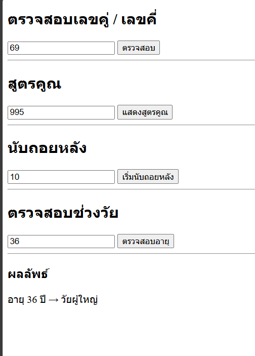
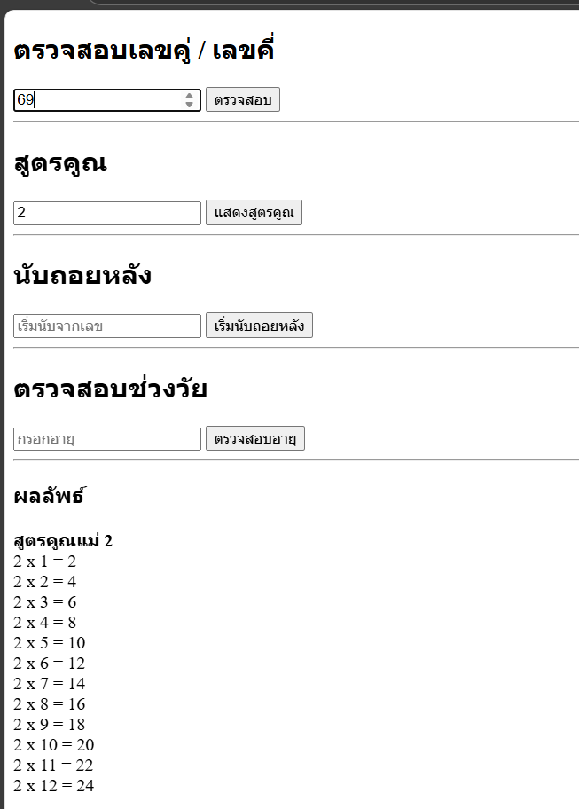
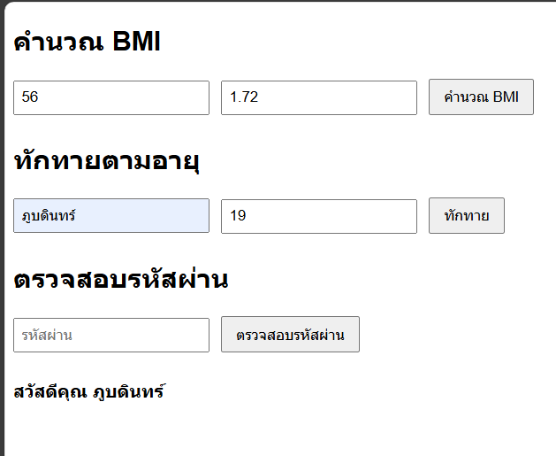
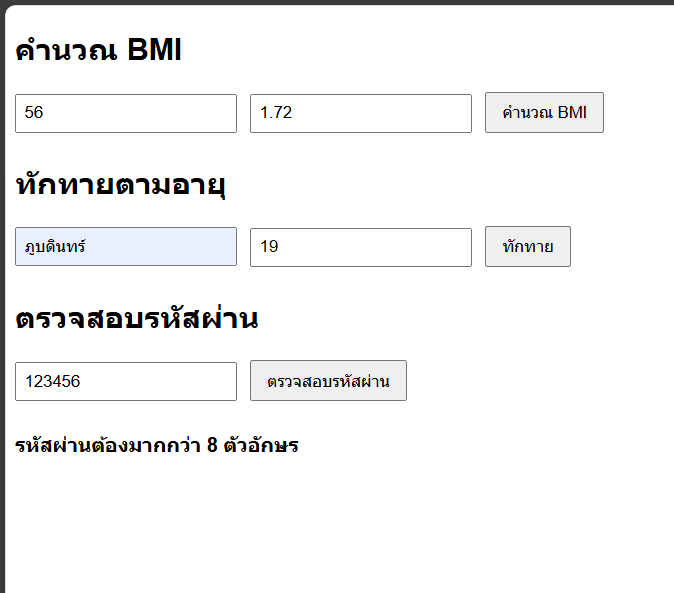
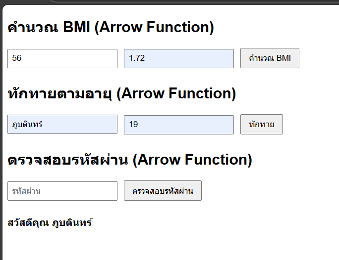
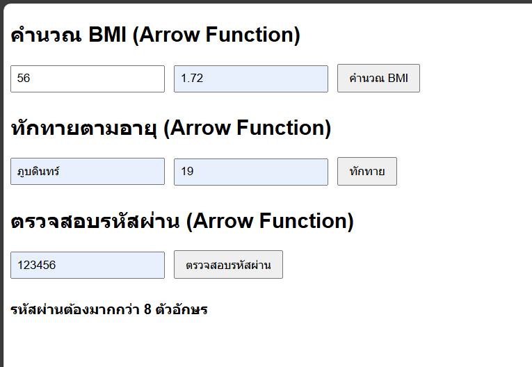
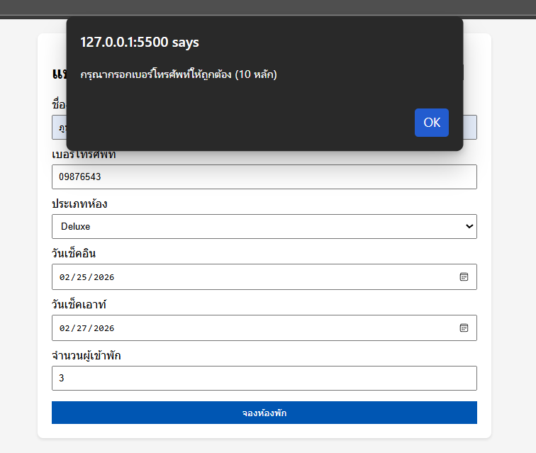
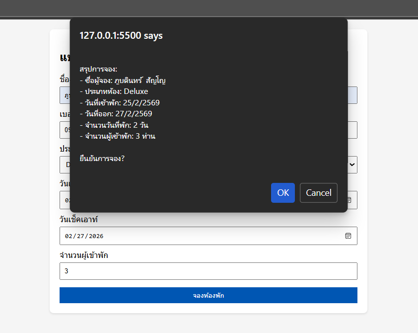

# การทดลอง พื้นฐาน JavaScript และการใช้งานร่วมกับ HTML/CSS
## การทดลองที่ 1 : ทำความรู้จักกับ JavaScript
###  การเพิ่ม JavaScript ลงในเว็บเพจ

JavaScript สามารถเพิ่มลงในเว็บเพจได้ 3 วิธี:

1. แบบ Inline: แทรก scipt ในแต่ละบรรทัดของ HTML Element
```html
<button onclick="alert('สวัสดี!')">คลิกที่นี่</button>
```

2. แบบ Internal Script: เขียน script ใน block   <script> </script>
```html
<script>
    alert('สวัสดี!');
</script>
```

3. แบบ External Script: เขียน script ในไฟล์แล้วเรียกใช้ใน HTML
   ไฟล์ script.js มีข้อมูลดังนี้
```javascript
    alert('สวัสดี!');
```
   ไฟล์ HTML มีการเรียกใช้ script ดังนี้
```html
<script src="script.js"></script>
```

### การทดลองที่ 1.1 : สร้างไฟล์ HTML และทดลองใช้ JavaScript ทั้ง 3 แบบ

สร้างไฟล์ `index.html`:
```html
<!DOCTYPE html>
<html lang="th">
<head>
    <meta charset="UTF-8">
    <title>ทดลอง JavaScript</title>
</head>
<body>
    <!-- Inline JavaScript -->
    <button onclick="alert('คลิกปุ่มที่ 1!')">ปุ่มที่ 1</button>

    <!-- ทดสอบ Internal JavaScript -->
    <button id="btn2">ปุ่มที่ 2</button>

    <!-- ทดสอบ External JavaScript -->
    <button id="btn3" onclick="hello3();">ปุ่มที่ 3</button>

    <!-- Internal JavaScript -->
    <script>
        document.getElementById('btn2').onclick = function() {
            alert('คลิกปุ่มที่ 2!');
        };
    </script>

    <!-- External JavaScript -->
  <!-- ต้องสร้างไฟล์ script.js มีโค้ดโปรแกรมในไฟล์ดังนี้
   function hello3(){
    alert('คลิกปุ่มที่ 3!');
    }
 -->
    <script src="script.js"></script>
</body>
</html>
```

### แบบฝึกปฏิบัติที่ 1: การใช้งาน JavaScript เบื้องต้น

1. สร้างหน้าเว็บที่มีปุ่ม 3 ปุ่ม:
   - ปุ่มที่ 1: ใช้ Inline JavaScript แสดงชื่อนักศึกษา
   - ปุ่มที่ 2: ใช้ Internal JavaScript แสดงวันที่ปัจจุบัน
   - ปุ่มที่ 3: ใช้ External JavaScript แสดงเวลาปัจจุบัน

2. เพิ่มกล่องข้อความและปุ่มสำหรับแสดงผล:
   - มีช่องกรอกข้อความ
   - มีปุ่มเมื่อคลิกแล้วจะแสดงข้อความที่กรอกในช่องข้อความ  (สามารถใช้ document.getElementById('id ของ textbox').value เพื่อดึงข้อมูลในช่อง)
### บันทึกผลการทดลอง 
```html
[<!DOCTYPE html>
<html lang="th">
<head>
    <meta charset="UTF-8">
    <title>แบบฝึก JavaScript</title>
</head>
<body>

    <button onclick="alert('ชื่อ: ภูบดินทร์ สัญโญ')">ปุ่มที่ 1 </button>

    <button id="btn2">ปุ่มที่ 2 </button>

    <button onclick="showTime()">ปุ่มที่ 3 </button>

    <hr>

    <input type="text" id="textbox" placeholder="พิมพ์ข้อความที่นี่">
    <button onclick="showText()">แสดงข้อความ</button>

    <script>
        document.getElementById('btn2').onclick = function() {
            const today = new Date();
            alert("วันที่ปัจจุบัน: " + today.toLocaleDateString());
        };

        function showText() {
            const text = document.getElementById('textbox').value;
            alert("ข้อความที่กรอก: " + text);
        }
    </script>

    <!-- External JavaScript -->
    <script src="script.js"></script>

</body>
</html>
(script.js)
function showTime() {
    const now = new Date();
    alert("เวลาปัจจุบัน: " + now.toLocaleTimeString());
}]
```
**รูปผลการทดลอง**

 )

## การทดลองที่ 2: พื้นฐาน JavaScript
### 2.1 การประกาศตัวแปรและชนิดข้อมูล

JavaScript มีวิธีการประกาศตัวแปร 3 แบบ:
- `var`: ประกาศตัวแปรแบบเดิม (legacy) - ไม่แนะนำให้ใช้ในโค้ดสมัยใหม่
- `let`: ประกาศตัวแปรที่สามารถเปลี่ยนแปลงค่าได้ - เหมาะสำหรับค่าที่ต้องการเปลี่ยนแปลงในภายหลัง
- `const`: ประกาศตัวแปรที่ไม่สามารถเปลี่ยนแปลงค่าได้ - เหมาะสำหรับค่าคงที่

ชนิดข้อมูลพื้นฐานใน JavaScript:
1. Number: ตัวเลขทั้งจำนวนเต็มและทศนิยม
2. String: ข้อความ ใช้เครื่องหมาย '' หรือ ""
3. Boolean: ค่าความจริง true/false
4. Undefined: ตัวแปรที่ยังไม่ได้กำหนดค่า
5. Null: ตัวแปรที่ไม่มีค่า (ต่างจาก undefined)
6. Array
7. Object
   
### ตัวอย่าง การประกาศตัวแปรแต่ละแบบ
```javascript
// ประกาศตัวแปรแบบ let - สามารถเปลี่ยนแปลงค่าได้ในภายหลัง
let name = "สมชาย";     // String เก็บข้อความ
let age = 25;           // Number เก็บตัวเลข
let isStudent = true;   // Boolean เก็บค่าจริง/เท็จ

// ประกาศตัวแปรแบบ const - ไม่สามารถเปลี่ยนแปลงค่าได้หลังจากประกาศ
const PI = 3.14;            // ค่าคงที่ทางคณิตศาสตร์
const DAYS_IN_WEEK = 7;     // ค่าคงที่ที่ไม่ควรเปลี่ยนแปลง

// การเปลี่ยนแปลงค่าตัวแปร
name = "สมหญิง";   // ทำได้เพราะประกาศด้วย let
age = 26;          // สามารถเปลี่ยนค่าได้
// PI = 3.15;      // Error! ไม่สามารถเปลี่ยนค่า const ได้

// ตัวอย่างการใช้งาน undefined และ null
let uninitializedVar;           // มีค่าเป็น undefined โดยอัตโนมัติ
let emptyValue = null;          // กำหนดค่า null อย่างชัดเจน

// ตัวอย่างการประกาศ Array
let fruits = ["แอปเปิ้ล", "กล้วย", "ส้ม"];

// ตัวอย่างการประกาศ Object
let person = {
    name: "สมชาย",
    age: 25,
    isStudent: true
};
```

### 📝 แบบทดสอบที่ 2.1: การทดลองประกาศตัวแปร
1. สร้างตัวแปรเก็บข้อมูล รหัสนักศึกษา ชื่อนักศึกษา คะแนนสอบกลางภาค, คะแนนสอบปลายภาค โดยเลือกใช้ let หรือ const 
2. สร้าง Object สำหรับเก็บข้อมูลนักศึกษา  ประกอบด้วยข้อมูล รหัสนักศึกษา, ชื่อ, สาขาวิชา, เกรดเฉลี่ย

### บันทึกผลการทดลอง 2.1
```html
[<!DOCTYPE html>
<html lang="th">
<head>
    <meta charset="UTF-8">
</head>
<body>


    <button onclick="showData()">แสดงข้อมูลตัวแปร</button>
    <button onclick="showObject()">แสดงข้อมูล Object</button>

    <script>

        const studentId = "68030404";
        const studentName = "ภูบดินทร์ สัญโญ";

        let midtermScore = 30;
        let finalScore = 40;

        function showData() {
            alert(
                "รหัสนักศึกษา: " + studentId + "\n" +
                "ชื่อ: " + studentName + "\n" +
                "คะแนนกลางภาค: " + midtermScore + "\n" +
                "คะแนนปลายภาค: " + finalScore
            );
        }


        const student = {
            id: "68030404",
            name: "ภูบดินทร์ สัญโญ",
            major: "เทคโนโลยีคอมพิวเตอร์",
            gpa: 2.00
        };

        function showObject() {
            alert(
                "ข้อมูลนักศึกษา\n\n" +
                "รหัส: " + student.id + "\n" +
                "ชื่อ: " + student.name + "\n" +
                "สาขา: " + student.major + "\n" +
                "เกรดเฉลี่ย: " + student.gpa
            );
        }
    </script>

</body>
</html>]
```
**รูปผลการทดลอง**

)


### 2.2 การดำเนินการทางคณิตศาสตร์

JavaScript มีตัวดำเนินการทางคณิตศาสตร์พื้นฐานดังนี้:
- `+` การบวก
- `-` การลบ
- `*` การคูณ
- `/` การหาร
- `%` การหารเอาเศษ (modulo)
- `**` การยกกำลัง (exponentiation)
- `++` การเพิ่มค่าทีละ 1 (increment)
- `--` การลดค่าทีละ 1 (decrement)

### แบบฝึกหัด 2.2: ทดลองใช้ตัวดำเนินการทางคณิตศาสตร์
```javascript
// กำหนดค่าตัวแปรเริ่มต้น
let x = 10;
let y = 5;

// การดำเนินการพื้นฐาน
let sum = x + y;      // บวก: 10 + 5 = 15
let diff = x - y;     // ลบ: 10 - 5 = 5
let product = x * y;  // คูณ: 10 * 5 = 50
let quotient = x / y; // หาร: 10 / 5 = 2
let remainder = x % y; // หารเอาเศษ: 10 % 5 = 0 (หาร 5 ลงตัว)

// การเพิ่ม/ลดค่าทีละ 1
let counter = 1;
counter++;            // เพิ่มค่าทีละ 1: counter = 2
counter--;            // ลดค่าทีละ 1: counter = 1

// การยกกำลัง
let squared = x ** 2;  // 10 ยกกำลัง 2 = 100
let cubed = x ** 3;    // 10 ยกกำลัง 3 = 1000

// การใช้ตัวดำเนินการร่วมกับการกำหนดค่า
let number = 5;
number += 3;          // เท่ากับ number = number + 3
number -= 2;          // เท่ากับ number = number - 2
number *= 4;          // เท่ากับ number = number * 4
number /= 2;          // เท่ากับ number = number / 2

```

### 📝 แบบทดสอบที่ 2.2: การคำนวณพื้นฐาน
1. เขียนโปรแกรม กำหนดคะแนน  3 วิชา แล้วหาค่าคะแนนเฉลี่ย แล้วแสดงผลการคำนวณ
2. เขียนโปรแกรม กำหนดชื่อสินค้า ราคาสินค้า คำนวณราคาสินค้าที่รวม VAT 7% แล้วแสดงผลการคำนวณ

### บันทึกผลการทดลอง 2.2
```html
[<!DOCTYPE html>
<html lang="th">
<head>
    <meta charset="UTF-8">
</head>
<body>

    <h2>คำนวณคะแนนเฉลี่ย</h2>

    <input type="number" id="score1" placeholder="คะแนนวิชา 1">
    <input type="number" id="score2" placeholder="คะแนนวิชา 2">
    <input type="number" id="score3" placeholder="คะแนนวิชา 3">

    <button onclick="calcAverage()">คำนวณค่าเฉลี่ย</button>

    <hr>

    <h2>คำนวณราคา + VAT 7%</h2>

    <input type="text" id="productName" placeholder="ชื่อสินค้า">
    <input type="number" id="price" placeholder="ราคา">

    <button onclick="calcVAT()">คำนวณ VAT</button>

    <script>
        function calcAverage() {
            let s1 = Number(document.getElementById("score1").value);
            let s2 = Number(document.getElementById("score2").value);
            let s3 = Number(document.getElementById("score3").value);

            if (!s1 || !s2 || !s3) {
                alert("กรุณากรอกคะแนนให้ครบ");
                return;
            }

            let avg = (s1 + s2 + s3) / 3;

            alert("คะแนนเฉลี่ย = " + avg.toFixed(2));
        }

        function calcVAT() {
            let name = document.getElementById("productName").value;
            let price = Number(document.getElementById("price").value);

            if (!name || !price) {
                alert("กรุณากรอกข้อมูลสินค้าให้ครบ");
                return;
            }

            let vat = price * 0.07;
            let total = price + vat;

            alert(
                "สินค้า: " + name + "\n" +
                "ราคา: " + price + " บาท\n" +
                "VAT 7%: " + vat.toFixed(2) + " บาท\n" +
                "ราคารวม: " + total.toFixed(2) + " บาท"
            );
        }
    </script>

</body>
</html>]
```
**รูปผลการทดลอง**
)

### 2.3 การควบคุมการทำงาน

JavaScript มีโครงสร้างควบคุมการทำงานหลักๆ ดังนี้:

1. เงื่อนไข (Conditionals):
   - `if`: ตรวจสอบเงื่อนไขเดียว
   - `if...else`: ตรวจสอบเงื่อนไขและมีทางเลือก
   - `if...else if...else`: ตรวจสอบหลายเงื่อนไข
   - `switch`: เลือกทำงานตามค่าที่กำหนด

2. การวนซ้ำ (Loops):
   - `for`: วนซ้ำตามจำนวนรอบที่กำหนด
   - `while`: วนซ้ำตราบใดที่เงื่อนไขเป็นจริง
   - `do...while`: ทำงานอย่างน้อย 1 ครั้ง แล้ววนซ้ำตามเงื่อนไข
   - `for...of`: วนซ้ำสำหรับข้อมูลแบบ iterable
   - `for...in`: วนซ้ำสำหรับ properties ใน object


```javascript
// 1. การใช้ if-else
let score = 75;

// ตรวจสอบเงื่อนไขตามลำดับ
if (score >= 80) {         // ถ้าคะแนน >= 80
    console.log("เกรด A");
} else if (score >= 70) {  // ถ้าคะแนน >= 70 แต่ < 80
    console.log("เกรด B");
} else {                   // ถ้าไม่ตรงเงื่อนไขใดเลย
    console.log("เกรด C");
}

// 2. การใช้ switch
let day = 1;
switch (day) {
    case 1:
        console.log("วันจันทร์");
        break;              // break เพื่อออกจาก switch
    case 2:
        console.log("วันอังคาร");
        break;
    default:               // ค่าเริ่มต้นถ้าไม่ตรงกับ case ใดๆ
        console.log("วันอื่นๆ");
}

// 3. การใช้ for loop
// วนซ้ำ 5 รอบ: เริ่มที่ 1, ทำจนถึง 5, เพิ่มค่าทีละ 1
for (let i = 1; i <= 5; i++) {
    console.log("รอบที่", i);
}

// 4. การใช้ while loop
// วนซ้ำตราบใดที่เงื่อนไขเป็นจริง
let count = 1;
while (count <= 3) {      // ทำซ้ำตราบใดที่ count <= 3
    console.log("นับ:", count);
    count++;              // เพิ่มค่า count ทีละ 1
}

// 5. การใช้ do...while loop
// ทำงานอย่างน้อย 1 ครั้ง แล้วค่อยตรวจสอบเงื่อนไข
let num = 1;
do {
    console.log("ตัวเลข:", num);
    num++;
} while (num <= 3);

// 6. การใช้ for...of loop กับ array
let fruits = ['แอปเปิ้ล', 'กล้วย', 'ส้ม'];
for (let fruit of fruits) {
    console.log("ผลไม้:", fruit);
}

// 7. การใช้ for...in loop กับ object
let person = {
    name: 'สมชาย',
    age: 25,
    job: 'โปรแกรมเมอร์'
};
for (let key in person) {
    console.log(key + ":", person[key]);
}

// 8. การใช้เงื่อนไขซ้อน (Nested Conditions)
let age = 18;
let hasPermission = true;

if (age >= 18) {
    if (hasPermission) {
        console.log("สามารถเข้าใช้งานได้");
    } else {
        console.log("ต้องได้รับอนุญาตก่อน");
    }
} else {
    console.log("อายุไม่ถึงเกณฑ์");
}

// 9. การใช้ตัวดำเนินการลอจิคัล (Logical Operators)
let isStudent = true;
let isMember = false;

if (isStudent && isMember) {           // AND (&&)
    console.log("เป็นทั้งนักเรียนและสมาชิก");
} else if (isStudent || isMember) {    // OR (||)
    console.log("เป็นอย่างใดอย่างหนึ่ง");
} else {
    console.log("ไม่เป็นทั้งสองอย่าง");
}

// 10. การใช้ break และ continue
for (let i = 1; i <= 5; i++) {
    if (i === 3) {
        continue;    // ข้ามการทำงานที่เหลือในรอบนี้
    }
    if (i === 4) {
        break;       // ออกจาก loop ทันที
    }
    console.log("ตัวเลข:", i);
}
```


### 📝 แบบทดสอบที่ 2.3: การควบคุมการทำงาน
1. กำหนดตัวเลข และตรวจสอบว่าตัวเลขที่กำหนดเป็นเลขคู่หรือเลขคี่
2. สร้าง loop แบบ for แสดงตารางสูตรคูณ แม่ 2 และ loop แบบ while แสดงสูตรคูณ แม่ 3
3. เขียนโปรแกรมนับถอยหลังจาก 10 ถึง 1
4. เขียนโปรแกรมกำหนดอายุ และตรวจสอบช่วงวัยตามอายุที่กำหนด (กำหนดอายุแต่ละช่วงวัย วัยเด็ก วัยรุ่น วัยผู้ใหญ่)

### บันทึกผลการทดลอง 2.3
```html
[<!DOCTYPE html>
<html lang="th">
<head>
    <meta charset="UTF-8">
    <title>แบบทดสอบ 2.3 (เวอร์ชันสมบูรณ์)</title>
</head>
<body>

    <h2> ตรวจสอบเลขคู่ / เลขคี่</h2>
    <input type="number" id="numberInput" placeholder="กรอกตัวเลข">
    <button onclick="checkEvenOdd()">ตรวจสอบ</button>

    <hr>

    <h2>สูตรคูณ</h2>
    <input type="number" id="multiInput" placeholder="กรอกแม่สูตรคูณ">
    <button onclick="showMultiplication()">แสดงสูตรคูณ</button>

    <hr>

    <h2>นับถอยหลัง</h2>
    <input type="number" id="countdownInput" placeholder="เริ่มนับจากเลข">
    <button onclick="countdown()">เริ่มนับถอยหลัง</button>

    <hr>

    <h2>ตรวจสอบช่วงวัย</h2>
    <input type="number" id="ageInput" placeholder="กรอกอายุ">
    <button onclick="checkAge()">ตรวจสอบอายุ</button>

    <hr>

    <h3>ผลลัพธ์</h3>
    <p id="output"></p>

    <script>
        /******เลขคู่ / เลขคี่ ****/
        function checkEvenOdd() {
            let number = Number(document.getElementById("numberInput").value);

            if (!number && number !== 0) {
                document.getElementById("output").innerHTML = "กรุณากรอกตัวเลข";
                return;
            }

            if (number % 2 === 0) {
                document.getElementById("output").innerHTML =
                    number + " เป็นเลขคู่";
            } else {
                document.getElementById("output").innerHTML =
                    number + " เป็นเลขคี่";
            }
        }

        /******สูตรคูณ *****/
        function showMultiplication() {
            let num = Number(document.getElementById("multiInput").value);

            if (!num && num !== 0) {
                document.getElementById("output").innerHTML = "กรุณากรอกแม่สูตรคูณ";
                return;
            }

            let result = "<b>สูตรคูณแม่ " + num + "</b><br>";

            for (let i = 1; i <= 12; i++) {
                result += num + " x " + i + " = " + (num * i) + "<br>";
            }

            document.getElementById("output").innerHTML = result;
        }

        /*****นับถอยหลัง *******/
        function countdown() {
            let start = Number(document.getElementById("countdownInput").value);

            if (!start && start !== 0) {
                document.getElementById("output").innerHTML = "กรุณากรอกตัวเลขเริ่มต้น";
                return;
            }

            let text = "<b>นับถอยหลังจาก " + start + "</b><br>";

            while (start >= 1) {
                text += start + "<br>";
                start--;
            }

            document.getElementById("output").innerHTML = text;
        }

        /***ช่วงวัย *****/
        function checkAge() {
            let age = Number(document.getElementById("ageInput").value);
            let message;

            if (!age && age !== 0) {
                document.getElementById("output").innerHTML = "กรุณากรอกอายุ";
                return;
            }

            if (age <= 12) {
                message = "วัยเด็ก";
            } else if (age <= 19) {
                message = "วัยรุ่น";
            } else {
                message = "วัยผู้ใหญ่";
            }

            document.getElementById("output").innerHTML =
                "อายุ " + age + " ปี → " + message;
        }
    </script>

</body>
</html>]
```
**รูปผลการทดลอง**
)

### 2.4 Functions และ Arrow Functions

Functions คือกลุ่มคำสั่งที่สามารถนำมาใช้ซ้ำได้ ใน JavaScript มีวิธีการเขียน function 2 แบบหลักๆ:

1. Function แบบปกติ (Regular Functions):
   - ใช้คำสั่ง `function` ในการประกาศ
   - สามารถมีหรือไม่มีพารามิเตอร์ก็ได้
   - สามารถ return ค่ากลับหรือไม่ก็ได้
   - มี `this` context ของตัวเอง

2. Arrow Functions:
   - เป็นวิธีเขียนแบบสั้นที่มาใน ES6
   - ไม่มี `this` context ของตัวเอง
   - เหมาะสำหรับ function สั้นๆ
   - มักใช้ใน callback functions

#### ตัวอย่างการสร้างและเรียกใช้ Function 

```javascript
// 1. Function พื้นฐาน - ไม่มีพารามิเตอร์และไม่ return ค่า
function sayHello() {
    console.log("สวัสดี!");
}
sayHello();  // เรียกใช้ function: แสดง "สวัสดี!"

// 2. Function ที่รับพารามิเตอร์
function greet(name) {
    console.log("สวัสดี " + name);
}
greet("สมชาย");  // แสดง: "สวัสดี สมชาย"

// 3. Function ที่ return ค่า
function add(a, b) {
    return a + b;  // ส่งค่าผลบวกกลับ
}
let sum = add(5, 3);  // sum = 8

// 4. Function ที่มีค่าเริ่มต้นของพารามิเตอร์
function greetWithTitle(name, title = "คุณ") {
    console.log("สวัสดี " + title + " " + name);
}
greetWithTitle("สมชาย");          // แสดง: "สวัสดี คุณ สมชาย"
greetWithTitle("สมชาย", "ดร.");   // แสดง: "สวัสดี ดร. สมชาย"

// 5. Function ที่รับหลายพารามิเตอร์ (Rest Parameters)
function sum(...numbers) {
    let total = 0;
    for (let num of numbers) {
        total += num;
    }
    return total;
}
console.log(sum(1, 2, 3, 4));  // แสดง: 10

// 6. Function ที่ return หลายค่าโดยใช้ Object
function getPersonInfo() {
    return {
        name: "สมชาย",
        age: 25,
        job: "โปรแกรมเมอร์"
    };
}
let person = getPersonInfo();
console.log(person.name);  // แสดง: "สมชาย"

// 7. Function ที่เป็น Method ใน Object
let calculator = {
    add: function(a, b) {
        return a + b;
    },
    subtract: function(a, b) {
        return a - b;
    }
};
console.log(calculator.add(5, 3));      // แสดง: 8
console.log(calculator.subtract(5, 3));  // แสดง: 2

// 8. Nested Function (Function ซ้อน Function)
function outer(x) {
    function inner(y) {
        return x + y;  // inner function สามารถเข้าถึงตัวแปรของ outer function
    }
    return inner;
}
let addFive = outer(5);
console.log(addFive(3));  // แสดง: 8

// 9. Callback Function
function process(callback) {
    console.log("กำลังประมวลผล...");
    callback();  // เรียกใช้ function ที่ส่งเข้ามา
}
process(function() {
    console.log("เสร็จสิ้น!");
});

// 10. Immediately Invoked Function Expression (IIFE)
(function() {
    console.log("Function นี้ทำงานทันทีที่ถูกประกาศ");
})();
```


### 📝 แบบทดสอบที่ 2.4.1: Functions
1. สร้าง function คำนวณค่า BMI (ดัชนีมวลกาย) จากน้ำหนักและส่วนสูง
2. สร้าง function ที่รับชื่อและอายุ แล้วแสดงข้อความทักทายที่เหมาะสมกับอายุ
3. เขียน function ตรวจสอบรหัสผ่านว่ามีความยาวมากกว่า 8 ตัวอักษรหรือไม่

### บันทึกผลการทดลอง 2.4.1
```html
[<!DOCTYPE html>
<html lang="th">
<head>
    <meta charset="UTF-8">
    <title>Functions Test</title>
    <style>
        body { font-family: sans-serif; }
        section { margin-bottom: 25px; }
        input { padding: 6px; margin-right: 6px; }
        button { padding: 6px 12px; cursor: pointer; }
        #result { margin-top: 20px; font-weight: bold; white-space: pre-line; }
    </style>
</head>
<body>

<h2>คำนวณ BMI</h2>
<section>
    <input type="number" id="weightInput" placeholder="น้ำหนัก (kg)">
    <input type="number" id="heightInput" placeholder="ส่วนสูง (m)" step="0.01">
    <button onclick="calculateBMI()">คำนวณ BMI</button>
</section>

<h2>ทักทายตามอายุ</h2>
<section>
    <input type="text" id="nameInput" placeholder="ชื่อ">
    <input type="number" id="ageInput" placeholder="อายุ">
    <button onclick="greetByAge()">ทักทาย</button>
</section>

<h2>ตรวจสอบรหัสผ่าน</h2>
<section>
    <input type="text" id="passwordInput" placeholder="รหัสผ่าน">
    <button onclick="checkPassword()">ตรวจสอบรหัสผ่าน</button>
</section>

<div id="result">ผลลัพธ์</div>

<script>
    function calculateBMI() {
        let weight = Number(document.getElementById("weightInput").value);
        let height = Number(document.getElementById("heightInput").value);

        if (!weight || !height || height <= 0) {
            document.getElementById("result").innerText =
                "กรุณากรอกน้ำหนักและส่วนสูงให้ถูกต้อง (ส่วนสูงเป็นเมตร เช่น 1.70)";
            return;
        }

        let bmi = weight / (height * height);

        document.getElementById("result").innerText =
            "BMI = " + bmi.toFixed(2);
    }


    function greetByAge() {
        let name = document.getElementById("nameInput").value.trim();
        let age = Number(document.getElementById("ageInput").value);

        if (!name || !age) {
            document.getElementById("result").innerText =
                "กรุณากรอกชื่อและอายุ";
            return;
        }

        let message;

        if (age < 13) message = "สวัสดีหนู " + name;
        else if (age < 60) message = "สวัสดีคุณ " + name;
        else message = "สวัสดีครับ/ค่ะ ท่าน " + name;

        document.getElementById("result").innerText = message;
    }


    function checkPassword() {
        let password = document.getElementById("passwordInput").value;

        if (!password) {
            document.getElementById("result").innerText =
                "กรุณากรอกรหัสผ่าน";
            return;
        }

        let message = (password.length > 8)
            ? "รหัสผ่านปลอดภัย"
            : "รหัสผ่านต้องมากกว่า 8 ตัวอักษร";

        document.getElementById("result").innerText = message;
    }
</script>

</body>
</html>]
```
**รูปผลการทดลอง**
)


#### 2.4.2 Arrow Function
Arrow Function เป็นวิธีการเขียน function แบบสั้นๆ ที่มาพร้อมกับ JavaScript เวอร์ชัน ES6

### ตัวอย่างการใช้ Arrow Function
```javascript
// Arrow Function แบบพื้นฐาน
const greet = (name) => {
    return "สวัสดี " + name;
};

// Arrow Function แบบย่อ (ถ้ามีคำสั่งเดียว)
const greetShort = name => "สวัสดี " + name;

// Arrow Function ที่มีหลายพารามิเตอร์
const multiply = (a, b) => a * b;

// Arrow Function ที่ไม่มีพารามิเตอร์
const getRandomNumber = () => Math.random();

// ตัวอย่างการใช้ Arrow Function กับ Array
const numbers = [1, 2, 3, 4, 5];

// การใช้ map กับ Arrow Function
const doubled = numbers.map(num => num * 2);
console.log("เลขคูณ 2:", doubled); // [2, 4, 6, 8, 10]

// การใช้ filter กับ Arrow Function
const evenNumbers = numbers.filter(num => num % 2 === 0);
console.log("เลขคู่:", evenNumbers); // [2, 4]
```
### แบบทดสอบ 2.4.2 เขียนฟังก์ชันต่อไปนี้ในรูปแบบ Arrow function
1. สร้าง function คำนวณค่า BMI (ดัชนีมวลกาย) จากน้ำหนักและส่วนสูง
2. สร้าง function ที่รับชื่อและอายุ แล้วแสดงข้อความทักทายที่เหมาะสมกับอายุ
3. เขียน function ตรวจสอบรหัสผ่านว่ามีความยาวมากกว่า 8 ตัวอักษรหรือไม่

### บันทึกผลการทดลอง 2.4.2
```html
[<!DOCTYPE html>
<html lang="th">
<head>
    <meta charset="UTF-8">
    <title>Arrow Functions Test</title>
    <style>
        body { font-family: sans-serif; }
        section { margin-bottom: 25px; }
        input { padding: 6px; margin-right: 6px; }
        button { padding: 6px 12px; cursor: pointer; }
        #result { margin-top: 20px; font-weight: bold; white-space: pre-line; }
    </style>
</head>
<body>

<h2>คำนวณ BMI (Arrow Function)</h2>
<section>
    <input type="number" id="weightInput" placeholder="น้ำหนัก (kg)">
    <input type="number" id="heightInput" placeholder="ส่วนสูง (m)" step="0.01">
    <button onclick="handleBMI()">คำนวณ BMI</button>
</section>

<h2>ทักทายตามอายุ (Arrow Function)</h2>
<section>
    <input type="text" id="nameInput" placeholder="ชื่อ">
    <input type="number" id="ageInput" placeholder="อายุ">
    <button onclick="handleGreeting()">ทักทาย</button>
</section>

<h2>ตรวจสอบรหัสผ่าน (Arrow Function)</h2>
<section>
    <input type="text" id="passwordInput" placeholder="รหัสผ่าน">
    <button onclick="handlePassword()">ตรวจสอบรหัสผ่าน</button>
</section>

<div id="result">ผลลัพธ์</div>

<script>
    // ===== Arrow Functions =====

    const calculateBMI = (weight, height) => weight / (height * height);

    const greetByAge = (name, age) => {
        if (age < 13) return "สวัสดีหนู " + name;
        if (age < 60) return "สวัสดีคุณ " + name;
        return "สวัสดีครับ/ค่ะ ท่าน " + name;
    };

    const checkPassword = password =>
        password.length > 8 ? "รหัสผ่านปลอดภัย" : "รหัสผ่านต้องมากกว่า 8 ตัวอักษร";

    // ===== Handlers (เชื่อมกับปุ่ม) =====

    const handleBMI = () => {
        const weight = Number(document.getElementById("weightInput").value);
        const height = Number(document.getElementById("heightInput").value);

        if (!weight || !height || height <= 0) {
            document.getElementById("result").innerText =
                "กรุณากรอกน้ำหนักและส่วนสูงให้ถูกต้อง (ส่วนสูงเป็นเมตร เช่น 1.70)";
            return;
        }

        const bmi = calculateBMI(weight, height);

        document.getElementById("result").innerText =
            "BMI = " + bmi.toFixed(2);
    };

    const handleGreeting = () => {
        const name = document.getElementById("nameInput").value.trim();
        const age = Number(document.getElementById("ageInput").value);

        if (!name || !age) {
            document.getElementById("result").innerText =
                "กรุณากรอกชื่อและอายุ";
            return;
        }

        document.getElementById("result").innerText =
            greetByAge(name, age);
    };

    const handlePassword = () => {
        const password = document.getElementById("passwordInput").value;

        if (!password) {
            document.getElementById("result").innerText =
                "กรุณากรอกรหัสผ่าน";
            return;
        }

        document.getElementById("result").innerText =
            checkPassword(password);
    };
</script>

</body>
</html>]
```
**รูปผลการทดลอง**
)


## การทดลองที่ 3 : การใช้ JavaScript กับ HTML และ CSS
### การทดลองที่ 3.1 การสร้างปุ่มและจัดการ Event ด้วย JavaScript
### ตัวอย่างที่ 1 
```html
<!DOCTYPE html>
<html>
<head>
    <title>Event Handling</title>
</head>
<body>
    <button onclick="showMessage()">คลิกที่นี่</button>
    
    <script>
    function showMessage() {
        alert("สวัสดีครับ/ค่ะ!");
    }
    </script>
</body>
</html>
```
### ตัวอย่างที่ 2
```html
<!DOCTYPE html>
<html>
<head>
    <title>Event Handling</title>
</head>
<body>
    Enter name<input type="text" id="name">
    <button onclick="showMessage(document.getElementById('name').value)">คลิกที่นี่</button>
    
    <script>
    function showMessage(name) {
        alert("สวัสดีครับ/ค่ะ คุณ :",name);
    }
    </script>
</body>
</html>
```
### ตัวอย่างที่ 3 
```html
<!DOCTYPE html>
<html>
<head>
    <title>Event Handling</title>
</head>
<body>
    Enter name<input type="text" id="name">
    <p id="output_value"></p>
    <button onclick="showMessage(document.getElementById('name').value)">คลิกที่นี่</button>
    
    <script>
    function showMessage(name) {
        document.getElementById('output_value').innerHTML='Hello' + name;
    }
    </script>
</body>
</html>
```

### แบบทดสอบ 3.1 
1. เขียนเว็บ รับค่าน้ำหนักและส่วนสูง ทำการ คำนวณค่า BMI (ดัชนีมวลกาย) แล้วแสดงผลว่า อ้วน, ผอม หรือ สมส่วน โดยเขียนฟังก์ชันแบบ Arrow function

### บันทึกผลการทดลอง 3.1
```html
[<!DOCTYPE html>
<html lang="th">
<head>
    <meta charset="UTF-8">
    <title>BMI Calculator</title>
    <style>
        body { font-family: sans-serif; }
        input { padding: 6px; margin: 5px; }
        button { padding: 6px 12px; cursor: pointer; }
        #output { margin-top: 15px; font-weight: bold; }
    </style>
</head>
<body>

<h2>คำนวณค่า BMI</h2>

น้ำหนัก (kg)
<input type="number" id="weight" placeholder="เช่น 60">

ส่วนสูง (m)
<input type="number" id="height" placeholder="เช่น 1.70" step="0.01">

<br><br>

<button onclick="handleBMI()">คำนวณ BMI</button>

<p id="output"></p>

<script>
    // ===== Arrow Function คำนวณ BMI =====
    const calculateBMI = (weight, height) => weight / (height * height);

    // ===== Arrow Function แปลผล BMI =====
    const getResult = (bmi) => {
        if (bmi < 18.5) return "ผอม";
        if (bmi < 25) return "สมส่วน";
        return "อ้วน";
    };

    // ===== Event Handler =====
    const handleBMI = () => {
        const weight = Number(document.getElementById("weight").value);
        const height = Number(document.getElementById("height").value);

        if (!weight || !height || height <= 0) {
            document.getElementById("output").innerText =
                "กรุณากรอกข้อมูลให้ถูกต้อง (ส่วนสูงเป็นเมตร เช่น 1.70)";
            return;
        }

        const bmi = calculateBMI(weight, height);
        const result = getResult(bmi);

        document.getElementById("output").innerText =
            "BMI = " + bmi.toFixed(2) + " → " + result;
    };
</script>

</body>
</html>]
```
**รูปผลการทดลอง**
)

## การทดลองที่ 3.2 : การสร้างฟอร์มสำหรับจองห้องพัก
การสร้างฟอร์มลงทะเบียนเพื่อรวบรวมข้อมูลที่จำเป็นสำหรับการจองห้องพัก

### ขั้นตอนที่ 3.2.1: สร้างโครงสร้าง HTML พื้นฐาน

สร้างไฟล์ `index.html` และใส่โค้ดต่อไปนี้:

```html
<!DOCTYPE html>
<html lang="th">
<head>
    <meta charset="UTF-8">
    <meta name="viewport" content="width=device-width, initial-scale=1.0">
    <title>ระบบจองห้องพักออนไลน์</title>
</head>
<body>
    <h1>แบบฟอร์มจองห้องพัก</h1>
    
    <form id="bookingForm">
        <div>
            <label for="fullname">ชื่อ-นามสกุล:</label>
            <input type="text" id="fullname" name="fullname" required>
        </div>

        <div>
            <label for="email">อีเมล:</label>
            <input type="email" id="email" name="email" required>
        </div>

        <div>
            <label for="phone">เบอร์โทรศัพท์:</label>
            <input type="tel" id="phone" name="phone" required>
        </div>

        <div>
            <label for="checkin">วันที่เช็คอิน:</label>
            <input type="date" id="checkin" name="checkin" required>
        </div>

        <div>
            <label for="checkout">วันที่เช็คเอาท์:</label>
            <input type="date" id="checkout" name="checkout" required>
        </div>

        <div>
            <label for="roomtype">ประเภทห้องพัก:</label>
            <select id="roomtype" name="roomtype" required>
                <option value="">กรุณาเลือกประเภทห้องพัก</option>
                <option value="standard">ห้องมาตรฐาน</option>
                <option value="deluxe">ห้องดีลักซ์</option>
                <option value="suite">ห้องสวีท</option>
            </select>
        </div>

        <div>
            <label for="guests">จำนวนผู้เข้าพัก:</label>
            <input type="number" id="guests" name="guests" min="1" max="4" required>
        </div>

        <button type="submit">จองห้องพัก</button>
    </form>
</body>
</html>
```

### ขั้นตอนที่ 3.2.2 : การปรับแต่งด้วย CSS

เพิ่มความสวยงามให้กับฟอร์มด้วย CSS โดยเพิ่ม `<style>` ในส่วน `<head>` ของไฟล์ HTML:

```html
<head>
    <meta charset="UTF-8">
    <meta name="viewport" content="width=device-width, initial-scale=1.0">
    <title>ระบบจองห้องพักออนไลน์</title>
    <style>
        body {
            font-family: 'Sarabun', sans-serif;
            max-width: 600px;
            margin: 0 auto;
            padding: 20px;
            background-color: #f5f5f5;
        }

        h1 {
            color: #2c3e50;
            text-align: center;
            margin-bottom: 30px;
        }

        form {
            background-color: white;
            padding: 20px;
            border-radius: 8px;
            box-shadow: 0 2px 4px rgba(0,0,0,0.1);
        }

        div {
            margin-bottom: 15px;
        }

        label {
            display: block;
            margin-bottom: 5px;
            color: #34495e;
            font-weight: bold;
        }

        input, select {
            width: 100%;
            padding: 8px;
            border: 1px solid #ddd;
            border-radius: 4px;
            box-sizing: border-box;
        }

        input:focus, select:focus {
            outline: none;
            border-color: #3498db;
            box-shadow: 0 0 5px rgba(52,152,219,0.3);
        }

        button {
            background-color: #2980b9;
            color: white;
            padding: 10px 20px;
            border: none;
            border-radius: 4px;
            cursor: pointer;
            width: 100%;
            font-size: 16px;
        }

        button:hover {
            background-color: #3498db;
        }

        @media (max-width: 480px) {
            body {
                padding: 10px;
            }
        }
    </style>
</head>
```

### คำอธิบาย CSS:

1. ใช้ `max-width` และ `margin: 0 auto` เพื่อจัดกึ่งกลางฟอร์ม
2. จัดการ layout ด้วย `display: block` และ `width: 100%`
3. เพิ่มเอฟเฟกต์ `hover` และ `focus`
4. ใช้ `box-shadow` เพื่อเพิ่มมิติการแสดงผล
5. รองรับการแสดงผลบนมือถือด้วย `@media`

### ผลการทดลอง
ในการทดลองนี้ ได้ทำการปรับแต่งหน้าเว็บแบบฟอร์มจองห้องพักด้วย CSS เพื่อให้หน้าเว็บดูสวยงามและใช้งานง่ายขึ้น โดยมีการกำหนดรูปแบบในส่วน body เช่น การตั้งค่าฟอนต์ Sarabun เพื่อให้เหมาะกับภาษาไทย การใช้ max-width และ margin: 0 auto เพื่อจัดกึ่งกลางฟอร์ม และกำหนดสีพื้นหลังเพื่อช่วยให้เนื้อหาเด่นขึ้น นอกจากนี้ยังมีการตกแต่ง form ด้วยพื้นหลังสีขาว เพิ่ม padding ทำมุมโค้ง และใส่เงา box-shadow เพื่อให้ฟอร์มดูมีมิติและทันสมัยมากขึ้น รวมถึงจัด Layout ของ label และ input ให้เรียงตัวเป็นระเบียบด้วย display: block และ width: 100% พร้อมเพิ่มเอฟเฟกต์ focus และ hover เพื่อให้หน้าเว็บดูมีการตอบสนองขณะใช้งาน สุดท้ายได้ใช้ @media เพื่อรองรับการแสดงผลบนมือถือ ทำให้หน้าเว็บสามารถปรับขนาดได้เหมาะสมกับอุปกรณ์ต่าง ๆ

### บันทึกผลการทดลอง 3.2.2
```html
[<!DOCTYPE html>
<html lang="th">
<head>
    <meta charset="UTF-8">
    <meta name="viewport" content="width=device-width, initial-scale=1.0">
    <title>ระบบจองห้องพักออนไลน์</title>

    <style>
        body {
            font-family: sans-serif;
            max-width: 600px;
            margin: 0 auto;
            padding: 20px;
            background-color: #f5f5f5;
        }

        h1 {
            text-align: center;
        }

        form {
            background-color: white;
            padding: 20px;
            border-radius: 8px;
            box-shadow: 0 2px 4px rgba(0,0,0,0.1);
        }

        div { margin-bottom: 15px; }

        label { display: block; margin-bottom: 5px; }

        input, select {
            width: 100%;
            padding: 8px;
            border: 1px solid #ddd;
            border-radius: 4px;
            box-sizing: border-box;
        }

        button {
            background-color: #2980b9;
            color: white;
            padding: 10px;
            border: none;
            border-radius: 4px;
            cursor: pointer;
            width: 100%;
        }

        button:hover { background-color: #3498db; }

        #result {
            margin-top: 20px;
            font-weight: bold;
            background: white;
            padding: 15px;
            border-radius: 8px;
            box-shadow: 0 2px 4px rgba(0,0,0,0.1);
            white-space: pre-line;
        }
    </style>
</head>

<body>

<h1>แบบฟอร์มจองห้องพัก</h1>

<form id="bookingForm">
    <div>
        <label>ชื่อ-นามสกุล:</label>
        <input type="text" id="fullname" required>
    </div>

    <div>
        <label>อีเมล:</label>
        <input type="email" id="email" required>
    </div>

    <div>
        <label>เบอร์โทรศัพท์:</label>
        <input type="tel" id="phone" required>
    </div>

    <div>
        <label>วันที่เช็คอิน:</label>
        <input type="date" id="checkin" required>
    </div>

    <div>
        <label>วันที่เช็คเอาท์:</label>
        <input type="date" id="checkout" required>
    </div>

    <div>
        <label>ประเภทห้องพัก:</label>
        <select id="roomtype" required>
            <option value="">กรุณาเลือกประเภทห้องพัก</option>
            <option value="ห้องมาตรฐาน">ห้องมาตรฐาน</option>
            <option value="ห้องดีลักซ์">ห้องดีลักซ์</option>
            <option value="ห้องสวีท">ห้องสวีท</option>
        </select>
    </div>

    <div>
        <label>จำนวนผู้เข้าพัก:</label>
        <input type="number" id="guests" min="1" max="4" required>
    </div>

    <button type="submit">จองห้องพัก</button>
</form>

<div id="result">ผลลัพธ์การจอง</div>

<script>
    const form = document.getElementById("bookingForm");

    form.addEventListener("submit", (event) => {
        event.preventDefault();

        const fullname = document.getElementById("fullname").value;
        const email = document.getElementById("email").value;
        const phone = document.getElementById("phone").value;
        const checkin = document.getElementById("checkin").value;
        const checkout = document.getElementById("checkout").value;
        const roomtype = document.getElementById("roomtype").value;
        const guests = document.getElementById("guests").value;

        if (checkin >= checkout) {
            document.getElementById("result").innerText =
                "วันที่เช็คเอาท์ต้องมากกว่าวันที่เช็คอิน";
            return;
        }

        document.getElementById("result").innerText =
            "จองห้องพักสำเร็จ ✅\n\n" +
            "ชื่อ: " + fullname + "\n" +
            "อีเมล: " + email + "\n" +
            "เบอร์โทร: " + phone + "\n" +
            "เช็คอิน: " + checkin + "\n" +
            "เช็คเอาท์: " + checkout + "\n" +
            "ประเภทห้อง: " + roomtype + "\n" +
            "จำนวนผู้เข้าพัก: " + guests;
    });
</script>

</body>
</html>]
```
**รูปผลการทดลอง**
)


## ขั้นตอนที่ 3.2.3: การเพิ่มฟังก์ชันด้วย JavaScript

เพิ่มโค้ด JavaScript ก่อนปิด `</body>`:

```html
<script>
    document.getElementById('bookingForm').addEventListener('submit', function(e) {
        e.preventDefault();
        
        const checkin = new Date(document.getElementById('checkin').value);
        const checkout = new Date(document.getElementById('checkout').value);
        const today = new Date();
        
        if (checkin < today) {
            alert('กรุณาเลือกวันเช็คอินที่ยังไม่ผ่านมา');
            return;
        }
        
        if (checkout <= checkin) {
            alert('วันเช็คเอาท์ต้องมาหลังวันเช็คอิน');
            return;
        }
        
        const phone = document.getElementById('phone').value;
        const phoneRegex = /^[0-9]{10}$/;
        if (!phoneRegex.test(phone)) {
            alert('กรุณากรอกเบอร์โทรศัพท์ให้ถูกต้อง (10 หลัก)');
            return;
        }
        
        const days = Math.ceil((checkout - checkin) / (1000 * 60 * 60 * 24));
        
        const roomtype = document.getElementById('roomtype');
        const roomtypeText = roomtype.options[roomtype.selectedIndex].text;
        
        const summary = `
            สรุปการจอง:
            - ชื่อผู้จอง: ${document.getElementById('fullname').value}
            - ประเภทห้อง: ${roomtypeText}
            - วันที่เข้าพัก: ${checkin.toLocaleDateString('th-TH')}
            - วันที่ออก: ${checkout.toLocaleDateString('th-TH')}
            - จำนวนวันที่พัก: ${days} วัน
            - จำนวนผู้เข้าพัก: ${document.getElementById('guests').value} ท่าน
        `;
        
        if (confirm(summary + '\n\nยืนยันการจองห้องพัก?')) {
            alert('จองห้องพักเรียบร้อยแล้ว');
            this.reset();
        }
    });

    document.getElementById('checkin').addEventListener('change', function() {
        document.getElementById('checkout').min = this.value;
    });

    document.getElementById('roomtype').addEventListener('change', function() {
        const guestsInput = document.getElementById('guests');
        if (this.value === 'standard') {
            guestsInput.max = 2;
        } else if (this.value === 'deluxe') {
            guestsInput.max = 3;
        } else if (this.value === 'suite') {
            guestsInput.max = 4;
        }
        
        if (guestsInput.value > guestsInput.max) {
            guestsInput.value = guestsInput.max;
        }
    });
</script>
```

### คำอธิบาย JavaScript:

1. ตรวจสอบความถูกต้องของข้อมูล:
   - วันที่เช็คอินต้องไม่เป็นวันที่ผ่านมาแล้ว
   - วันที่เช็คเอาท์ต้องมาหลังวันเช็คอิน
   - เบอร์โทรศัพท์ต้องมี 10 หลัก

2. เพิ่มฟังก์ชันการโต้ตอบ:
   - แสดงสรุปการจองก่อนยืนยัน
   - รีเซ็ตฟอร์มหลังการจอง
   - ปรับจำนวนผู้เข้าพักตามประเภทห้อง

3. การตรวจสอบแบบ Real-time:
   - ตรวจสอบวันที่เช็คอิน-เช็คเอาท์
   - ปรับจำนวนผู้เข้าพักสูงสุดตามประเภทห้อง
</body>
</html>
```

### ผลการทดลอง
1. การดักจับการกดปุ่ม Submit ของฟอร์ม
ใช้ addEventListener('submit', ...) เพื่อป้องกันไม่ให้ฟอร์มส่งข้อมูลทันทีด้วย preventDefault() ทำให้สามารถตรวจสอบข้อมูลก่อน

2. การตรวจสอบวันที่เช็คอินและเช็คเอาท์
เปรียบเทียบค่าวันที่ที่ผู้ใช้เลือก

ถ้าเช็คอินเป็นวันย้อนหลัง → แจ้งเตือน

ถ้าเช็คเอาท์มาก่อนหรือเท่ากับเช็คอิน → แจ้งเตือน

3. การตรวจสอบเบอร์โทรศัพท์
ใช้ Regular Expression ตรวจสอบว่าเป็นตัวเลข 10 หลัก
ถ้าไม่ตรงเงื่อนไข ระบบจะแสดง alert

4. การคำนวณจำนวนวันที่พัก
นำวันเช็คอินและเช็คเอาท์มาหาผลต่าง เพื่อคำนวณจำนวนวัน และแสดงผลในหน้าต่างยืนยัน

5. การตรวจสอบแบบ Real-time
เมื่อเปลี่ยนวันเช็คอิน ระบบจะปรับค่า min ของวันเช็คเอาท์อัตโนมัติ ป้องกันการเลือกวันผิด

6. การจำกัดจำนวนผู้เข้าพัก
เมื่อเปลี่ยนประเภทห้อง ระบบจะปรับจำนวนผู้เข้าพักสูงสุดให้เหมาะสมกับห้องที่เลือก

สรุปผลการทดลอง

ในการทดลองนี้ ได้ทำการเพิ่ม JavaScript เพื่อควบคุมการทำงานของแบบฟอร์ม โดยเน้นที่การตรวจสอบความถูกต้องของข้อมูล เช่น วันที่และเบอร์โทรศัพท์ รวมถึงเพิ่มการทำงานแบบ Real-time และการจำกัดจำนวนผู้เข้าพักตามประเภทห้อง

ผลที่ได้คือ ฟอร์มสามารถป้องกันการกรอกข้อมูลผิดพลาด แจ้งเตือนข้อผิดพลาดได้ทันที และช่วยให้การใช้งานสะดวกมากขึ้น ทำให้ระบบมีความถูกต้องและใช้งานได้ดีขึ้น

### บันทึกผลการทดลอง 3.2.3
```html
[<!DOCTYPE html>
<html lang="th">
<head>
    <meta charset="UTF-8">
    <title>Booking Form</title>
    <style>
        body {
            font-family: 'Sarabun', sans-serif;
            background-color: #f5f5f5;
            margin: 0;
            padding: 20px;
        }

        form {
            max-width: 600px;
            margin: 0 auto;
            background: white;
            padding: 20px;
            border-radius: 8px;
            box-shadow: 0 2px 4px rgba(0,0,0,0.1);
        }

        label {
            display: block;
            margin-top: 10px;
        }

        input, select, button {
            display: block;
            width: 100%;
            padding: 8px;
            margin-top: 5px;
            box-sizing: border-box;
        }

        input:focus, select:focus {
            border: 1px solid #007bff;
            box-shadow: 0 0 5px rgba(0,123,255,0.5);
            outline: none;
        }

        button {
            margin-top: 15px;
            background-color: #007bff;
            color: white;
            border: none;
            cursor: pointer;
        }

        button:hover {
            background-color: #0056b3;
        }

        @media (max-width: 480px) {
            form {
                padding: 15px;
            }
        }
    </style>
</head>
<body>

<form id="bookingForm">
    <h2>แบบฟอร์มจองห้องพัก</h2>

    <label>ชื่อ-นามสกุล</label>
    <input type="text" id="fullname" required>

    <label>เบอร์โทรศัพท์</label>
    <input type="text" id="phone" required>

    <label>ประเภทห้อง</label>
    <select id="roomtype">
        <option value="standard">Standard</option>
        <option value="deluxe">Deluxe</option>
        <option value="suite">Suite</option>
    </select>

    <label>วันเช็คอิน</label>
    <input type="date" id="checkin" required>

    <label>วันเช็คเอาท์</label>
    <input type="date" id="checkout" required>

    <label>จำนวนผู้เข้าพัก</label>
    <input type="number" id="guests" value="1" min="1">

    <button type="submit">จองห้องพัก</button>
</form>

<script>
document.getElementById('bookingForm').addEventListener('submit', function(e) {
    e.preventDefault();

    const checkin = new Date(document.getElementById('checkin').value);
    const checkout = new Date(document.getElementById('checkout').value);
    const today = new Date();

    today.setHours(0,0,0,0);

    if (checkin < today) {
        alert('กรุณาเลือกวันเช็คอินที่ยังไม่ผ่านมา');
        return;
    }

    if (checkout <= checkin) {
        alert('วันเช็คเอาท์ต้องมาหลังวันเช็คอิน');
        return;
    }

    const phone = document.getElementById('phone').value;
    const phoneRegex = /^[0-9]{10}$/;

    if (!phoneRegex.test(phone)) {
        alert('กรุณากรอกเบอร์โทรศัพท์ให้ถูกต้อง (10 หลัก)');
        return;
    }

    const days = Math.ceil((checkout - checkin) / (1000 * 60 * 60 * 24));

    const roomtype = document.getElementById('roomtype');
    const roomtypeText = roomtype.options[roomtype.selectedIndex].text;

    const summary = `
สรุปการจอง:
- ชื่อผู้จอง: ${document.getElementById('fullname').value}
- ประเภทห้อง: ${roomtypeText}
- วันที่เข้าพัก: ${checkin.toLocaleDateString('th-TH')}
- วันที่ออก: ${checkout.toLocaleDateString('th-TH')}
- จำนวนวันที่พัก: ${days} วัน
- จำนวนผู้เข้าพัก: ${document.getElementById('guests').value} ท่าน
`;

    if (confirm(summary + '\nยืนยันการจอง?')) {
        alert('จองห้องพักเรียบร้อยแล้ว');
        this.reset();
    }
});

document.getElementById('checkin').addEventListener('change', function() {
    document.getElementById('checkout').min = this.value;
});

document.getElementById('roomtype').addEventListener('change', function() {
    const guestsInput = document.getElementById('guests');

    if (this.value === 'standard') guestsInput.max = 2;
    if (this.value === 'deluxe') guestsInput.max = 3;
    if (this.value === 'suite') guestsInput.max = 4;

    if (guestsInput.value > guestsInput.max) {
        guestsInput.value = guestsInput.max;
    }
});
</script>

</body>
</html>]
```
**รูปผลการทดลอง**
)


## คำแนะนำเพิ่มเติม
- ทดลองเขียนโค้ดทุกตัวอย่างด้วยตัวเอง
- ลองปรับเปลี่ยนค่าต่างๆ เพื่อดูผลลัพธ์ที่เปลี่ยนไป
- ใช้ Console ใน Developer Tools ของเบราว์เซอร์เพื่อดูผลลัพธ์และแก้ไขข้อผิดพลาด
- ทำความเข้าใจแต่ละบรรทัดของโค้ดก่อนที่จะไปศึกษาหัวข้อถัดไป (ใช้ GenAI เพื่อช่วยในการอธิบายได้)

## แหล่งเรียนรู้เพิ่มเติม
- MDN Web Docs: https://developer.mozilla.org/th/docs/Web/JavaScript
- W3Schools: https://www.w3schools.com/js/
- JavaScript.info: https://javascript.info/
