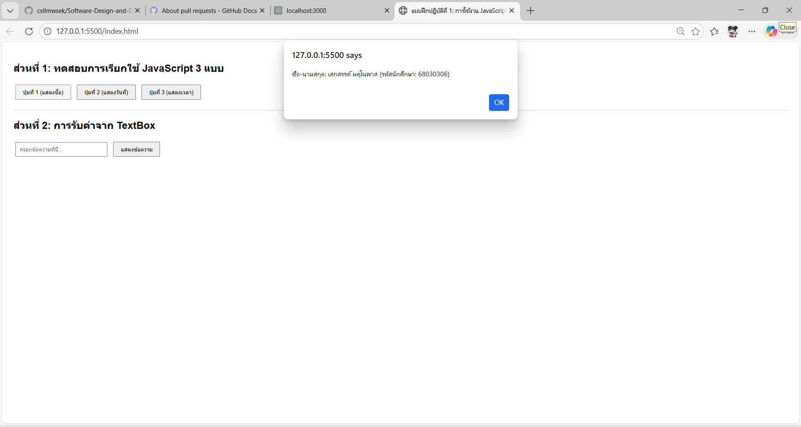
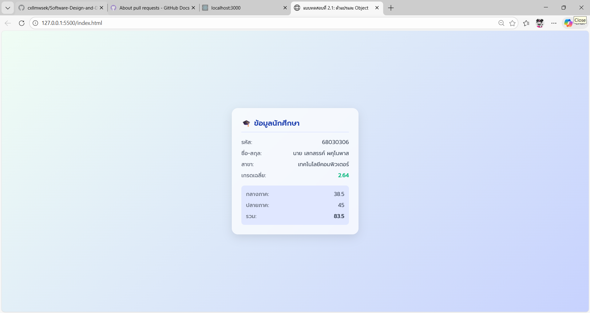
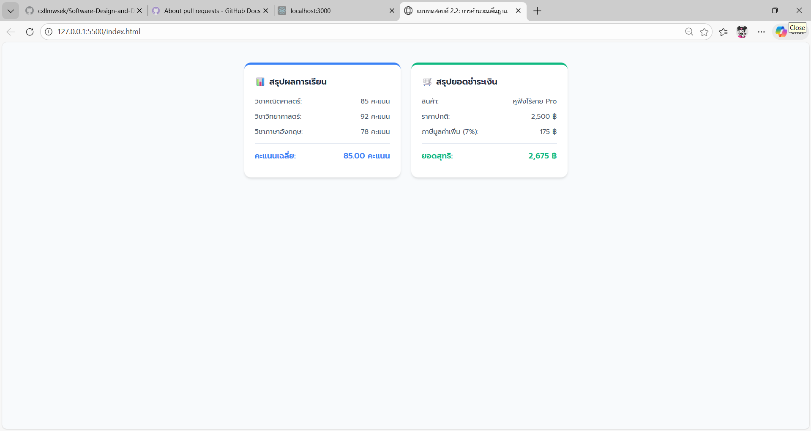
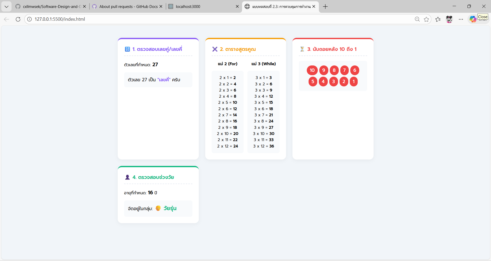
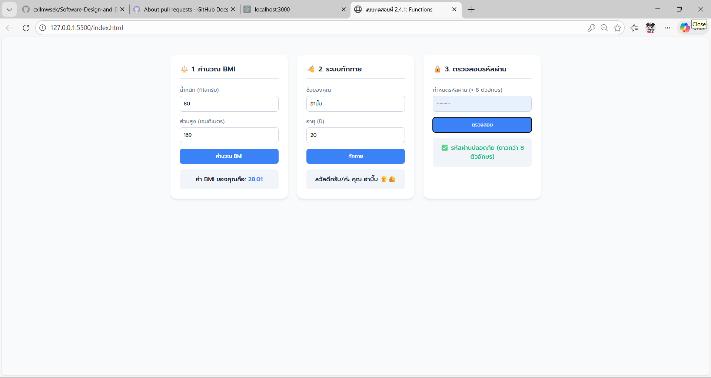
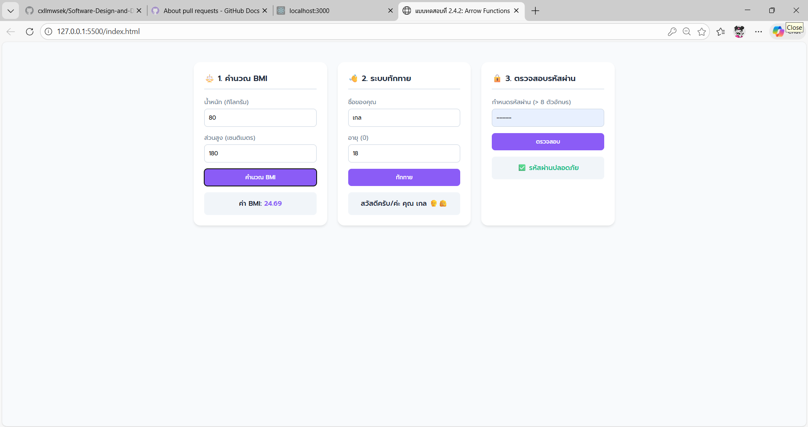
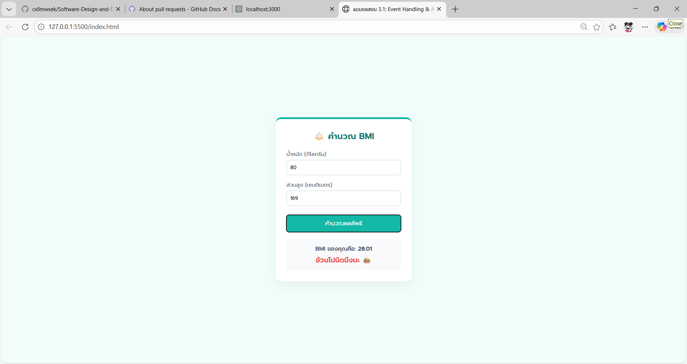
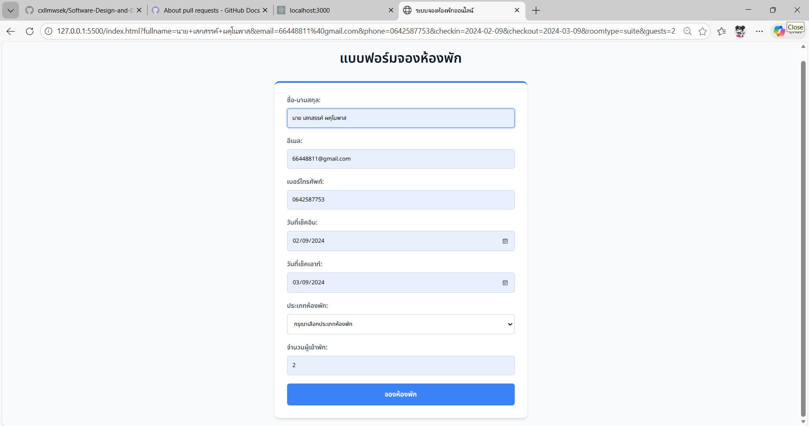
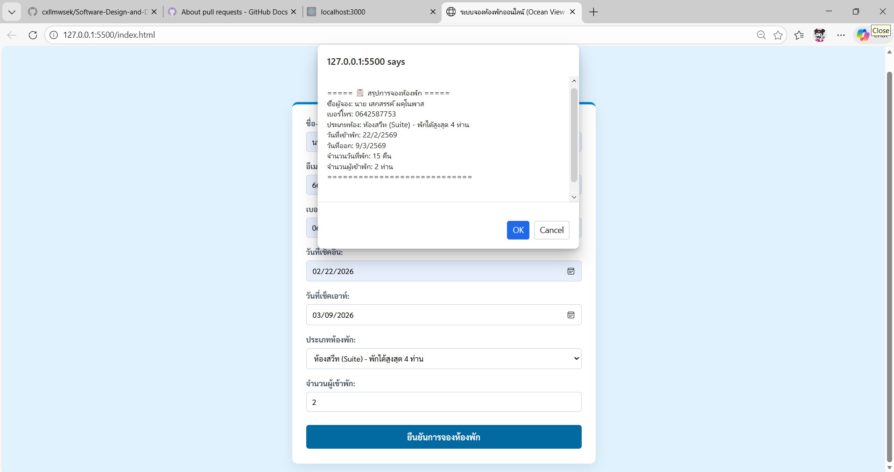
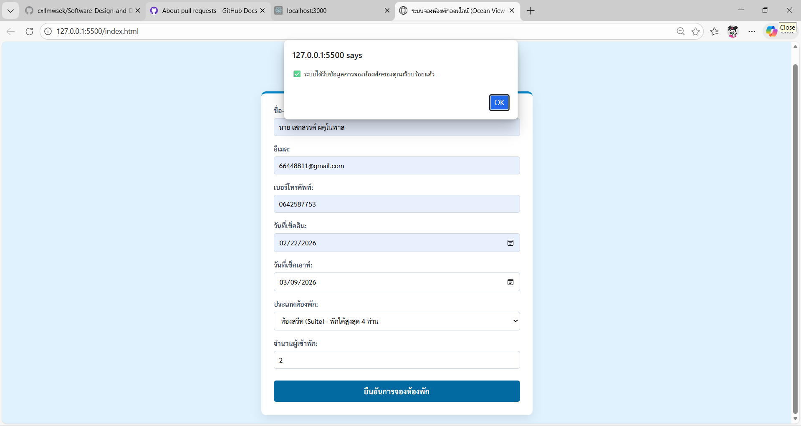

# การทดลอง พื้นฐาน JavaScript และการใช้งานร่วมกับ HTML/CSS
## การทดลองที่ 1 : ทำความรู้จักกับ JavaScript
###  การเพิ่ม JavaScript ลงในเว็บเพจ

JavaScript สามารถเพิ่มลงในเว็บเพจได้ 3 วิธี:

1. แบบ Inline: แทรก scipt ในแต่ละบรรทัดของ HTML Element
```html
<button onclick="alert('สวัสดี!')">คลิกที่นี่</button>
```

2. แบบ Internal Script: เขียน script ใน block   <script> </script>
```html
<script>
    alert('สวัสดี!');
</script>
```

3. แบบ External Script: เขียน script ในไฟล์แล้วเรียกใช้ใน HTML
   ไฟล์ script.js มีข้อมูลดังนี้
```javascript
    alert('สวัสดี!');
```
   ไฟล์ HTML มีการเรียกใช้ script ดังนี้
```html
<script src="script.js"></script>
```

### การทดลองที่ 1.1 : สร้างไฟล์ HTML และทดลองใช้ JavaScript ทั้ง 3 แบบ

สร้างไฟล์ `index.html`:
```html
<!DOCTYPE html>
<html lang="th">
<head>
    <meta charset="UTF-8">
    <title>ทดลอง JavaScript</title>
</head>
<body>
    <!-- Inline JavaScript -->
    <button onclick="alert('คลิกปุ่มที่ 1!')">ปุ่มที่ 1</button>

    <!-- ทดสอบ Internal JavaScript -->
    <button id="btn2">ปุ่มที่ 2</button>

    <!-- ทดสอบ External JavaScript -->
    <button id="btn3" onclick="hello3();">ปุ่มที่ 3</button>

    <!-- Internal JavaScript -->
    <script>
        document.getElementById('btn2').onclick = function() {
            alert('คลิกปุ่มที่ 2!');
        };
    </script>

    <!-- External JavaScript -->
  <!-- ต้องสร้างไฟล์ script.js มีโค้ดโปรแกรมในไฟล์ดังนี้
   function hello3(){
    alert('คลิกปุ่มที่ 3!');
    }
 -->
    <script src="script.js"></script>
</body>
</html>
```

### แบบฝึกปฏิบัติที่ 1: การใช้งาน JavaScript เบื้องต้น

1. สร้างหน้าเว็บที่มีปุ่ม 3 ปุ่ม:
   - ปุ่มที่ 1: ใช้ Inline JavaScript แสดงชื่อนักศึกษา
   - ปุ่มที่ 2: ใช้ Internal JavaScript แสดงวันที่ปัจจุบัน
   - ปุ่มที่ 3: ใช้ External JavaScript แสดงเวลาปัจจุบัน

2. เพิ่มกล่องข้อความและปุ่มสำหรับแสดงผล:
   - มีช่องกรอกข้อความ
   - มีปุ่มเมื่อคลิกแล้วจะแสดงข้อความที่กรอกในช่องข้อความ  (สามารถใช้ document.getElementById('id ของ textbox').value เพื่อดึงข้อมูลในช่อง)
### บันทึกผลการทดลอง 
```html
[<!DOCTYPE html>
<html lang="th">
<head>
    <meta charset="UTF-8">
    <title>แบบฝึกปฏิบัติที่ 1: การใช้งาน JavaScript เบื้องต้น</title>
    <style>
        body { font-family: sans-serif; padding: 20px; }
        button { padding: 8px 16px; margin: 5px; cursor: pointer; }
        input { padding: 8px; margin: 5px; width: 200px; }
        hr { margin: 20px 0; border: 0; border-top: 1px solid #ccc; }
    </style>
</head>
<body>
    <h2>ส่วนที่ 1: ทดสอบการเรียกใช้ JavaScript 3 แบบ</h2>
    
    <button onclick="alert('ชื่อ-นามสกุล: เสกสรรค์ ผคุโนพาส (รหัสนักศึกษา: 68030306)')">
        ปุ่มที่ 1 (แสดงชื่อ)
    </button>

    <button id="btn-date">
        ปุ่มที่ 2 (แสดงวันที่)
    </button>

    <button onclick="showTime()">
        ปุ่มที่ 3 (แสดงเวลา)
    </button>

    <hr>

    <h2>ส่วนที่ 2: การรับค่าจาก TextBox</h2>
    <input type="text" id="myInput" placeholder="กรอกข้อความที่นี่...">
    <button onclick="showText()">แสดงข้อความ</button>

    <script>
        // โค้ดสำหรับปุ่มที่ 2: แสดงวันที่ปัจจุบัน
        document.getElementById('btn-date').onclick = function() {
            // สร้าง object Date เพื่อดึงวันเวลาปัจจุบัน
            const currentDate = new Date();
            // แปลงเป็นวันที่แบบไทย (toLocaleDateString)
            alert('วันที่ปัจจุบัน: ' + currentDate.toLocaleDateString('th-TH'));
        };

        // โค้ดสำหรับดึงข้อมูลจากช่องกรอกข้อความ
        function showText() {
            // ใช้ id เพื่อเข้าถึง element input และดึงค่า .value ออกมา
            const textValue = document.getElementById('myInput').value;
            
            // เช็คว่าผู้ใช้พิมพ์อะไรมาหรือเปล่า
            if(textValue === "") {
                alert("คุณยังไม่ได้กรอกข้อความเลย!");
            } else {
                alert("ข้อความที่คุณกรอกคือ: " + textValue);
            }
        }
    </script>

    <script src="script.js"></script>
</body>
</html>]

javascript 
 function showTime() {
    // สร้าง object Date
    const currentTime = new Date();
    // แปลงเป็นเวลาแบบไทย (ชั่วโมง:นาที:วินาที)
    alert('เวลาปัจจุบัน: ' + currentTime.toLocaleTimeString('th-TH'));
}
```
**รูปผลการทดลอง**
](images/image.png)

## การทดลองที่ 2: พื้นฐาน JavaScript
### 2.1 การประกาศตัวแปรและชนิดข้อมูล

JavaScript มีวิธีการประกาศตัวแปร 3 แบบ:
- `var`: ประกาศตัวแปรแบบเดิม (legacy) - ไม่แนะนำให้ใช้ในโค้ดสมัยใหม่
- `let`: ประกาศตัวแปรที่สามารถเปลี่ยนแปลงค่าได้ - เหมาะสำหรับค่าที่ต้องการเปลี่ยนแปลงในภายหลัง
- `const`: ประกาศตัวแปรที่ไม่สามารถเปลี่ยนแปลงค่าได้ - เหมาะสำหรับค่าคงที่

ชนิดข้อมูลพื้นฐานใน JavaScript:
1. Number: ตัวเลขทั้งจำนวนเต็มและทศนิยม
2. String: ข้อความ ใช้เครื่องหมาย '' หรือ ""
3. Boolean: ค่าความจริง true/false
4. Undefined: ตัวแปรที่ยังไม่ได้กำหนดค่า
5. Null: ตัวแปรที่ไม่มีค่า (ต่างจาก undefined)
6. Array
7. Object
   
### ตัวอย่าง การประกาศตัวแปรแต่ละแบบ
```javascript
// ประกาศตัวแปรแบบ let - สามารถเปลี่ยนแปลงค่าได้ในภายหลัง
let name = "สมชาย";     // String เก็บข้อความ
let age = 25;           // Number เก็บตัวเลข
let isStudent = true;   // Boolean เก็บค่าจริง/เท็จ

// ประกาศตัวแปรแบบ const - ไม่สามารถเปลี่ยนแปลงค่าได้หลังจากประกาศ
const PI = 3.14;            // ค่าคงที่ทางคณิตศาสตร์
const DAYS_IN_WEEK = 7;     // ค่าคงที่ที่ไม่ควรเปลี่ยนแปลง

// การเปลี่ยนแปลงค่าตัวแปร
name = "สมหญิง";   // ทำได้เพราะประกาศด้วย let
age = 26;          // สามารถเปลี่ยนค่าได้
// PI = 3.15;      // Error! ไม่สามารถเปลี่ยนค่า const ได้

// ตัวอย่างการใช้งาน undefined และ null
let uninitializedVar;           // มีค่าเป็น undefined โดยอัตโนมัติ
let emptyValue = null;          // กำหนดค่า null อย่างชัดเจน

// ตัวอย่างการประกาศ Array
let fruits = ["แอปเปิ้ล", "กล้วย", "ส้ม"];

// ตัวอย่างการประกาศ Object
let person = {
    name: "สมชาย",
    age: 25,
    isStudent: true
};
```

### 📝 แบบทดสอบที่ 2.1: การทดลองประกาศตัวแปร
1. สร้างตัวแปรเก็บข้อมูล รหัสนักศึกษา ชื่อนักศึกษา คะแนนสอบกลางภาค, คะแนนสอบปลายภาค โดยเลือกใช้ let หรือ const 
2. สร้าง Object สำหรับเก็บข้อมูลนักศึกษา  ประกอบด้วยข้อมูล รหัสนักศึกษา, ชื่อ, สาขาวิชา, เกรดเฉลี่ย

### บันทึกผลการทดลอง 2.1
```html
[<!DOCTYPE html>
<html lang="th">
<head>
    <meta charset="UTF-8">
    <meta name="viewport" content="width=device-width, initial-scale=1.0">
    <title>แบบทดสอบที่ 2.1: ตัวแปรและ Object</title>
    <link href="https://fonts.googleapis.com/css2?family=Prompt:wght@300;400;500;600&display=swap" rel="stylesheet">
    <style>
        body {
            font-family: 'Prompt', sans-serif;
            background: linear-gradient(135deg, #f0fdf4, #c7d2fe);
            min-height: 100vh;
            display: flex;
            justify-content: center;
            align-items: center;
            margin: 0;
        }
        .student-card {
            background: rgba(255, 255, 255, 0.7);
            backdrop-filter: blur(10px);
            border: 1px solid rgba(255, 255, 255, 0.5);
            padding: 30px;
            border-radius: 20px;
            box-shadow: 0 10px 30px rgba(0, 0, 0, 0.1);
            width: 350px;
        }
        .student-card h2 {
            margin-top: 0;
            color: #1e40af;
            border-bottom: 2px solid #e0e7ff;
            padding-bottom: 10px;
        }
        .info-row {
            display: flex;
            justify-content: space-between;
            margin-bottom: 10px;
            font-size: 1.1rem;
            color: #374151;
        }
        .label { font-weight: 500; color: #6b7280; }
        .score-box {
            background: #e0e7ff;
            padding: 15px;
            border-radius: 10px;
            margin-top: 20px;
        }
    </style>
</head>
<body>

    <div class="student-card">
        <h2>🎓 ข้อมูลนักศึกษา</h2>
        
        <div class="info-row"><span class="label">รหัส:</span> <span id="display-id">-</span></div>
        <div class="info-row"><span class="label">ชื่อ-สกุล:</span> <span id="display-name">-</span></div>
        <div class="info-row"><span class="label">สาขา:</span> <span id="display-major">-</span></div>
        <div class="info-row"><span class="label">เกรดเฉลี่ย:</span> <span id="display-gpa" style="color: #10b981; font-weight: bold;">-</span></div>
        
        <div class="score-box">
            <div class="info-row"><span class="label">กลางภาค:</span> <span id="display-midterm">-</span></div>
            <div class="info-row"><span class="label">ปลายภาค:</span> <span id="display-final">-</span></div>
            <div class="info-row" style="margin-bottom:0; font-weight:600;"><span class="label">รวม:</span> <span id="display-total">-</span></div>
        </div>
    </div>

    <script>
        // ==========================================
        //  1. สร้างตัวแปรเก็บข้อมูล (รหัส, ชื่อ, กลางภาค, ปลายภาค)
        // ==========================================
        // ใช้ const สำหรับรหัสนักศึกษาเพราะเป็นค่าที่ไม่ควรเปลี่ยนแปลง
        const studentIdVar = "661234567"; 
        
        // ใช้ let สำหรับชื่อ (เผื่อเปลี่ยนชื่อ) และคะแนนสอบ (สามารถอัปเดตค่าได้)
        let studentNameVar = "สมหญิง รักเรียน";
        let midtermScore = 38.5;
        let finalScore = 45.0;

        // ==========================================
        //  2. สร้าง Object สำหรับเก็บข้อมูลนักศึกษา
        // ==========================================
        const studentObject = {
            id: "68030306",
            name: "นาย เสกสรรค์ ผคุโนพาส",
            major: "เทคโนโลยีคอมพิวเตอร์",
            gpa: 2.64
        };

        // ==========================================
        // โค้ดส่วนเสริม (ของแถม): นำข้อมูลที่สร้างไว้ไปแสดงบนหน้าเว็บ (DOM Manipulation)
        // ==========================================
        
        // นำข้อมูลจาก Object ไปใส่ใน HTML
        document.getElementById('display-id').innerText = studentObject.id;
        document.getElementById('display-name').innerText = studentObject.name;
        document.getElementById('display-major').innerText = studentObject.major;
        document.getElementById('display-gpa').innerText = studentObject.gpa;

        // นำข้อมูลจากตัวแปรเดี่ยวๆ ไปใส่ใน HTML (ส่วนคะแนน)
        document.getElementById('display-midterm').innerText = midtermScore;
        document.getElementById('display-final').innerText = finalScore;
        
        // คำนวณคะแนนรวมแล้วแสดงผล
        let totalScore = midtermScore + finalScore;
        document.getElementById('display-total').innerText = totalScore;

    </script>
</body>
</html>]
```
**รูปผลการทดลอง**
](images/image.png)


### 2.2 การดำเนินการทางคณิตศาสตร์

JavaScript มีตัวดำเนินการทางคณิตศาสตร์พื้นฐานดังนี้:
- `+` การบวก
- `-` การลบ
- `*` การคูณ
- `/` การหาร
- `%` การหารเอาเศษ (modulo)
- `**` การยกกำลัง (exponentiation)
- `++` การเพิ่มค่าทีละ 1 (increment)
- `--` การลดค่าทีละ 1 (decrement)

### แบบฝึกหัด 2.2: ทดลองใช้ตัวดำเนินการทางคณิตศาสตร์
```javascript
// กำหนดค่าตัวแปรเริ่มต้น
let x = 10;
let y = 5;

// การดำเนินการพื้นฐาน
let sum = x + y;      // บวก: 10 + 5 = 15
let diff = x - y;     // ลบ: 10 - 5 = 5
let product = x * y;  // คูณ: 10 * 5 = 50
let quotient = x / y; // หาร: 10 / 5 = 2
let remainder = x % y; // หารเอาเศษ: 10 % 5 = 0 (หาร 5 ลงตัว)

// การเพิ่ม/ลดค่าทีละ 1
let counter = 1;
counter++;            // เพิ่มค่าทีละ 1: counter = 2
counter--;            // ลดค่าทีละ 1: counter = 1

// การยกกำลัง
let squared = x ** 2;  // 10 ยกกำลัง 2 = 100
let cubed = x ** 3;    // 10 ยกกำลัง 3 = 1000

// การใช้ตัวดำเนินการร่วมกับการกำหนดค่า
let number = 5;
number += 3;          // เท่ากับ number = number + 3
number -= 2;          // เท่ากับ number = number - 2
number *= 4;          // เท่ากับ number = number * 4
number /= 2;          // เท่ากับ number = number / 2

```

### 📝 แบบทดสอบที่ 2.2: การคำนวณพื้นฐาน
1. เขียนโปรแกรม กำหนดคะแนน  3 วิชา แล้วหาค่าคะแนนเฉลี่ย แล้วแสดงผลการคำนวณ
2. เขียนโปรแกรม กำหนดชื่อสินค้า ราคาสินค้า คำนวณราคาสินค้าที่รวม VAT 7% แล้วแสดงผลการคำนวณ

### บันทึกผลการทดลอง 2.2
```html
[<!DOCTYPE html>
<html lang="th">
<head>
    <meta charset="UTF-8">
    <meta name="viewport" content="width=device-width, initial-scale=1.0">
    <title>แบบทดสอบที่ 2.2: การคำนวณพื้นฐาน</title>
    <link href="https://fonts.googleapis.com/css2?family=Prompt:wght@300;400;500;600&display=swap" rel="stylesheet">
    <style>
        /* 🎨 สไตล์การ์ดแบบ Clean & Modern */
        body {
            font-family: 'Prompt', sans-serif;
            background-color: #f8fafc;
            display: flex;
            justify-content: center;
            align-items: flex-start;
            gap: 25px;
            padding: 40px 20px;
            flex-wrap: wrap; /* ให้การ์ดปัดตกบรรทัดใหม่ได้ในจอมือถือ */
        }
        .card {
            background: #ffffff;
            border-radius: 16px;
            padding: 25px;
            width: 320px;
            box-shadow: 0 4px 6px -1px rgba(0,0,0,0.1), 0 2px 4px -1px rgba(0,0,0,0.06);
            /* ใช้ตัวแปรสีที่กำหนดแบบ Inline ช่วยทำแถบสีด้านบนการ์ด */
            border-top: 5px solid var(--theme-color); 
        }
        .card-title {
            font-size: 1.25rem;
            font-weight: 600;
            margin-bottom: 20px;
            color: #1e293b;
        }
        .data-row {
            display: flex;
            justify-content: space-between;
            margin-bottom: 12px;
            color: #475569;
        }
        .divider {
            height: 1px;
            background: #e2e8f0;
            margin: 15px 0;
        }
        .highlight {
            font-weight: 600;
            color: var(--theme-color);
            font-size: 1.15rem;
        }
    </style>
</head>
<body>

    <div class="card" style="--theme-color: #3b82f6;">
        <div class="card-title">📊 สรุปผลการเรียน</div>
        <div class="data-row"><span>วิชาคณิตศาสตร์:</span> <span id="s1"></span></div>
        <div class="data-row"><span>วิชาวิทยาศาสตร์:</span> <span id="s2"></span></div>
        <div class="data-row"><span>วิชาภาษาอังกฤษ:</span> <span id="s3"></span></div>
        <div class="divider"></div>
        <div class="data-row"><span class="highlight">คะแนนเฉลี่ย:</span> <span id="avg" class="highlight"></span></div>
    </div>

    <div class="card" style="--theme-color: #10b981;">
        <div class="card-title">🛒 สรุปยอดชำระเงิน</div>
        <div class="data-row"><span>สินค้า:</span> <span id="p-name"></span></div>
        <div class="data-row"><span>ราคาปกติ:</span> <span id="p-price"></span></div>
        <div class="data-row"><span>ภาษีมูลค่าเพิ่ม (7%):</span> <span id="p-vat"></span></div>
        <div class="divider"></div>
        <div class="data-row"><span class="highlight">ยอดสุทธิ:</span> <span id="p-total" class="highlight"></span></div>
    </div>

    <script>
        // ==========================================
        // 📝 ข้อ 1: คำนวณคะแนนเฉลี่ย 3 วิชา
        // ==========================================
        let mathScore = 85;
        let scienceScore = 92;
        let englishScore = 78;

        // บวกคะแนนทั้งหมดก่อน แล้วค่อยหาร 3 (ต้องใส่วงเล็บเพื่อให้ทำบวกก่อนหาร)
        let totalScore = (mathScore + scienceScore + englishScore);
        let averageScore = totalScore / 3;

        // แสดงผล
        document.getElementById('s1').innerText = mathScore + " คะแนน";
        document.getElementById('s2').innerText = scienceScore + " คะแนน";
        document.getElementById('s3').innerText = englishScore + " คะแนน";
        // .toFixed(2) คือเวทมนตร์ที่ช่วยปัดเศษให้เหลือทศนิยม 2 ตำแหน่งครับ
        document.getElementById('avg').innerText = averageScore.toFixed(2) + " คะแนน";


        // ==========================================
        // 📝 ข้อ 2: คำนวณราคาสินค้ารวม VAT 7%
        // ==========================================
        let productName = "หูฟังไร้สาย Pro";
        let basePrice = 2500;
        
        // คำนวณหา VAT 7% (เทียบเท่ากับ 0.07 หรือ 7/100)
        let vatAmount = basePrice * 0.07;
        
        // นำราคาปกติ มาบวกกับ ภาษีที่คำนวณได้
        let totalPrice = basePrice + vatAmount;

        // แสดงผล
        document.getElementById('p-name').innerText = productName;
        // .toLocaleString() คือเวทมนตร์ที่ช่วยใส่ลูกน้ำ (,) ให้ตัวเลข เช่น 2500 -> 2,500
        document.getElementById('p-price').innerText = basePrice.toLocaleString() + " ฿";
        document.getElementById('p-vat').innerText = vatAmount.toLocaleString() + " ฿";
        document.getElementById('p-total').innerText = totalPrice.toLocaleString() + " ฿";
    </script>
</body>
</html>]
```
**รูปผลการทดลอง**
](images/image.png)

### 2.3 การควบคุมการทำงาน

JavaScript มีโครงสร้างควบคุมการทำงานหลักๆ ดังนี้:

1. เงื่อนไข (Conditionals):
   - `if`: ตรวจสอบเงื่อนไขเดียว
   - `if...else`: ตรวจสอบเงื่อนไขและมีทางเลือก
   - `if...else if...else`: ตรวจสอบหลายเงื่อนไข
   - `switch`: เลือกทำงานตามค่าที่กำหนด

2. การวนซ้ำ (Loops):
   - `for`: วนซ้ำตามจำนวนรอบที่กำหนด
   - `while`: วนซ้ำตราบใดที่เงื่อนไขเป็นจริง
   - `do...while`: ทำงานอย่างน้อย 1 ครั้ง แล้ววนซ้ำตามเงื่อนไข
   - `for...of`: วนซ้ำสำหรับข้อมูลแบบ iterable
   - `for...in`: วนซ้ำสำหรับ properties ใน object


```javascript
// 1. การใช้ if-else
let score = 75;

// ตรวจสอบเงื่อนไขตามลำดับ
if (score >= 80) {         // ถ้าคะแนน >= 80
    console.log("เกรด A");
} else if (score >= 70) {  // ถ้าคะแนน >= 70 แต่ < 80
    console.log("เกรด B");
} else {                   // ถ้าไม่ตรงเงื่อนไขใดเลย
    console.log("เกรด C");
}

// 2. การใช้ switch
let day = 1;
switch (day) {
    case 1:
        console.log("วันจันทร์");
        break;              // break เพื่อออกจาก switch
    case 2:
        console.log("วันอังคาร");
        break;
    default:               // ค่าเริ่มต้นถ้าไม่ตรงกับ case ใดๆ
        console.log("วันอื่นๆ");
}

// 3. การใช้ for loop
// วนซ้ำ 5 รอบ: เริ่มที่ 1, ทำจนถึง 5, เพิ่มค่าทีละ 1
for (let i = 1; i <= 5; i++) {
    console.log("รอบที่", i);
}

// 4. การใช้ while loop
// วนซ้ำตราบใดที่เงื่อนไขเป็นจริง
let count = 1;
while (count <= 3) {      // ทำซ้ำตราบใดที่ count <= 3
    console.log("นับ:", count);
    count++;              // เพิ่มค่า count ทีละ 1
}

// 5. การใช้ do...while loop
// ทำงานอย่างน้อย 1 ครั้ง แล้วค่อยตรวจสอบเงื่อนไข
let num = 1;
do {
    console.log("ตัวเลข:", num);
    num++;
} while (num <= 3);

// 6. การใช้ for...of loop กับ array
let fruits = ['แอปเปิ้ล', 'กล้วย', 'ส้ม'];
for (let fruit of fruits) {
    console.log("ผลไม้:", fruit);
}

// 7. การใช้ for...in loop กับ object
let person = {
    name: 'สมชาย',
    age: 25,
    job: 'โปรแกรมเมอร์'
};
for (let key in person) {
    console.log(key + ":", person[key]);
}

// 8. การใช้เงื่อนไขซ้อน (Nested Conditions)
let age = 18;
let hasPermission = true;

if (age >= 18) {
    if (hasPermission) {
        console.log("สามารถเข้าใช้งานได้");
    } else {
        console.log("ต้องได้รับอนุญาตก่อน");
    }
} else {
    console.log("อายุไม่ถึงเกณฑ์");
}

// 9. การใช้ตัวดำเนินการลอจิคัล (Logical Operators)
let isStudent = true;
let isMember = false;

if (isStudent && isMember) {           // AND (&&)
    console.log("เป็นทั้งนักเรียนและสมาชิก");
} else if (isStudent || isMember) {    // OR (||)
    console.log("เป็นอย่างใดอย่างหนึ่ง");
} else {
    console.log("ไม่เป็นทั้งสองอย่าง");
}

// 10. การใช้ break และ continue
for (let i = 1; i <= 5; i++) {
    if (i === 3) {
        continue;    // ข้ามการทำงานที่เหลือในรอบนี้
    }
    if (i === 4) {
        break;       // ออกจาก loop ทันที
    }
    console.log("ตัวเลข:", i);
}
```


### 📝 แบบทดสอบที่ 2.3: การควบคุมการทำงาน
1. กำหนดตัวเลข และตรวจสอบว่าตัวเลขที่กำหนดเป็นเลขคู่หรือเลขคี่
2. สร้าง loop แบบ for แสดงตารางสูตรคูณ แม่ 2 และ loop แบบ while แสดงสูตรคูณ แม่ 3
3. เขียนโปรแกรมนับถอยหลังจาก 10 ถึง 1
4. เขียนโปรแกรมกำหนดอายุ และตรวจสอบช่วงวัยตามอายุที่กำหนด (กำหนดอายุแต่ละช่วงวัย วัยเด็ก วัยรุ่น วัยผู้ใหญ่)

### บันทึกผลการทดลอง 2.3
```html
[<!DOCTYPE html>
<html lang="th">
<head>
    <meta charset="UTF-8">
    <meta name="viewport" content="width=device-width, initial-scale=1.0">
    <title>แบบทดสอบที่ 2.3: การควบคุมการทำงาน</title>
    <link href="https://fonts.googleapis.com/css2?family=Prompt:wght@300;400;500;600&display=swap" rel="stylesheet">
    <style>
        /* (ใส่ CSS เดิมของข้อ 2.3 ไว้ตรงนี้ได้เลยครับ เพื่อประหยัดพื้นที่ผมขอละไว้นะครับ) */
        body { font-family: 'Prompt', sans-serif; background-color: #f1f5f9; padding: 40px 20px; display: flex; justify-content: center; }
        .container { display: grid; grid-template-columns: repeat(auto-fit, minmax(300px, 1fr)); gap: 25px; max-width: 1000px; width: 100%; }
        .card { background: #ffffff; border-radius: 16px; padding: 25px; box-shadow: 0 4px 15px rgba(0,0,0,0.05); border-top: 5px solid var(--card-color, #cbd5e1); }
        .card h3 { margin-top: 0; color: var(--card-color); border-bottom: 2px dashed #e2e8f0; padding-bottom: 10px; font-size: 1.2rem; }
        .result-box { background: #f8fafc; padding: 15px; border-radius: 8px; margin-top: 15px; font-size: 1.1rem; line-height: 1.6; }
        .badge { display: inline-block; background: var(--card-color); color: white; padding: 5px 12px; border-radius: 20px; margin: 3px; font-weight: 500; }
        .multiplication-grid { display: grid; grid-template-columns: 1fr 1fr; gap: 15px; text-align: center; }
    </style>
</head>
<body>

    <div class="container">
        <div class="card" style="--card-color: #8b5cf6;">
            <h3>🔢 1. ตรวจสอบเลขคู่/เลขคี่</h3>
            <p>ตัวเลขที่กำหนด: <span id="num-check" style="font-weight: bold; font-size: 1.2em;"></span></p>
            <div class="result-box" id="result-1"></div>
        </div>

        <div class="card" style="--card-color: #f59e0b;">
            <h3>✖️ 2. ตารางสูตรคูณ</h3>
            <div class="multiplication-grid">
                <div>
                    <strong>แม่ 2 (For)</strong>
                    <div class="result-box" id="result-2-for" style="font-size: 0.95rem;"></div>
                </div>
                <div>
                    <strong>แม่ 3 (While)</strong>
                    <div class="result-box" id="result-2-while" style="font-size: 0.95rem;"></div>
                </div>
            </div>
        </div>

        <div class="card" style="--card-color: #ef4444;">
            <h3>⏳ 3. นับถอยหลัง 10 ถึง 1</h3>
            <div class="result-box" id="result-3" style="text-align: center;"></div>
        </div>

        <div class="card" style="--card-color: #10b981;">
            <h3>👤 4. ตรวจสอบช่วงวัย</h3>
            <p>อายุที่กำหนด: <span id="age-check" style="font-weight: bold; font-size: 1.2em;"></span> ปี</p>
            <div class="result-box" id="result-4"></div>
        </div>
    </div>

    <script src="script.js"></script>
</body>
</html>]
```
**รูปผลการทดลอง**
](images/image.png)

### 2.4 Functions และ Arrow Functions

Functions คือกลุ่มคำสั่งที่สามารถนำมาใช้ซ้ำได้ ใน JavaScript มีวิธีการเขียน function 2 แบบหลักๆ:

1. Function แบบปกติ (Regular Functions):
   - ใช้คำสั่ง `function` ในการประกาศ
   - สามารถมีหรือไม่มีพารามิเตอร์ก็ได้
   - สามารถ return ค่ากลับหรือไม่ก็ได้
   - มี `this` context ของตัวเอง

2. Arrow Functions:
   - เป็นวิธีเขียนแบบสั้นที่มาใน ES6
   - ไม่มี `this` context ของตัวเอง
   - เหมาะสำหรับ function สั้นๆ
   - มักใช้ใน callback functions

#### ตัวอย่างการสร้างและเรียกใช้ Function 

```javascript
// 1. Function พื้นฐาน - ไม่มีพารามิเตอร์และไม่ return ค่า
function sayHello() {
    console.log("สวัสดี!");
}
sayHello();  // เรียกใช้ function: แสดง "สวัสดี!"

// 2. Function ที่รับพารามิเตอร์
function greet(name) {
    console.log("สวัสดี " + name);
}
greet("สมชาย");  // แสดง: "สวัสดี สมชาย"

// 3. Function ที่ return ค่า
function add(a, b) {
    return a + b;  // ส่งค่าผลบวกกลับ
}
let sum = add(5, 3);  // sum = 8

// 4. Function ที่มีค่าเริ่มต้นของพารามิเตอร์
function greetWithTitle(name, title = "คุณ") {
    console.log("สวัสดี " + title + " " + name);
}
greetWithTitle("สมชาย");          // แสดง: "สวัสดี คุณ สมชาย"
greetWithTitle("สมชาย", "ดร.");   // แสดง: "สวัสดี ดร. สมชาย"

// 5. Function ที่รับหลายพารามิเตอร์ (Rest Parameters)
function sum(...numbers) {
    let total = 0;
    for (let num of numbers) {
        total += num;
    }
    return total;
}
console.log(sum(1, 2, 3, 4));  // แสดง: 10

// 6. Function ที่ return หลายค่าโดยใช้ Object
function getPersonInfo() {
    return {
        name: "สมชาย",
        age: 25,
        job: "โปรแกรมเมอร์"
    };
}
let person = getPersonInfo();
console.log(person.name);  // แสดง: "สมชาย"

// 7. Function ที่เป็น Method ใน Object
let calculator = {
    add: function(a, b) {
        return a + b;
    },
    subtract: function(a, b) {
        return a - b;
    }
};
console.log(calculator.add(5, 3));      // แสดง: 8
console.log(calculator.subtract(5, 3));  // แสดง: 2

// 8. Nested Function (Function ซ้อน Function)
function outer(x) {
    function inner(y) {
        return x + y;  // inner function สามารถเข้าถึงตัวแปรของ outer function
    }
    return inner;
}
let addFive = outer(5);
console.log(addFive(3));  // แสดง: 8

// 9. Callback Function
function process(callback) {
    console.log("กำลังประมวลผล...");
    callback();  // เรียกใช้ function ที่ส่งเข้ามา
}
process(function() {
    console.log("เสร็จสิ้น!");
});

// 10. Immediately Invoked Function Expression (IIFE)
(function() {
    console.log("Function นี้ทำงานทันทีที่ถูกประกาศ");
})();
```


### 📝 แบบทดสอบที่ 2.4.1: Functions
1. สร้าง function คำนวณค่า BMI (ดัชนีมวลกาย) จากน้ำหนักและส่วนสูง
2. สร้าง function ที่รับชื่อและอายุ แล้วแสดงข้อความทักทายที่เหมาะสมกับอายุ
3. เขียน function ตรวจสอบรหัสผ่านว่ามีความยาวมากกว่า 8 ตัวอักษรหรือไม่

### บันทึกผลการทดลอง 2.4.1
```html
[<!DOCTYPE html>
<html lang="th">
<head>
    <meta charset="UTF-8">
    <meta name="viewport" content="width=device-width, initial-scale=1.0">
    <title>แบบทดสอบที่ 2.4.1: Functions</title>
    <link href="https://fonts.googleapis.com/css2?family=Prompt:wght@300;400;500;600&display=swap" rel="stylesheet">
    <style>
        /* 🎨 สไตล์ UI แบบ Clean & Modern */
        body { font-family: 'Prompt', sans-serif; background-color: #f8fafc; padding: 40px 20px; display: flex; justify-content: center; }
        .container { display: grid; grid-template-columns: repeat(auto-fit, minmax(300px, 1fr)); gap: 25px; max-width: 1000px; width: 100%; }
        .card { background: #ffffff; border-radius: 16px; padding: 25px; box-shadow: 0 4px 6px -1px rgba(0,0,0,0.1); }
        .card h3 { margin-top: 0; color: #1e293b; border-bottom: 2px solid #e2e8f0; padding-bottom: 10px; }
        
        /* สไตล์ฟอร์มกรอกข้อมูล */
        .input-group { margin-bottom: 15px; }
        .input-group label { display: block; font-size: 0.9rem; color: #64748b; margin-bottom: 5px; }
        .input-group input { width: 100%; padding: 10px; border: 1px solid #cbd5e1; border-radius: 8px; box-sizing: border-box; font-family: 'Prompt'; }
        
        button { background-color: #3b82f6; color: white; border: none; padding: 10px 15px; border-radius: 8px; cursor: pointer; width: 100%; font-family: 'Prompt'; font-weight: 500; transition: background 0.2s; }
        button:hover { background-color: #2563eb; }
        
        .result-box { background: #f1f5f9; padding: 15px; border-radius: 8px; margin-top: 15px; text-align: center; font-weight: 500; min-height: 24px; color: #0f172a; }
    </style>
</head>
<body>

    <div class="container">
        <div class="card">
            <h3>⚖️ 1. คำนวณ BMI</h3>
            <div class="input-group">
                <label>น้ำหนัก (กิโลกรัม)</label>
                <input type="number" id="input-weight" placeholder="เช่น 65">
            </div>
            <div class="input-group">
                <label>ส่วนสูง (เซนติเมตร)</label>
                <input type="number" id="input-height" placeholder="เช่น 170">
            </div>
            <button onclick="handleBMI()">คำนวณ BMI</button>
            <div class="result-box" id="result-bmi">ผลลัพธ์จะแสดงที่นี่</div>
        </div>

        <div class="card">
            <h3>👋 2. ระบบทักทาย</h3>
            <div class="input-group">
                <label>ชื่อของคุณ</label>
                <input type="text" id="input-name" placeholder="กรอกชื่อ">
            </div>
            <div class="input-group">
                <label>อายุ (ปี)</label>
                <input type="number" id="input-age" placeholder="เช่น 25">
            </div>
            <button onclick="handleGreeting()">ทักทาย</button>
            <div class="result-box" id="result-greeting">ผลลัพธ์จะแสดงที่นี่</div>
        </div>

        <div class="card">
            <h3>🔒 3. ตรวจสอบรหัสผ่าน</h3>
            <div class="input-group">
                <label>กำหนดรหัสผ่าน (> 8 ตัวอักษร)</label>
                <input type="password" id="input-password" placeholder="กรอกรหัสผ่าน">
            </div>
            <button onclick="handlePassword()">ตรวจสอบ</button>
            <div class="result-box" id="result-password">ผลลัพธ์จะแสดงที่นี่</div>
        </div>
    </div>

    <script src="script.js"></script>
</body>
</html>]
```
**รูปผลการทดลอง**
](images/image.png)


#### 2.4.2 Arrow Function
Arrow Function เป็นวิธีการเขียน function แบบสั้นๆ ที่มาพร้อมกับ JavaScript เวอร์ชัน ES6

### ตัวอย่างการใช้ Arrow Function
```javascript
// Arrow Function แบบพื้นฐาน
const greet = (name) => {
    return "สวัสดี " + name;
};

// Arrow Function แบบย่อ (ถ้ามีคำสั่งเดียว)
const greetShort = name => "สวัสดี " + name;

// Arrow Function ที่มีหลายพารามิเตอร์
const multiply = (a, b) => a * b;

// Arrow Function ที่ไม่มีพารามิเตอร์
const getRandomNumber = () => Math.random();

// ตัวอย่างการใช้ Arrow Function กับ Array
const numbers = [1, 2, 3, 4, 5];

// การใช้ map กับ Arrow Function
const doubled = numbers.map(num => num * 2);
console.log("เลขคูณ 2:", doubled); // [2, 4, 6, 8, 10]

// การใช้ filter กับ Arrow Function
const evenNumbers = numbers.filter(num => num % 2 === 0);
console.log("เลขคู่:", evenNumbers); // [2, 4]
```
### แบบทดสอบ 2.4.2 เขียนฟังก์ชันต่อไปนี้ในรูปแบบ Arrow function
1. สร้าง function คำนวณค่า BMI (ดัชนีมวลกาย) จากน้ำหนักและส่วนสูง
2. สร้าง function ที่รับชื่อและอายุ แล้วแสดงข้อความทักทายที่เหมาะสมกับอายุ
3. เขียน function ตรวจสอบรหัสผ่านว่ามีความยาวมากกว่า 8 ตัวอักษรหรือไม่

### บันทึกผลการทดลอง 2.4.2
```html
[<!DOCTYPE html>
<html lang="th">
<head>
    <meta charset="UTF-8">
    <meta name="viewport" content="width=device-width, initial-scale=1.0">
    <title>แบบทดสอบที่ 2.4.2: Arrow Functions</title>
    <link href="https://fonts.googleapis.com/css2?family=Prompt:wght@300;400;500;600&display=swap" rel="stylesheet">
    <style>
        /* 🎨 สไตล์ UI แบบ Clean & Modern (ใช้แบบเดียวกับ 2.4.1 ได้เลย) */
        body { font-family: 'Prompt', sans-serif; background-color: #f8fafc; padding: 40px 20px; display: flex; justify-content: center; }
        .container { display: grid; grid-template-columns: repeat(auto-fit, minmax(300px, 1fr)); gap: 25px; max-width: 1000px; width: 100%; }
        .card { background: #ffffff; border-radius: 16px; padding: 25px; box-shadow: 0 4px 6px -1px rgba(0,0,0,0.1); }
        .card h3 { margin-top: 0; color: #1e293b; border-bottom: 2px solid #e2e8f0; padding-bottom: 10px; }
        .input-group { margin-bottom: 15px; }
        .input-group label { display: block; font-size: 0.9rem; color: #64748b; margin-bottom: 5px; }
        .input-group input { width: 100%; padding: 10px; border: 1px solid #cbd5e1; border-radius: 8px; box-sizing: border-box; font-family: 'Prompt'; }
        button { background-color: #8b5cf6; color: white; border: none; padding: 10px 15px; border-radius: 8px; cursor: pointer; width: 100%; font-family: 'Prompt'; font-weight: 500; transition: background 0.2s; }
        button:hover { background-color: #7c3aed; }
        .result-box { background: #f1f5f9; padding: 15px; border-radius: 8px; margin-top: 15px; text-align: center; font-weight: 500; min-height: 24px; color: #0f172a; }
    </style>
</head>
<body>

    <div class="container">
        <div class="card">
            <h3>⚖️ 1. คำนวณ BMI</h3>
            <div class="input-group">
                <label>น้ำหนัก (กิโลกรัม)</label>
                <input type="number" id="input-weight" placeholder="เช่น 65">
            </div>
            <div class="input-group">
                <label>ส่วนสูง (เซนติเมตร)</label>
                <input type="number" id="input-height" placeholder="เช่น 170">
            </div>
            <button onclick="handleBMI()">คำนวณ BMI</button>
            <div class="result-box" id="result-bmi">ผลลัพธ์จะแสดงที่นี่</div>
        </div>

        <div class="card">
            <h3>👋 2. ระบบทักทาย</h3>
            <div class="input-group">
                <label>ชื่อของคุณ</label>
                <input type="text" id="input-name" placeholder="กรอกชื่อ">
            </div>
            <div class="input-group">
                <label>อายุ (ปี)</label>
                <input type="number" id="input-age" placeholder="เช่น 25">
            </div>
            <button onclick="handleGreeting()">ทักทาย</button>
            <div class="result-box" id="result-greeting">ผลลัพธ์จะแสดงที่นี่</div>
        </div>

        <div class="card">
            <h3>🔒 3. ตรวจสอบรหัสผ่าน</h3>
            <div class="input-group">
                <label>กำหนดรหัสผ่าน (> 8 ตัวอักษร)</label>
                <input type="password" id="input-password" placeholder="กรอกรหัสผ่าน">
            </div>
            <button onclick="handlePassword()">ตรวจสอบ</button>
            <div class="result-box" id="result-password">ผลลัพธ์จะแสดงที่นี่</div>
        </div>
    </div>

    <script>
        // ==========================================
        // 🚀 ส่วนที่ 1: เปลี่ยนฟังก์ชันหลักเป็น Arrow Functions ทั้งหมด
        // ==========================================

        // 1. Arrow Function แบบมีหลายบรรทัด (ต้องมีปีกกา {} และคำว่า return)
        const calculateBMI = (weight, heightCm) => {
            let heightM = heightCm / 100;
            return (weight / (heightM * heightM)).toFixed(2);
        };

        // 2. Arrow Function แบบมีการเช็คเงื่อนไข
        const getGreetingMessage = (name, age) => {
            if (age < 18) return `สวัสดีจ้ะน้อง ${name} 👧👦`;
            if (age < 60) return `สวัสดีครับ/ค่ะ คุณ ${name} 👨👩`;
            return `สวัสดีครับ/ค่ะ คุณลุง/คุณป้า ${name} 👴👵`;
        };

        // 3. 🌟 Arrow Function แบบย่อสุดๆ (มีพารามิเตอร์ตัวเดียว และมีบรรทัดเดียว)
        // ไม่ต้องใส่วงเล็บตรง password และไม่ต้องพิมพ์คำว่า return! โคตรเท่!
        const isPasswordSecure = password => password.length > 8;


        // ==========================================
        // 🚀 ส่วนที่ 2: UI Handlers (จับมันแปลงเป็น Arrow Function ด้วยเลย!)
        // ==========================================

        const handleBMI = () => {
            let weight = parseFloat(document.getElementById('input-weight').value);
            let height = parseFloat(document.getElementById('input-height').value);
            
            if (!weight || !height) {
                document.getElementById('result-bmi').innerText = "กรุณากรอกข้อมูลให้ครบถ้วน";
                return;
            }
            let myBMI = calculateBMI(weight, height);
            document.getElementById('result-bmi').innerHTML = `ค่า BMI: <strong style="color:#8b5cf6;">${myBMI}</strong>`;
        };

        const handleGreeting = () => {
            let name = document.getElementById('input-name').value;
            let age = parseInt(document.getElementById('input-age').value);

            if (name === "" || isNaN(age)) {
                document.getElementById('result-greeting').innerText = "กรุณากรอกชื่อและอายุ";
                return;
            }
            document.getElementById('result-greeting').innerText = getGreetingMessage(name, age);
        };

        const handlePassword = () => {
            let password = document.getElementById('input-password').value;
            let isSecure = isPasswordSecure(password);
            
            let resultBox = document.getElementById('result-password');
            if (isSecure) {
                resultBox.innerHTML = `<span style="color: #10b981;">✅ รหัสผ่านปลอดภัย</span>`;
            } else {
                resultBox.innerHTML = `<span style="color: #ef4444;">❌ รหัสผ่านสั้นเกินไป</span>`;
            }
        };
    </script>
</body>
</html>]
```
**รูปผลการทดลอง**
](images/image.png)


## การทดลองที่ 3 : การใช้ JavaScript กับ HTML และ CSS
### การทดลองที่ 3.1 การสร้างปุ่มและจัดการ Event ด้วย JavaScript
### ตัวอย่างที่ 1 
```html
<!DOCTYPE html>
<html>
<head>
    <title>Event Handling</title>
</head>
<body>
    <button onclick="showMessage()">คลิกที่นี่</button>
    
    <script>
    function showMessage() {
        alert("สวัสดีครับ/ค่ะ!");
    }
    </script>
</body>
</html>
```
### ตัวอย่างที่ 2
```html
<!DOCTYPE html>
<html>
<head>
    <title>Event Handling</title>
</head>
<body>
    Enter name<input type="text" id="name">
    <button onclick="showMessage(document.getElementById('name').value)">คลิกที่นี่</button>
    
    <script>
    function showMessage(name) {
        alert("สวัสดีครับ/ค่ะ คุณ :",name);
    }
    </script>
</body>
</html>
```
### ตัวอย่างที่ 3 
```html
<!DOCTYPE html>
<html>
<head>
    <title>Event Handling</title>
</head>
<body>
    Enter name<input type="text" id="name">
    <p id="output_value"></p>
    <button onclick="showMessage(document.getElementById('name').value)">คลิกที่นี่</button>
    
    <script>
    function showMessage(name) {
        document.getElementById('output_value').innerHTML='Hello' + name;
    }
    </script>
</body>
</html>
```

### แบบทดสอบ 3.1 
1. เขียนเว็บ รับค่าน้ำหนักและส่วนสูง ทำการ คำนวณค่า BMI (ดัชนีมวลกาย) แล้วแสดงผลว่า อ้วน, ผอม หรือ สมส่วน โดยเขียนฟังก์ชันแบบ Arrow function

### บันทึกผลการทดลอง 3.1
```html
[<!DOCTYPE html>
<html lang="th">
<head>
    <meta charset="UTF-8">
    <meta name="viewport" content="width=device-width, initial-scale=1.0">
    <title>แบบทดสอบ 3.1: Event Handling & Arrow Function</title>
    <link href="https://fonts.googleapis.com/css2?family=Prompt:wght@300;400;500;600&display=swap" rel="stylesheet">
    <style>
        /* 🎨 สไตล์ฟอร์มคำนวณ BMI */
        body {
            font-family: 'Prompt', sans-serif;
            background-color: #f0fdfa; /* สีพื้นหลังโทนเขียวมินต์สบายตา */
            display: flex;
            justify-content: center;
            align-items: center;
            height: 100vh;
            margin: 0;
        }
        .bmi-card {
            background: #ffffff;
            padding: 30px;
            border-radius: 16px;
            box-shadow: 0 10px 25px rgba(0,0,0,0.05);
            width: 320px;
            text-align: center;
            border-top: 5px solid #14b8a6;
        }
        .bmi-card h2 {
            margin-top: 0;
            color: #0f766e;
        }
        .input-group {
            margin-bottom: 15px;
            text-align: left;
        }
        .input-group label {
            display: block;
            margin-bottom: 5px;
            color: #475569;
            font-size: 0.95rem;
        }
        .input-group input {
            width: 100%;
            padding: 10px;
            border: 1px solid #cbd5e1;
            border-radius: 8px;
            box-sizing: border-box;
            font-family: 'Prompt';
        }
        button {
            background-color: #14b8a6;
            color: white;
            border: none;
            padding: 12px;
            width: 100%;
            border-radius: 8px;
            font-size: 1rem;
            font-family: 'Prompt';
            cursor: pointer;
            transition: 0.3s;
            margin-top: 10px;
        }
        button:hover {
            background-color: #0d9488;
        }
        #result-box {
            margin-top: 20px;
            padding: 15px;
            border-radius: 8px;
            background-color: #f8fafc;
            color: #334155;
            min-height: 20px;
            font-weight: 500;
        }
        .status {
            font-size: 1.2rem;
            font-weight: 600;
            display: block;
            margin-top: 5px;
        }
    </style>
</head>
<body>

    <div class="bmi-card">
        <h2>⚖️ คำนวณ BMI</h2>
        
        <div class="input-group">
            <label>น้ำหนัก (กิโลกรัม)</label>
            <input type="number" id="weightVal" placeholder="เช่น 60">
        </div>
        
        <div class="input-group">
            <label>ส่วนสูง (เซนติเมตร)</label>
            <input type="number" id="heightVal" placeholder="เช่น 170">
        </div>

        <button onclick="processBMI()">คำนวณผลลัพธ์</button>

        <div id="result-box">ผลลัพธ์จะแสดงที่นี่</div>
    </div>

    <script>
        // ==========================================
        // 🚀 เขียนฟังก์ชันประเมินเกณฑ์ด้วย Arrow Function แบบย่อ
        // ==========================================
        const checkShape = (bmi) => {
            if (bmi < 18.5) return "<span style='color:#3b82f6;'>ผอมไปหน่อยนะ 🏃‍♂️</span>";
            if (bmi >= 18.5 && bmi < 25) return "<span style='color:#10b981;'>สมส่วน หุ่นดีมาก! ✨</span>";
            return "<span style='color:#ef4444;'>อ้วนไปนิดนึงนะ 🍔</span>";
        };

        // ==========================================
        // 🚀 Arrow Function สำหรับจัดการข้อมูลเมื่อกดปุ่ม (Event Handler)
        // ==========================================
        const processBMI = () => {
            // 1. ดึงค่าจากช่อง Input
            let w = parseFloat(document.getElementById('weightVal').value);
            let h_cm = parseFloat(document.getElementById('heightVal').value);

            let resultDiv = document.getElementById('result-box');

            // เช็คว่าผู้ใช้กรอกข้อมูลครบและถูกต้องไหม
            if (!w || !h_cm || w <= 0 || h_cm <= 0) {
                resultDiv.innerHTML = "⚠️ กรุณากรอกข้อมูลให้ถูกต้อง";
                return;
            }

            // 2. คำนวณ BMI (สูตร: น้ำหนัก (กก.) / ส่วนสูง (เมตร) ยกกำลัง 2)
            let h_m = h_cm / 100;
            let bmiValue = w / (h_m * h_m);
            let formattedBMI = bmiValue.toFixed(2); // ปัดทศนิยม 2 ตำแหน่ง

            // 3. นำค่า BMI ไปเข้าฟังก์ชันเช็คเกณฑ์
            let shapeStatus = checkShape(bmiValue);

            // 4. ส่งผลลัพธ์กลับไปแสดงที่หน้าเว็บ (HTML)
            resultDiv.innerHTML = `BMI ของคุณคือ: <strong>${formattedBMI}</strong> <br> <span class="status">${shapeStatus}</span>`;
        };
    </script>
</body>
</html>]
```
**รูปผลการทดลอง**
](images/image.png)

## การทดลองที่ 3.2 : การสร้างฟอร์มสำหรับจองห้องพัก
การสร้างฟอร์มลงทะเบียนเพื่อรวบรวมข้อมูลที่จำเป็นสำหรับการจองห้องพัก

### ขั้นตอนที่ 3.2.1: สร้างโครงสร้าง HTML พื้นฐาน

สร้างไฟล์ `index.html` และใส่โค้ดต่อไปนี้:

```html
<!DOCTYPE html>
<html lang="th">
<head>
    <meta charset="UTF-8">
    <meta name="viewport" content="width=device-width, initial-scale=1.0">
    <title>ระบบจองห้องพักออนไลน์</title>
</head>
<body>
    <h1>แบบฟอร์มจองห้องพัก</h1>
    
    <form id="bookingForm">
        <div>
            <label for="fullname">ชื่อ-นามสกุล:</label>
            <input type="text" id="fullname" name="fullname" required>
        </div>

        <div>
            <label for="email">อีเมล:</label>
            <input type="email" id="email" name="email" required>
        </div>

        <div>
            <label for="phone">เบอร์โทรศัพท์:</label>
            <input type="tel" id="phone" name="phone" required>
        </div>

        <div>
            <label for="checkin">วันที่เช็คอิน:</label>
            <input type="date" id="checkin" name="checkin" required>
        </div>

        <div>
            <label for="checkout">วันที่เช็คเอาท์:</label>
            <input type="date" id="checkout" name="checkout" required>
        </div>

        <div>
            <label for="roomtype">ประเภทห้องพัก:</label>
            <select id="roomtype" name="roomtype" required>
                <option value="">กรุณาเลือกประเภทห้องพัก</option>
                <option value="standard">ห้องมาตรฐาน</option>
                <option value="deluxe">ห้องดีลักซ์</option>
                <option value="suite">ห้องสวีท</option>
            </select>
        </div>

        <div>
            <label for="guests">จำนวนผู้เข้าพัก:</label>
            <input type="number" id="guests" name="guests" min="1" max="4" required>
        </div>

        <button type="submit">จองห้องพัก</button>
    </form>
</body>
</html>
```

### ขั้นตอนที่ 3.2.2 : การปรับแต่งด้วย CSS

เพิ่มความสวยงามให้กับฟอร์มด้วย CSS โดยเพิ่ม `<style>` ในส่วน `<head>` ของไฟล์ HTML:

```html
<head>
    <meta charset="UTF-8">
    <meta name="viewport" content="width=device-width, initial-scale=1.0">
    <title>ระบบจองห้องพักออนไลน์</title>
    <style>
        body {
            font-family: 'Sarabun', sans-serif;
            max-width: 600px;
            margin: 0 auto;
            padding: 20px;
            background-color: #f5f5f5;
        }

        h1 {
            color: #2c3e50;
            text-align: center;
            margin-bottom: 30px;
        }

        form {
            background-color: white;
            padding: 20px;
            border-radius: 8px;
            box-shadow: 0 2px 4px rgba(0,0,0,0.1);
        }

        div {
            margin-bottom: 15px;
        }

        label {
            display: block;
            margin-bottom: 5px;
            color: #34495e;
            font-weight: bold;
        }

        input, select {
            width: 100%;
            padding: 8px;
            border: 1px solid #ddd;
            border-radius: 4px;
            box-sizing: border-box;
        }

        input:focus, select:focus {
            outline: none;
            border-color: #3498db;
            box-shadow: 0 0 5px rgba(52,152,219,0.3);
        }

        button {
            background-color: #2980b9;
            color: white;
            padding: 10px 20px;
            border: none;
            border-radius: 4px;
            cursor: pointer;
            width: 100%;
            font-size: 16px;
        }

        button:hover {
            background-color: #3498db;
        }

        @media (max-width: 480px) {
            body {
                padding: 10px;
            }
        }
    </style>
</head>
```

### คำอธิบาย CSS:

1. ใช้ `max-width` และ `margin: 0 auto` เพื่อจัดกึ่งกลางฟอร์ม
2. จัดการ layout ด้วย `display: block` และ `width: 100%`
3. เพิ่มเอฟเฟกต์ `hover` และ `focus`
4. ใช้ `box-shadow` เพื่อเพิ่มมิติการแสดงผล
5. รองรับการแสดงผลบนมือถือด้วย `@media`

### ผลการทดลอง
ทดสอบปรับแต่ง CSS ในแต่ละส่วน แล้วเขียน สรุปผลการทดลองว่าได้ทดลองเปลี่ยนส่วนใด แล้วผลเป็นอย่างไร พร้อมแนบรูปประกอบการทดลอง

### บันทึกผลการทดลอง 3.2.2
```html
[<!DOCTYPE html>
<html lang="th">
<head>
    <meta charset="UTF-8">
    <meta name="viewport" content="width=device-width, initial-scale=1.0">
    <title>ระบบจองห้องพักออนไลน์</title>
    <link href="https://fonts.googleapis.com/css2?family=Noto+Sans+Thai:wght@300;400;600&display=swap" rel="stylesheet">
    <style>
        body {
            font-family: 'Noto Sans Thai', sans-serif;
            max-width: 600px;
            margin: 0 auto;
            padding: 20px;
            /* ทดลอง 1: เปลี่ยนสีพื้นหลังเป็นโทนสว่างสบายตา */
            background-color: #f8fafc; 
        }

        h1 {
            /* ทดลอง 2: เปลี่ยนสีหัวข้อและจัดกึ่งกลาง */
            color: #0f172a;
            text-align: center;
            margin-bottom: 30px;
            font-weight: 600;
        }

        form {
            background-color: white;
            padding: 30px; /* ทดลอง 3: เพิ่มระยะขอบด้านในให้ฟอร์มดูไม่อึดอัด */
            /* ทดลอง 4: เพิ่มความโค้งมนและเงาให้ฟอร์มดูมีมิติ (Card UI) */
            border-radius: 12px;
            box-shadow: 0 4px 6px -1px rgba(0, 0, 0, 0.1), 0 2px 4px -1px rgba(0, 0, 0, 0.06);
            border-top: 4px solid #3b82f6; /* เพิ่มแถบสีด้านบน */
        }

        div {
            margin-bottom: 20px; /* เพิ่มระยะห่างระหว่างช่องกรอก */
        }

        label {
            display: block;
            margin-bottom: 8px;
            color: #475569;
            font-weight: 600;
            font-size: 0.95rem;
        }

        input, select {
            width: 100%;
            padding: 12px; /* ทดลอง 5: เพิ่มขนาดช่องกรอกให้สัมผัสง่ายขึ้น */
            border: 1px solid #cbd5e1;
            border-radius: 6px;
            box-sizing: border-box;
            font-family: inherit; /* ใช้ฟอนต์เดียวกับ body */
            transition: border-color 0.2s; /* เพิ่ม Transition ให้ดูนุ่มนวล */
        }

        /* ทดลอง 6: ปรับแต่งสถานะตอนคลิกช่องกรอก (Focus) */
        input:focus, select:focus {
            outline: none;
            border-color: #3b82f6;
            box-shadow: 0 0 0 3px rgba(59, 130, 246, 0.2);
        }

        /* ทดลอง 7: ปรับแต่งปุ่มกด */
        button {
            background-color: #3b82f6;
            color: white;
            padding: 14px 20px;
            border: none;
            border-radius: 6px;
            cursor: pointer;
            width: 100%;
            font-size: 16px;
            font-weight: 600;
            font-family: inherit;
            transition: background-color 0.2s, transform 0.1s;
        }

        /* ทดลอง 8: ปรับแต่งสถานะตอนเอาเมาส์ชี้ปุ่ม (Hover) */
        button:hover {
            background-color: #2563eb;
            transform: translateY(-1px); /* ให้ปุ่มขยับขึ้นเล็กน้อย */
        }

        @media (max-width: 480px) {
            body {
                padding: 10px;
            }
            form {
                padding: 20px;
            }
        }
    </style>
</head>
<body>
    <h1>แบบฟอร์มจองห้องพัก</h1>
    
    <form id="bookingForm">
        <div>
            <label for="fullname">ชื่อ-นามสกุล:</label>
            <input type="text" id="fullname" name="fullname" required>
        </div>

        <div>
            <label for="email">อีเมล:</label>
            <input type="email" id="email" name="email" required>
        </div>

        <div>
            <label for="phone">เบอร์โทรศัพท์:</label>
            <input type="tel" id="phone" name="phone" required>
        </div>

        <div>
            <label for="checkin">วันที่เช็คอิน:</label>
            <input type="date" id="checkin" name="checkin" required>
        </div>

        <div>
            <label for="checkout">วันที่เช็คเอาท์:</label>
            <input type="date" id="checkout" name="checkout" required>
        </div>

        <div>
            <label for="roomtype">ประเภทห้องพัก:</label>
            <select id="roomtype" name="roomtype" required>
                <option value="">กรุณาเลือกประเภทห้องพัก</option>
                <option value="standard">ห้องมาตรฐาน</option>
                <option value="deluxe">ห้องดีลักซ์</option>
                <option value="suite">ห้องสวีท</option>
            </select>
        </div>

        <div>
            <label for="guests">จำนวนผู้เข้าพัก:</label>
            <input type="number" id="guests" name="guests" min="1" max="4" required>
        </div>

        <button type="submit">จองห้องพัก</button>
    </form>
</body>
</html>]
```
**รูปผลการทดลอง**
](images/image.png)


## ขั้นตอนที่ 3.2.3: การเพิ่มฟังก์ชันด้วย JavaScript

เพิ่มโค้ด JavaScript ก่อนปิด `</body>`:

```html
<script>
    document.getElementById('bookingForm').addEventListener('submit', function(e) {
        e.preventDefault();
        
        // ตรวจสอบวันที่
        const checkin = new Date(document.getElementById('checkin').value);
        const checkout = new Date(document.getElementById('checkout').value);
        const today = new Date();
        
        if (checkin < today) {
            alert('กรุณาเลือกวันเช็คอินที่ยังไม่ผ่านมา');
            return;
        }
        
        if (checkout <= checkin) {
            alert('วันเช็คเอาท์ต้องมาหลังวันเช็คอิน');
            return;
        }
        
        // ตรวจสอบรูปแบบเบอร์โทร
        const phone = document.getElementById('phone').value;
        const phoneRegex = /^[0-9]{10}$/;
        if (!phoneRegex.test(phone)) {
            alert('กรุณากรอกเบอร์โทรศัพท์ให้ถูกต้อง (10 หลัก)');
            return;
        }
        
        // คำนวณจำนวนวันที่พัก
        const days = Math.ceil((checkout - checkin) / (1000 * 60 * 60 * 24));
        
        // แสดงสรุปการจอง
        const roomtype = document.getElementById('roomtype');
        const roomtypeText = roomtype.options[roomtype.selectedIndex].text;
        
        const summary = `
            สรุปการจอง:
            - ชื่อผู้จอง: ${document.getElementById('fullname').value}
            - ประเภทห้อง: ${roomtypeText}
            - วันที่เข้าพัก: ${checkin.toLocaleDateString('th-TH')}
            - วันที่ออก: ${checkout.toLocaleDateString('th-TH')}
            - จำนวนวันที่พัก: ${days} วัน
            - จำนวนผู้เข้าพัก: ${document.getElementById('guests').value} ท่าน
        `;
        
        if (confirm(summary + '\n\nยืนยันการจองห้องพัก?')) {
            alert('จองห้องพักเรียบร้อยแล้ว');
            this.reset();
        }
    });

    // เพิ่มการตรวจสอบวันที่แบบ Real-time
    document.getElementById('checkin').addEventListener('change', function() {
        document.getElementById('checkout').min = this.value;
    });

    // จำกัดจำนวนผู้เข้าพักตามประเภทห้อง
    document.getElementById('roomtype').addEventListener('change', function() {
        const guestsInput = document.getElementById('guests');
        if (this.value === 'standard') {
            guestsInput.max = 2;
        } else if (this.value === 'deluxe') {
            guestsInput.max = 3;
        } else if (this.value === 'suite') {
            guestsInput.max = 4;
        }
        
        if (guestsInput.value > guestsInput.max) {
            guestsInput.value = guestsInput.max;
        }
    });
</script>
```

### คำอธิบาย JavaScript:

1. ตรวจสอบความถูกต้องของข้อมูล:
   - วันที่เช็คอินต้องไม่เป็นวันที่ผ่านมาแล้ว
   - วันที่เช็คเอาท์ต้องมาหลังวันเช็คอิน
   - เบอร์โทรศัพท์ต้องมี 10 หลัก

2. เพิ่มฟังก์ชันการโต้ตอบ:
   - แสดงสรุปการจองก่อนยืนยัน
   - รีเซ็ตฟอร์มหลังการจอง
   - ปรับจำนวนผู้เข้าพักตามประเภทห้อง

3. การตรวจสอบแบบ Real-time:
   - ตรวจสอบวันที่เช็คอิน-เช็คเอาท์
   - ปรับจำนวนผู้เข้าพักสูงสุดตามประเภทห้อง
</body>
</html>
```

### ผลการทดลอง
ทดสอบปรับแต่ง JavaScript ในแต่ละส่วน แล้วอธิบายโค้ดในแต่ละส่วน เขียนสรุปผลการทดลองว่าได้ทดลองเปลี่ยนส่วนใด แล้วผลเป็นอย่างไร พร้อมแนบรูปประกอบการทดลอง

### บันทึกผลการทดลอง 3.2.3
```html
[<!DOCTYPE html>
<html lang="th">
<head>
    <meta charset="UTF-8">
    <meta name="viewport" content="width=device-width, initial-scale=1.0">
    <title>ระบบจองห้องพักออนไลน์ (Ocean View Hotel)</title>
    <link href="https://fonts.googleapis.com/css2?family=Sarabun:wght@300;400;600&display=swap" rel="stylesheet">
    
    <style>
        body { font-family: 'Sarabun', sans-serif; max-width: 650px; margin: 0 auto; padding: 20px; background-color: #e0f2fe; }
        h1 { color: #0369a1; text-align: center; margin-bottom: 30px; font-weight: 600; }
        form { background-color: white; padding: 30px; border-radius: 12px; box-shadow: 0 10px 25px rgba(0, 0, 0, 0.08); border-top: 5px solid #0284c7; }
        .form-group { margin-bottom: 20px; }
        label { display: block; margin-bottom: 8px; color: #334155; font-weight: 600; }
        input, select { width: 100%; padding: 10px 12px; border: 1px solid #cbd5e1; border-radius: 6px; box-sizing: border-box; font-family: 'Sarabun', sans-serif; font-size: 16px; }
        input:focus, select:focus { outline: none; border-color: #0ea5e9; box-shadow: 0 0 0 3px rgba(14, 165, 233, 0.2); }
        button { background-color: #0284c7; color: white; padding: 14px 20px; border: none; border-radius: 6px; cursor: pointer; width: 100%; font-size: 18px; font-weight: 600; font-family: 'Sarabun', sans-serif; transition: all 0.3s ease; margin-top: 10px; }
        button:hover { background-color: #0369a1; transform: translateY(-2px); }
        @media (max-width: 480px) { form { padding: 20px; } body { padding: 10px; } }
    </style>
</head>
<body>

    <h1>Ocean View Hotel<br><span style="font-size: 0.6em; color: #64748b;">แบบฟอร์มจองห้องพัก</span></h1>
    
    <form id="bookingForm">
        <div class="form-group">
            <label for="fullname">ชื่อ-นามสกุล:</label>
            <input type="text" id="fullname" name="fullname" placeholder="เช่น นายสมชาย ใจดี" required>
        </div>

        <div class="form-group">
            <label for="email">อีเมล:</label>
            <input type="email" id="email" name="email" placeholder="example@email.com" required>
        </div>

        <div class="form-group">
            <label for="phone">เบอร์โทรศัพท์:</label>
            <input type="tel" id="phone" name="phone" placeholder="ตัวเลข 10 หลัก" required>
        </div>

        <div class="form-group">
            <label for="checkin">วันที่เช็คอิน:</label>
            <input type="date" id="checkin" name="checkin" required>
        </div>

        <div class="form-group">
            <label for="checkout">วันที่เช็คเอาท์:</label>
            <input type="date" id="checkout" name="checkout" required>
        </div>

        <div class="form-group">
            <label for="roomtype">ประเภทห้องพัก:</label>
            <select id="roomtype" name="roomtype" required>
                <option value="">-- กรุณาเลือกประเภทห้องพัก --</option>
                <option value="standard">ห้องมาตรฐาน (Standard) - พักได้สูงสุด 2 ท่าน</option>
                <option value="deluxe">ห้องดีลักซ์ (Deluxe) - พักได้สูงสุด 3 ท่าน</option>
                <option value="suite">ห้องสวีท (Suite) - พักได้สูงสุด 4 ท่าน</option>
            </select>
        </div>

        <div class="form-group">
            <label for="guests">จำนวนผู้เข้าพัก:</label>
            <input type="number" id="guests" name="guests" min="1" value="1" required>
        </div>

        <button type="submit">ยืนยันการจองห้องพัก</button>
    </form>

    <script>
        const form = document.getElementById('bookingForm');
        const checkinInput = document.getElementById('checkin');
        const checkoutInput = document.getElementById('checkout');
        const roomtypeSelect = document.getElementById('roomtype');
        const guestsInput = document.getElementById('guests');

        const today = new Date().toISOString().split('T')[0];
        checkinInput.min = today; 

        checkinInput.addEventListener('change', function() {
            checkoutInput.min = this.value;
            if(checkoutInput.value && checkoutInput.value <= this.value) {
                checkoutInput.value = ""; 
            }
        });

        roomtypeSelect.addEventListener('change', function() {
            if (this.value === 'standard') {
                guestsInput.max = 2;
            } else if (this.value === 'deluxe') {
                guestsInput.max = 3;
            } else if (this.value === 'suite') {
                guestsInput.max = 4;
            }
            
            if (parseInt(guestsInput.value) > parseInt(guestsInput.max)) {
                guestsInput.value = guestsInput.max;
                alert(`⚠️ ห้องพักประเภทนี้รองรับผู้เข้าพักได้สูงสุด ${guestsInput.max} ท่าน`);
            }
        });

        form.addEventListener('submit', function(e) {
            e.preventDefault(); 
            
            const checkinDate = new Date(checkinInput.value);
            const checkoutDate = new Date(checkoutInput.value);
            checkinDate.setHours(0,0,0,0);
            checkoutDate.setHours(0,0,0,0);
            
            let phone = document.getElementById('phone').value.replace(/[-\s]/g, '');
            const phoneRegex = /^[0-9]{10}$/;
            if (!phoneRegex.test(phone)) {
                alert('⚠️ กรุณากรอกเบอร์โทรศัพท์ให้ถูกต้อง (ตัวเลข 10 หลัก)');
                return;
            }
            
            const timeDiff = checkoutDate.getTime() - checkinDate.getTime();
            const days = Math.ceil(timeDiff / (1000 * 60 * 60 * 24));
            
            if(days <= 0) {
                alert('⚠️ วันเช็คเอาท์ต้องมาหลังวันเช็คอินอย่างน้อย 1 วัน');
                return;
            }
            
            const roomtypeText = roomtypeSelect.options[roomtypeSelect.selectedIndex].text;
            
            const summary = `
===== 📋 สรุปการจองห้องพัก =====
ชื่อผู้จอง: ${document.getElementById('fullname').value}
เบอร์โทร: ${phone}
ประเภทห้อง: ${roomtypeText}
วันที่เข้าพัก: ${checkinDate.toLocaleDateString('th-TH')}
วันที่ออก: ${checkoutDate.toLocaleDateString('th-TH')}
จำนวนวันที่พัก: ${days} คืน
จำนวนผู้เข้าพัก: ${guestsInput.value} ท่าน
============================
            `;
            
            if (confirm(summary + '\n\nกดยืนยันเพื่อดำเนินการจองห้องพัก?')) {
                alert('✅ ระบบได้รับข้อมูลการจองห้องพักของคุณเรียบร้อยแล้ว');
                this.reset(); 
            }
        });
    </script>
</body>
</html>]
```
**รูปผลการทดลอง**
  ](images/image.png)


## คำแนะนำเพิ่มเติม
- ทดลองเขียนโค้ดทุกตัวอย่างด้วยตัวเอง
- ลองปรับเปลี่ยนค่าต่างๆ เพื่อดูผลลัพธ์ที่เปลี่ยนไป
- ใช้ Console ใน Developer Tools ของเบราว์เซอร์เพื่อดูผลลัพธ์และแก้ไขข้อผิดพลาด
- ทำความเข้าใจแต่ละบรรทัดของโค้ดก่อนที่จะไปศึกษาหัวข้อถัดไป (ใช้ GenAI เพื่อช่วยในการอธิบายได้)

## แหล่งเรียนรู้เพิ่มเติม
- MDN Web Docs: https://developer.mozilla.org/th/docs/Web/JavaScript
- W3Schools: https://www.w3schools.com/js/
- JavaScript.info: https://javascript.info/
